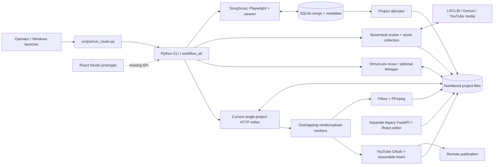

# AUDIT 01 — Repository architecture and responsibilities

## 1. Executive Summary

Repository root verified with Git: `D:\Hello World\2. Automations\EchoForge`. Audit date: 2026-10-09; user timezone Asia/Calcutta. Source and declarative files are the primary evidence. No source fixes, dependency installs/upgrades, migrations, deletions, real downloads, uploads or billable model requests were performed. Only these two repository reports are created.

Discovery found **311 tracked files**, including **133 historical migration snapshots** and **3 tracked Studio build outputs** excluded from detailed source review. Adding **24 installed first-party image assets** and **one private .env key inventory** gives **200 relevant files in 49 relevant folders (including root)**. **199 relevant files are fully inspected for their applicable source/declarative/asset responsibilities; .env is partially inspected (keys only). Zero relevant source files are unread or inaccessible.** There are 62 verified zero-byte files: empty scaffolds are documented, not treated as implemented features. Secret file contents are deliberately outside scope.

“Reviewed” is a static/contract inspection status, not a correctness or test-pass claim. For assets it means metadata/decoding/font loading; for PDF it means full two-page text. “Tests Reviewed” means testability, available tests and missing cases examined; it does not imply every file was executed. Dynamic integrations remain limited as specified below.

EchoForge is a local, file-backed lyrics-video pipeline. SongScout collects weekly YouTube chart candidates into SQLite; a project allocator creates numbered song directories; MuseVault reviews metadata and collects lyrics/audio/artwork; VerseLock reuses online timing or infers a timing skeleton; an editor adjusts a saved timeline; Pillow and FFmpeg export video; TubeHarbor generates metadata and performs OAuth/resumable YouTube upload.

The stage separation and inspectable files provide useful manual checkpoints, but the executable system has multiple overlapping routers, editor schemas, render workers and upload implementations. The Studio frontend is an unfinished integration: its required backend is not included. The configured “weekly” behavior is on-demand Friday eligibility, not an installed scheduler. This architecture cannot currently promise safe unattended recovery or publication correctness.

### Explicit exclusions and runtime discovery

| Category | Discovery | Treatment |
|---|---|---|
| `.git/` | Git repository/admin internals | Not application source; no mutations |
| `.migration_backups/` | 133 files, 152 nested directories, historical copies | Inactive historical snapshots; not imported by current entry points. Inventory every tracked path below; no line-by-line duplicate audit. Cleanup code references this archive only for optional deletion |
| `apps/web-studio/frontend/dist/` | 3 tracked generated files | Build output of inspected TS/React/CSS source; not treated as independent maintained source; shipped bundle parity not proven |
| Legacy `node_modules/`, backend `.venv/` | Installed third-party dependencies/runtime | Excluded vendor code; manifest/lock engines reviewed; no install or dependency modification |
| `__pycache__/`, bytecode and transient caches | Generated interpreter/tool artifacts | Excluded; audit Python invocations used `-B`; pytest/Ruff cache writing disabled |
| `projects/` generated contents | 9 projects, 382 files, 83 nested directories, approximately 250 MB | Media, per-run reports, backups and generated project copies excluded from per-file source audit. Read-only structural/state sample across all nine projects and isolated fixtures used |
| `data/` runtime contents | SQLite (81,920 bytes), raw chart JSON (61,875 bytes), 3 placeholders | DB inspected read-only (`mode=ro`, integrity_check); raw chart is generated external response. Placeholder responsibilities included |
| `.secrets/` | 3 local credential files | Presence/storage/consumers inspected; values never read, emitted or used. Omitted from 200 relevant first-party files |
| `.env` | Config keys match documented template | Included as partial review, values redacted |

Installed shared images are **included**, despite Git ignoring them: 20 background JPGs, logo/player PNGs and two reference PNGs. Six TTF files (three shared, three legacy copies) are included and loaded successfully. Detailed third-party CVE database evaluation was not performed; no claim of vulnerability-free dependencies is made.

## 2. Complete Repository Tree

The tree below includes every one of the 200 in-scope files; the exclusion/runtime trees are enumerated separately.

```text
EchoForge/
├── apps/
│   ├── web-studio/
│   │   └── frontend/
│   │       ├── src/
│   │       │   ├── editors/
│   │       │   │   ├── LyricsEditor.tsx
│   │       │   │   └── SyncEditor.tsx
│   │       │   ├── views/
│   │       │   │   ├── RenderQueueView.tsx
│   │       │   │   ├── SettingsView.tsx
│   │       │   │   ├── TemplatesView.tsx
│   │       │   │   ├── UploadManagerView.tsx
│   │       │   │   └── ViewSharedComponents.tsx
│   │       │   ├── App.tsx
│   │       │   ├── api.ts
│   │       │   ├── main.tsx
│   │       │   ├── styles.css
│   │       │   └── types.ts
│   │       ├── index.html
│   │       ├── package-lock.json
│   │       ├── package.json
│   │       └── tsconfig.json
│   ├── webeditor/
│   │   ├── backend/
│   │   │   ├── routes/
│   │   │   │   ├── __init__.py
│   │   │   │   ├── editor.py
│   │   │   │   ├── projects.py
│   │   │   │   ├── render.py
│   │   │   │   └── upload.py
│   │   │   ├── services/
│   │   │   │   ├── __init__.py
│   │   │   │   ├── media_service.py
│   │   │   │   ├── project_service.py
│   │   │   │   ├── render_service.py
│   │   │   │   └── upload_service.py
│   │   │   ├── app.py
│   │   │   └── schemas.py
│   │   ├── frontend/
│   │   │   ├── src/
│   │   │   │   ├── components/
│   │   │   │   │   ├── Inspector.jsx
│   │   │   │   │   ├── PreviewCanvas.jsx
│   │   │   │   │   ├── ProjectList.jsx
│   │   │   │   │   ├── RenderPanel.jsx
│   │   │   │   │   ├── Timeline.jsx
│   │   │   │   │   └── Topbar.jsx
│   │   │   │   ├── styles/
│   │   │   │   │   ├── base.css
│   │   │   │   │   ├── editor.css
│   │   │   │   │   ├── inspector.css
│   │   │   │   │   └── timeline.css
│   │   │   │   ├── App.jsx
│   │   │   │   ├── api.js
│   │   │   │   └── main.jsx
│   │   │   ├── index.html
│   │   │   ├── package.json
│   │   │   └── vite.config.js
│   │   ├── app.js
│   │   ├── index.html
│   │   └── style.css
│   └── webeditor_legacy/
│       ├── backend/
│       │   ├── main.py
│       │   └── requirements.txt
│       ├── frontend/
│       │   ├── public/
│       │   │   └── fonts/
│       │   │       ├── Bernier/
│       │   │       │   └── Bernier-Regular.ttf
│       │   │       ├── Cherry_Bomb_One/
│       │   │       │   └── CherryBombOne-Regular.ttf
│       │   │       └── Odibee_Sans/
│       │   │           └── OdibeeSans-Regular.ttf
│       │   ├── src/
│       │   │   ├── api.js
│       │   │   ├── main.jsx
│       │   │   └── styles.css
│       │   ├── index.html
│       │   ├── package-lock.json
│       │   ├── package.json
│       │   └── vite.config.js
│       ├── README.md
│       └── run.bat
├── assets/
│   ├── backgrounds/
│   │   ├── .gitkeep
│   │   ├── 01.jpg
│   │   ├── 02.jpg
│   │   ├── 03.jpg
│   │   ├── 04.jpg
│   │   ├── 05.jpg
│   │   ├── 06.jpg
│   │   ├── 07.jpg
│   │   ├── 08.jpg
│   │   ├── 09.jpg
│   │   ├── 10.jpg
│   │   ├── 11.jpg
│   │   ├── 12.jpg
│   │   ├── 13.jpg
│   │   ├── 14.jpg
│   │   ├── 15.jpg
│   │   ├── 16.jpg
│   │   ├── 17.jpg
│   │   ├── 18.jpg
│   │   ├── 19.jpg
│   │   └── 20.jpg
│   ├── defaults/
│   │   ├── logo.png
│   │   └── player.png
│   ├── fonts/
│   │   ├── Bernier/
│   │   │   └── Bernier-Regular.ttf
│   │   ├── Cherry_Bomb_One/
│   │   │   └── CherryBombOne-Regular.ttf
│   │   └── Odibee_Sans/
│   │       └── OdibeeSans-Regular.ttf
│   └── references/
│       ├── .gitkeep
│       ├── lyrics_video_background_reference.png
│       └── upload_thumbnail_reference.png
├── data/
│   ├── app_state/
│   │   └── .gitkeep
│   ├── songscout/
│   │   └── .gitkeep
│   └── .gitkeep
├── docs/
│   ├── CLEANUP_NOTES.md
│   ├── PROJECT_STRUCTURE.md
│   ├── WORKFLOW.md
│   ├── renderer_stage1_editor_project.md
│   └── renderer_stage2_webeditor_v2.md
├── projects/
│   └── .gitkeep
├── scripts/
│   ├── build-web-studio.mjs
│   ├── clean_cache.bat
│   ├── echoforge_router.py
│   ├── final_cleanup.py
│   ├── generate_youtube_metadata.py
│   ├── mark_project_uploaded.py
│   ├── normalize_project_audio.py
│   ├── open_editor.bat
│   ├── open_webeditor.py
│   ├── open_webeditor_legacy.py
│   ├── prepare_editor_project.py
│   ├── prepare_editor_project_v2.py
│   ├── project_status.py
│   ├── render_and_upload.py
│   ├── render_project.py
│   ├── render_upload_project.py
│   ├── run.bat
│   ├── run_router.py
│   ├── setup.bat
│   ├── upload_to_youtube.py
│   ├── validate_musevault_assets.py
│   ├── verselock_compare_sources.py
│   ├── verselock_full_sync.py
│   ├── verselock_sync.py
│   ├── verselock_timestamp_transfer.py
│   ├── verselock_whisper_advanced.py
│   ├── verselock_whisper_probe.py
│   ├── workflow_all.py
│   └── youtube_upload_project.py
├── src/
│   └── echoforge/
│       ├── core/
│       │   ├── __init__.py
│       │   ├── config.py
│       │   ├── logging.py
│       │   ├── paths.py
│       │   ├── project_builder.py
│       │   └── schemas.py
│       ├── stages/
│       │   ├── musevault/
│       │   │   ├── __init__.py
│       │   │   ├── asset_collector.py
│       │   │   ├── asset_validator.py
│       │   │   ├── audio_normalizer.py
│       │   │   ├── audio_service.py
│       │   │   ├── background_maker.py
│       │   │   ├── genius_lyrics.py
│       │   │   ├── image_service.py
│       │   │   ├── lyrics_fetcher.py
│       │   │   ├── metadata_review.py
│       │   │   ├── song_downloader.py
│       │   │   ├── synced_lyrics_fetcher.py
│       │   │   └── thumbnail_maker.py
│       │   ├── renderer/
│       │   │   ├── __init__.py
│       │   │   ├── editor_project_builder.py
│       │   │   ├── editor_project_v2.py
│       │   │   ├── exporter.py
│       │   │   ├── render_jobs.py
│       │   │   ├── webeditor_renderer.py
│       │   │   └── webeditor_server.py
│       │   ├── songscout/
│       │   │   ├── __init__.py
│       │   │   ├── cleaner.py
│       │   │   ├── database.py
│       │   │   ├── policy.py
│       │   │   ├── scraper.py
│       │   │   └── selector.py
│       │   ├── tubeharbor/
│       │   │   ├── __init__.py
│       │   │   ├── metadata_generator.py
│       │   │   ├── upload_db.py
│       │   │   └── youtube_uploader.py
│       │   ├── verselock/
│       │   │   ├── __init__.py
│       │   │   ├── lrc_parser.py
│       │   │   ├── lyrics_cleaner.py
│       │   │   ├── lyrics_whisper_aligner.py
│       │   │   ├── online_lrc_finder.py
│       │   │   ├── sync_candidate_ranker.py
│       │   │   ├── sync_exporter.py
│       │   │   ├── sync_runner.py
│       │   │   ├── synced_reuse.py
│       │   │   ├── timestamp_transfer.py
│       │   │   ├── whisper_advanced.py
│       │   │   └── whisper_probe.py
│       │   └── __init__.py
│       ├── utils/
│       │   ├── __init__.py
│       │   ├── file_utils.py
│       │   ├── image_utils.py
│       │   ├── process_utils.py
│       │   └── text_utils.py
│       ├── __init__.py
│       ├── __main__.py
│       ├── cli.py
│       └── orchestrator.py
├── tests/
│   ├── __init__.py
│   ├── test_musevault.py
│   ├── test_songscout.py
│   ├── test_verselock.py
│   └── test_workflow.py
├── .env
├── .env.example
├── .gitignore
├── Phase 1 Critical Fixes.pdf
├── pyproject.toml
├── requirements-heavy.txt
├── requirements.txt
├── run.bat
└── start_echoforge.bat
```

Generated project structure (all nine installed projects share the main layout; nested candidates/backups vary):

```text
projects/<number_title_artist>/
  project_state.json       # identity/stage/source history
  asset_manifest.json      # expected/resolved assets and sync pointers
  metadata_review.json     # human/display/search metadata
  audio/                  # downloaded/normalized source and status
  lyrics/                 # source plain lyrics, online LRC, service reports
  images/                 # source/downloaded/composed visual assets
  sync/                   # prepared audio, inference JSON, candidates, finals, reports
  editor/                 # editor_project, old timeline/style/preview, save backups
  renders/                # upload_thumbnail, final_video or legacy final_lyrics_video, report
  upload/                 # metadata, upload report/schedule, worker status/lock/log
```

`data/render_jobs.json` and `data/upload_db.json` are module-created paths even though neither was populated at discovery. `data/app_state/` only has its tracked placeholder. No repository CI workflow, migrations directory, web-studio backend, or active daemon scheduler was discovered.

## 3. Folder-by-Folder Explanation

### Folder: `.`

**Purpose/responsibilities:** Repository entry/configuration and top-level components. **Classification:** Essential.

**Direct files:** `.env`, `.env.example`, `.gitignore`, `Phase 1 Critical Fixes.pdf`, `pyproject.toml`, `requirements-heavy.txt`, `requirements.txt`, `run.bat`, `start_echoforge.bat`. **Child folders:** `apps`, `assets`, `data`, `docs`, `projects`, `scripts`, `src`, `tests`.

**Dependencies/interactions:** src, scripts, apps, assets, data, projects, docs and tests.

### Folder: `apps`

**Purpose/responsibilities:** Three different UI families and empty future scaffolds. **Classification:** Mixed essential/optional.

**Direct files:** None; namespace/container only. **Child folders:** `web-studio`, `webeditor`, `webeditor_legacy`.

**Dependencies/interactions:** scripts and Python renderer services.

### Folder: `apps/web-studio`

**Purpose/responsibilities:** Studio React prototype and proposed pipeline API client. **Classification:** Optional/incomplete service integration.

**Direct files:** None; namespace/container only. **Child folders:** `frontend`.

**Dependencies/interactions:** Absent compatible backend; package/build config and canonical project model.

### Folder: `apps/web-studio/frontend`

**Purpose/responsibilities:** Studio React prototype and proposed pipeline API client. **Classification:** Optional/incomplete service integration.

**Direct files:** `index.html`, `package-lock.json`, `package.json`, `tsconfig.json`. **Child folders:** `src`.

**Dependencies/interactions:** Absent compatible backend; package/build config and canonical project model.

### Folder: `apps/web-studio/frontend/src`

**Purpose/responsibilities:** Studio React prototype and proposed pipeline API client. **Classification:** Optional/incomplete service integration.

**Direct files:** `App.tsx`, `api.ts`, `main.tsx`, `styles.css`, `types.ts`. **Child folders:** `editors`, `views`.

**Dependencies/interactions:** Absent compatible backend; package/build config and canonical project model.

### Folder: `apps/web-studio/frontend/src/editors`

**Purpose/responsibilities:** Studio lyrics draft and timing editors. **Classification:** Optional/incomplete service integration.

**Direct files:** `LyricsEditor.tsx`, `SyncEditor.tsx`. **Child folders:** None in maintained scope.

**Dependencies/interactions:** Absent compatible backend; package/build config and canonical project model.

### Folder: `apps/web-studio/frontend/src/views`

**Purpose/responsibilities:** Studio render/upload/templates/settings views and shared visuals. **Classification:** Optional/incomplete service integration.

**Direct files:** `RenderQueueView.tsx`, `SettingsView.tsx`, `TemplatesView.tsx`, `UploadManagerView.tsx`, `ViewSharedComponents.tsx`. **Child folders:** None in maintained scope.

**Dependencies/interactions:** Absent compatible backend; package/build config and canonical project model.

### Folder: `apps/webeditor`

**Purpose/responsibilities:** Current plain-JavaScript single-project track editor. **Classification:** Essential current UI.

**Direct files:** `app.js`, `index.html`, `style.css`. **Child folders:** `backend`, `frontend`.

**Dependencies/interactions:** scripts/open_webeditor.py, V2 project builder/exporter and shared assets.

### Folder: `apps/webeditor/backend`

**Purpose/responsibilities:** Empty planned replacement service/React UI scaffolds. **Classification:** Unimplemented/possibly redundant.

**Direct files:** `app.py`, `schemas.py`. **Child folders:** `routes`, `services`.

**Dependencies/interactions:** No functional consumers; actual current app is parent HTML/JS/CSS.

### Folder: `apps/webeditor/backend/routes`

**Purpose/responsibilities:** Empty planned replacement service/React UI scaffolds. **Classification:** Unimplemented/possibly redundant.

**Direct files:** `__init__.py`, `editor.py`, `projects.py`, `render.py`, `upload.py`. **Child folders:** None in maintained scope.

**Dependencies/interactions:** No functional consumers; actual current app is parent HTML/JS/CSS.

### Folder: `apps/webeditor/backend/services`

**Purpose/responsibilities:** Empty planned replacement service/React UI scaffolds. **Classification:** Unimplemented/possibly redundant.

**Direct files:** `__init__.py`, `media_service.py`, `project_service.py`, `render_service.py`, `upload_service.py`. **Child folders:** None in maintained scope.

**Dependencies/interactions:** No functional consumers; actual current app is parent HTML/JS/CSS.

### Folder: `apps/webeditor/frontend`

**Purpose/responsibilities:** Empty planned replacement service/React UI scaffolds. **Classification:** Unimplemented/possibly redundant.

**Direct files:** `index.html`, `package.json`, `vite.config.js`. **Child folders:** `src`.

**Dependencies/interactions:** No functional consumers; actual current app is parent HTML/JS/CSS.

### Folder: `apps/webeditor/frontend/src`

**Purpose/responsibilities:** Empty planned replacement service/React UI scaffolds. **Classification:** Unimplemented/possibly redundant.

**Direct files:** `App.jsx`, `api.js`, `main.jsx`. **Child folders:** `components`, `styles`.

**Dependencies/interactions:** No functional consumers; actual current app is parent HTML/JS/CSS.

### Folder: `apps/webeditor/frontend/src/components`

**Purpose/responsibilities:** Empty planned replacement service/React UI scaffolds. **Classification:** Unimplemented/possibly redundant.

**Direct files:** `Inspector.jsx`, `PreviewCanvas.jsx`, `ProjectList.jsx`, `RenderPanel.jsx`, `Timeline.jsx`, `Topbar.jsx`. **Child folders:** None in maintained scope.

**Dependencies/interactions:** No functional consumers; actual current app is parent HTML/JS/CSS.

### Folder: `apps/webeditor/frontend/src/styles`

**Purpose/responsibilities:** Empty planned replacement service/React UI scaffolds. **Classification:** Unimplemented/possibly redundant.

**Direct files:** `base.css`, `editor.css`, `inspector.css`, `timeline.css`. **Child folders:** None in maintained scope.

**Dependencies/interactions:** No functional consumers; actual current app is parent HTML/JS/CSS.

### Folder: `apps/webeditor_legacy`

**Purpose/responsibilities:** Separate historical React/FastAPI editor with its own schema/render/upload assumptions. **Classification:** Optional legacy; dependencies/generated venv/node_modules excluded.

**Direct files:** `README.md`, `run.bat`. **Child folders:** `backend`, `frontend`.

**Dependencies/interactions:** Legacy API/frontend, shared projects/assets, external TubeHarbor directory not present.

### Folder: `apps/webeditor_legacy/backend`

**Purpose/responsibilities:** Separate historical React/FastAPI editor with its own schema/render/upload assumptions. **Classification:** Optional legacy; dependencies/generated venv/node_modules excluded.

**Direct files:** `main.py`, `requirements.txt`. **Child folders:** None in maintained scope.

**Dependencies/interactions:** Legacy API/frontend, shared projects/assets, external TubeHarbor directory not present.

### Folder: `apps/webeditor_legacy/frontend`

**Purpose/responsibilities:** Separate historical React/FastAPI editor with its own schema/render/upload assumptions. **Classification:** Optional legacy; dependencies/generated venv/node_modules excluded.

**Direct files:** `index.html`, `package-lock.json`, `package.json`, `vite.config.js`. **Child folders:** `public`, `src`.

**Dependencies/interactions:** Legacy API/frontend, shared projects/assets, external TubeHarbor directory not present.

### Folder: `apps/webeditor_legacy/frontend/public`

**Purpose/responsibilities:** Separate historical React/FastAPI editor with its own schema/render/upload assumptions. **Classification:** Optional legacy; dependencies/generated venv/node_modules excluded.

**Direct files:** None; namespace/container only. **Child folders:** `fonts`.

**Dependencies/interactions:** Legacy API/frontend, shared projects/assets, external TubeHarbor directory not present.

### Folder: `apps/webeditor_legacy/frontend/public/fonts`

**Purpose/responsibilities:** Static font copies served by Vite. **Classification:** Optional legacy; dependencies/generated venv/node_modules excluded.

**Direct files:** None; namespace/container only. **Child folders:** `Bernier`, `Cherry_Bomb_One`, `Odibee_Sans`.

**Dependencies/interactions:** Legacy API/frontend, shared projects/assets, external TubeHarbor directory not present.

### Folder: `apps/webeditor_legacy/frontend/public/fonts/Bernier`

**Purpose/responsibilities:** Static font copies served by Vite. **Classification:** Optional legacy; dependencies/generated venv/node_modules excluded.

**Direct files:** `Bernier-Regular.ttf`. **Child folders:** None in maintained scope.

**Dependencies/interactions:** Legacy API/frontend, shared projects/assets, external TubeHarbor directory not present.

### Folder: `apps/webeditor_legacy/frontend/public/fonts/Cherry_Bomb_One`

**Purpose/responsibilities:** Static font copies served by Vite. **Classification:** Optional legacy; dependencies/generated venv/node_modules excluded.

**Direct files:** `CherryBombOne-Regular.ttf`. **Child folders:** None in maintained scope.

**Dependencies/interactions:** Legacy API/frontend, shared projects/assets, external TubeHarbor directory not present.

### Folder: `apps/webeditor_legacy/frontend/public/fonts/Odibee_Sans`

**Purpose/responsibilities:** Static font copies served by Vite. **Classification:** Optional legacy; dependencies/generated venv/node_modules excluded.

**Direct files:** `OdibeeSans-Regular.ttf`. **Child folders:** None in maintained scope.

**Dependencies/interactions:** Legacy API/frontend, shared projects/assets, external TubeHarbor directory not present.

### Folder: `apps/webeditor_legacy/frontend/src`

**Purpose/responsibilities:** Separate historical React/FastAPI editor with its own schema/render/upload assumptions. **Classification:** Optional legacy; dependencies/generated venv/node_modules excluded.

**Direct files:** `api.js`, `main.jsx`, `styles.css`. **Child folders:** None in maintained scope.

**Dependencies/interactions:** Legacy API/frontend, shared projects/assets, external TubeHarbor directory not present.

### Folder: `assets`

**Purpose/responsibilities:** Shared visual sources/fonts/reference images. **Classification:** Essential/optional content mixture.

**Direct files:** None; namespace/container only. **Child folders:** `backgrounds`, `defaults`, `fonts`, `references`.

**Dependencies/interactions:** MuseVault and render/editor apps.

### Folder: `assets/backgrounds`

**Purpose/responsibilities:** Twenty selectable background source images plus folder placeholder. **Classification:** Essential installed content; images ignored by Git.

**Direct files:** `.gitkeep`, `01.jpg`, `02.jpg`, `03.jpg`, `04.jpg`, `05.jpg`, `06.jpg`, `07.jpg`, `08.jpg`, `09.jpg`, `10.jpg`, `11.jpg`, `12.jpg`, `13.jpg`, `14.jpg`, `15.jpg`, `16.jpg`, `17.jpg`, `18.jpg`, `19.jpg`, `20.jpg`. **Child folders:** None in maintained scope.

**Dependencies/interactions:** MuseVault image/background composition.

### Folder: `assets/defaults`

**Purpose/responsibilities:** Installed shared logo/player overlay PNGs. **Classification:** Essential artwork defaults; ignored by Git.

**Direct files:** `logo.png`, `player.png`. **Child folders:** None in maintained scope.

**Dependencies/interactions:** Background and thumbnail makers.

### Folder: `assets/fonts`

**Purpose/responsibilities:** Shared font family directory used by Pillow/editor styling. **Classification:** Essential visual assets.

**Direct files:** None; namespace/container only. **Child folders:** `Bernier`, `Cherry_Bomb_One`, `Odibee_Sans`.

**Dependencies/interactions:** renderers, artwork generators and duplicate legacy public font copies.

### Folder: `assets/fonts/Bernier`

**Purpose/responsibilities:** Shared font family directory used by Pillow/editor styling. **Classification:** Essential visual assets.

**Direct files:** `Bernier-Regular.ttf`. **Child folders:** None in maintained scope.

**Dependencies/interactions:** renderers, artwork generators and duplicate legacy public font copies.

### Folder: `assets/fonts/Cherry_Bomb_One`

**Purpose/responsibilities:** Shared font family directory used by Pillow/editor styling. **Classification:** Essential visual assets.

**Direct files:** `CherryBombOne-Regular.ttf`. **Child folders:** None in maintained scope.

**Dependencies/interactions:** renderers, artwork generators and duplicate legacy public font copies.

### Folder: `assets/fonts/Odibee_Sans`

**Purpose/responsibilities:** Shared font family directory used by Pillow/editor styling. **Classification:** Essential visual assets.

**Direct files:** `OdibeeSans-Regular.ttf`. **Child folders:** None in maintained scope.

**Dependencies/interactions:** renderers, artwork generators and duplicate legacy public font copies.

### Folder: `assets/references`

**Purpose/responsibilities:** Visual composition reference PNGs plus placeholder. **Classification:** Optional design reference; ignored PNGs.

**Direct files:** `.gitkeep`, `lyrics_video_background_reference.png`, `upload_thumbnail_reference.png`. **Child folders:** None in maintained scope.

**Dependencies/interactions:** Human/design comparison, artwork layout context.

### Folder: `data`

**Purpose/responsibilities:** Persistent DB/ledger/job location; current SQLite and raw chart exist. **Classification:** Essential runtime state.

**Direct files:** `.gitkeep`. **Child folders:** `app_state`, `songscout`.

**Dependencies/interactions:** SongScout, render_jobs and upload_db.

### Folder: `data/app_state`

**Purpose/responsibilities:** Reserved application state directory with placeholder. **Classification:** Optional currently unused scaffold.

**Direct files:** `.gitkeep`. **Child folders:** None in maintained scope.

**Dependencies/interactions:** No populated app_state data discovered.

### Folder: `data/songscout`

**Purpose/responsibilities:** Persisted chart SQLite/raw response; placeholder tracked. **Classification:** Essential runtime state; generated data excluded from line audit.

**Direct files:** `.gitkeep`. **Child folders:** None in maintained scope.

**Dependencies/interactions:** SongScout database/scraper and project allocator.

### Folder: `docs`

**Purpose/responsibilities:** Two renderer notes and three empty documentation scaffolds. **Classification:** Optional reference/documentation.

**Direct files:** `CLEANUP_NOTES.md`, `PROJECT_STRUCTURE.md`, `WORKFLOW.md`, `renderer_stage1_editor_project.md`, `renderer_stage2_webeditor_v2.md`. **Child folders:** None in maintained scope.

**Dependencies/interactions:** Preparation/editor implementations.

### Folder: `projects`

**Purpose/responsibilities:** Nine populated generated song project trees, tracked placeholder only. **Classification:** Essential runtime artifacts, excluded bulk media/copies.

**Direct files:** `.gitkeep`. **Child folders:** None in maintained scope.

**Dependencies/interactions:** Every stage and editor.

### Folder: `scripts`

**Purpose/responsibilities:** Operational wrappers, launch, pipeline, validation and cleanup commands. **Classification:** Essential entry points; alternative routers redundant.

**Direct files:** `build-web-studio.mjs`, `clean_cache.bat`, `echoforge_router.py`, `final_cleanup.py`, `generate_youtube_metadata.py`, `mark_project_uploaded.py`, `normalize_project_audio.py`, `open_editor.bat`, `open_webeditor.py`, `open_webeditor_legacy.py`, `prepare_editor_project.py`, `prepare_editor_project_v2.py`, `project_status.py`, `render_and_upload.py`, `render_project.py`, `render_upload_project.py`, `run.bat`, `run_router.py`, `setup.bat`, `upload_to_youtube.py`, `validate_musevault_assets.py`, `verselock_compare_sources.py`, `verselock_full_sync.py`, `verselock_sync.py`, `verselock_timestamp_transfer.py`, `verselock_whisper_advanced.py`, `verselock_whisper_probe.py`, `workflow_all.py`, `youtube_upload_project.py`. **Child folders:** None in maintained scope.

**Dependencies/interactions:** src, apps and runtime projects.

### Folder: `src`

**Purpose/responsibilities:** Python src-layout package and command/stage namespaces. **Classification:** Essential.

**Direct files:** None; namespace/container only. **Child folders:** `echoforge`.

**Dependencies/interactions:** scripts, data/projects and apps.

### Folder: `src/echoforge`

**Purpose/responsibilities:** Python src-layout package and command/stage namespaces. **Classification:** Essential.

**Direct files:** `__init__.py`, `__main__.py`, `cli.py`, `orchestrator.py`. **Child folders:** `core`, `stages`, `utils`.

**Dependencies/interactions:** scripts, data/projects and apps.

### Folder: `src/echoforge/core`

**Purpose/responsibilities:** Shared configuration, paths, state vocabulary, logs and project creation. **Classification:** Essential.

**Direct files:** `__init__.py`, `config.py`, `logging.py`, `paths.py`, `project_builder.py`, `schemas.py`. **Child folders:** None in maintained scope.

**Dependencies/interactions:** stages and CLI.

### Folder: `src/echoforge/stages`

**Purpose/responsibilities:** Python src-layout package and command/stage namespaces. **Classification:** Essential.

**Direct files:** `__init__.py`. **Child folders:** `musevault`, `renderer`, `songscout`, `tubeharbor`, `verselock`.

**Dependencies/interactions:** scripts, data/projects and apps.

### Folder: `src/echoforge/stages/musevault`

**Purpose/responsibilities:** Metadata review, lyrics/audio/artwork collection. **Classification:** Essential implementation.

**Direct files:** `__init__.py`, `asset_collector.py`, `asset_validator.py`, `audio_normalizer.py`, `audio_service.py`, `background_maker.py`, `genius_lyrics.py`, `image_service.py`, `lyrics_fetcher.py`, `metadata_review.py`, `song_downloader.py`, `synced_lyrics_fetcher.py`, `thumbnail_maker.py`. **Child folders:** None in maintained scope.

**Dependencies/interactions:** core paths/state, sibling pipeline stages and scripts.

### Folder: `src/echoforge/stages/renderer`

**Purpose/responsibilities:** Editor schemas, HTTP UI, jobs and MP4 generation. **Classification:** Essential implementation.

**Direct files:** `__init__.py`, `editor_project_builder.py`, `editor_project_v2.py`, `exporter.py`, `render_jobs.py`, `webeditor_renderer.py`, `webeditor_server.py`. **Child folders:** None in maintained scope.

**Dependencies/interactions:** core paths/state, sibling pipeline stages and scripts.

### Folder: `src/echoforge/stages/songscout`

**Purpose/responsibilities:** Chart discovery, Friday policy, SQLite selection/history. **Classification:** Essential implementation.

**Direct files:** `__init__.py`, `cleaner.py`, `database.py`, `policy.py`, `scraper.py`, `selector.py`. **Child folders:** None in maintained scope.

**Dependencies/interactions:** core paths/state, sibling pipeline stages and scripts.

### Folder: `src/echoforge/stages/tubeharbor`

**Purpose/responsibilities:** YouTube metadata/OAuth/upload ledger. **Classification:** Essential implementation.

**Direct files:** `__init__.py`, `metadata_generator.py`, `upload_db.py`, `youtube_uploader.py`. **Child folders:** None in maintained scope.

**Dependencies/interactions:** core paths/state, sibling pipeline stages and scripts.

### Folder: `src/echoforge/stages/verselock`

**Purpose/responsibilities:** Timed lyrics, reuse, optional inference and alignment. **Classification:** Essential implementation.

**Direct files:** `__init__.py`, `lrc_parser.py`, `lyrics_cleaner.py`, `lyrics_whisper_aligner.py`, `online_lrc_finder.py`, `sync_candidate_ranker.py`, `sync_exporter.py`, `sync_runner.py`, `synced_reuse.py`, `timestamp_transfer.py`, `whisper_advanced.py`, `whisper_probe.py`. **Child folders:** None in maintained scope.

**Dependencies/interactions:** core paths/state, sibling pipeline stages and scripts.

### Folder: `src/echoforge/utils`

**Purpose/responsibilities:** Reserved utility scaffolds, all empty. **Classification:** Optional/unimplemented.

**Direct files:** `__init__.py`, `file_utils.py`, `image_utils.py`, `process_utils.py`, `text_utils.py`. **Child folders:** None in maintained scope.

**Dependencies/interactions:** No active utility behavior or imports requiring implementation found.

### Folder: `tests`

**Purpose/responsibilities:** Four empty intended regression modules and initializer. **Classification:** Essential assurance scaffolds, currently no tests.

**Direct files:** `__init__.py`, `test_musevault.py`, `test_songscout.py`, `test_verselock.py`, `test_workflow.py`. **Child folders:** None in maintained scope.

**Dependencies/interactions:** Pipeline modules; audit fixtures stayed outside repository.

## 4. File-by-File Documentation

### File: `.env`

**Purpose:** Private local operational configuration.

**Core functionality:** Only key inventory reviewed; secret-bearing values excluded. Partial review explicitly recorded.

**Important functions/classes or declarative effects:** Declarative fields/selectors/resources and their effects are described in core functionality; no callables.

**Inputs:** Local environment loader.

**Outputs:** Runtime values, intentionally redacted.

**Dependencies:** Declarative consumer dependencies described above; no Python imports.

**Interactions:** `.gitignore`, `apps/webeditor_legacy/backend/main.py`, `apps/webeditor_legacy/frontend/src/api.js`, `scripts/echoforge_router.py`, `scripts/generate_youtube_metadata.py`, `scripts/open_webeditor.py`, `scripts/render_upload_project.py`, `scripts/run_router.py`, `scripts/workflow_all.py`, `src/echoforge/core/config.py`, `src/echoforge/orchestrator.py`, `src/echoforge/stages/musevault/genius_lyrics.py`, `src/echoforge/stages/renderer/exporter.py`, `src/echoforge/stages/tubeharbor/metadata_generator.py`, `src/echoforge/stages/tubeharbor/youtube_uploader.py`

**State:** Declarative/read-only asset/configuration unless its documented consumer writes runtime/build outputs.

**Execution triggers:** Configuration/build/reference/asset consumer; batch entry points run on user invocation.

**Criticality:** Medium. **Inspection:** 534 bytes; 0 text lines where applicable. Private values intentionally not read.

### File: `.env.example`

**Purpose:** Documented environment template.

**Core functionality:** Declares chart/count, zone, Genius, *_PATH OAuth fields, editor ports, LRCLIB and popup; names do not all match consumers.

**Important functions/classes or declarative effects:** Declarative fields/selectors/resources and their effects are described in core functionality; no callables.

**Inputs:** Environment loader/operator.

**Outputs:** Settings names/defaults; empty token placeholders.

**Dependencies:** Declarative consumer dependencies described above; no Python imports.

**Interactions:** `src/echoforge/orchestrator.py`

**State:** Declarative/read-only asset/configuration unless its documented consumer writes runtime/build outputs.

**Execution triggers:** Configuration/build/reference/asset consumer; batch entry points run on user invocation.

**Criticality:** Medium. **Inspection:** 470 bytes; 21 text lines where applicable. 

### File: `.gitignore`

**Purpose:** Git exclusion policy.

**Core functionality:** Excludes .env/.secrets, project media, environments and most generated outputs; historical snapshots and Studio dist remain tracked.

**Important functions/classes or declarative effects:** Declarative fields/selectors/resources and their effects are described in core functionality; no callables.

**Inputs:** Git path matching.

**Outputs:** Runtime/secret/dependency/cache exclusions.

**Dependencies:** Declarative consumer dependencies described above; no Python imports.

**Interactions:** Package/stage/CLI consumer described in workflow; no literal caller found.

**State:** Declarative/read-only asset/configuration unless its documented consumer writes runtime/build outputs.

**Execution triggers:** Configuration/build/reference/asset consumer; batch entry points run on user invocation.

**Criticality:** Medium. **Inspection:** 1412 bytes; 110 text lines where applicable. 

### File: `Phase 1 Critical Fixes.pdf`

**Purpose:** Two-page historical critical-fix requirements reference.

**Core functionality:** Entire two-page text extracted read-only with bundled pypdf using PDF skill; contents treated as historical evidence, not new instructions; no layout audit required for this content-only use.

**Important functions/classes or declarative effects:** Declarative fields/selectors/resources and their effects are described in core functionality; no callables.

**Inputs:** Auditor/developer.

**Outputs:** Requested logging, duplicate-upload guard, persistent jobs, runner wiring and cleanup.

**Dependencies:** Declarative consumer dependencies described above; no Python imports.

**Interactions:** Package/stage/CLI consumer described in workflow; no literal caller found.

**State:** Declarative/read-only asset/configuration unless its documented consumer writes runtime/build outputs.

**Execution triggers:** Configuration/build/reference/asset consumer; batch entry points run on user invocation.

**Criticality:** Low. **Inspection:** 18746 bytes; 0 text lines where applicable. 

### File: `apps/web-studio/frontend/index.html`

**Purpose:** Studio compiled browser boot document.

**Core functionality:** Copied into dist by builder; source document assumes bundled assets, not direct TS execution.

**Important functions/classes or declarative effects:** Declarative fields/selectors/resources and their effects are described in core functionality; no callables.

**Inputs:** Browser/custom builder.

**Outputs:** root element and /assets/app.js plus /assets/app.css.

**Dependencies:** Declarative consumer dependencies described above; no Python imports.

**Interactions:** `scripts/build-web-studio.mjs`, `scripts/open_webeditor.py`

**State:** Declarative/read-only asset/configuration unless its documented consumer writes runtime/build outputs.

**Execution triggers:** Browser load/build/user events or backend startup according to role.

**Criticality:** High. **Inspection:** 376 bytes; 14 text lines where applicable. 

### File: `apps/web-studio/frontend/package-lock.json`

**Purpose:** Studio reproducible npm dependency graph.

**Core functionality:** Lock v3: 38 entries; esbuild>=18 Node and TypeScript>=14.17 engine requirements reviewed; no vulnerability DB scan.

**Important functions/classes or declarative effects:** Declarative fields/selectors/resources and their effects are described in core functionality; no callables.

**Inputs:** npm ci/install.

**Outputs:** Resolved versions/integrities and platform optional packages.

**Dependencies:** Declarative consumer dependencies described above; no Python imports.

**Interactions:** Parent UI build/HTML or operational consumer named in purpose; relative frontend imports below.

**State:** Declarative/read-only asset/configuration unless its documented consumer writes runtime/build outputs.

**Execution triggers:** Browser load/build/user events or backend startup according to role.

**Criticality:** Medium. **Inspection:** 19160 bytes; 607 text lines where applicable. 

### File: `apps/web-studio/frontend/package.json`

**Purpose:** Studio build/dependency manifest.

**Core functionality:** Uses custom build-web-studio.mjs, not Vite; required local dependencies absent in current Studio tree.

**Important functions/classes or declarative effects:** Declarative fields/selectors/resources and their effects are described in core functionality; no callables.

**Inputs:** npm/custom esbuild builder.

**Outputs:** build/watch scripts, React18 and TypeScript toolchain.

**Dependencies:** Declarative consumer dependencies described above; no Python imports.

**Interactions:** Parent UI build/HTML or operational consumer named in purpose; relative frontend imports below.

**State:** Declarative/read-only asset/configuration unless its documented consumer writes runtime/build outputs.

**Execution triggers:** Browser load/build/user events or backend startup according to role.

**Criticality:** Medium. **Inspection:** 486 bytes; 20 text lines where applicable. 

### File: `apps/web-studio/frontend/src/App.tsx`

**Purpose:** Studio navigation/dashboard/project/chart workflow UI.

**Core functionality:** Refresh uses Promise.all, polling and selection; manual/song actions delegate absent API; embeds lyrics/sync/render/upload/templates/settings views.

**Important functions/classes or declarative effects:** Named functions/components: `App`, `executeAction`, `stageNext`, `openProject`, `openLyrics`, `openSync`, `DashboardView`, `DiscoverView`, `runCharts`, `QueueView`, `ProjectsView`, `ProjectDetailPanel`, `ManualProjectForm`, `submit`, `LogsView`, `ProjectCard`, `ProjectRow`, `Panel`, `SummaryTile`, `StatusBadge`, `ProgressBar`, `JobIndicator`, `EmptyState`, `formatDate`, `formatBytes`. Their major behaviors and consumer roles are described above.

**Inputs:** API payloads, selected project, polling and form state.

**Outputs:** Rendered views, project actions and editor selection.

**Dependencies:** `react`, `./api`, `./editors/LyricsEditor`, `./editors/SyncEditor`, `./views/RenderQueueView`, `./views/SettingsView`, `./views/TemplatesView`, `./views/UploadManagerView`, `./types`

**Interactions:** Parent UI build/HTML or operational consumer named in purpose; relative frontend imports below.

**State:** Frontend local component state; API calls delegated to described backend. Styles/type declarations do not persist state.

**Execution triggers:** Browser load/build/user events or backend startup according to role.

**Criticality:** Medium. **Inspection:** 32307 bytes; 972 text lines where applicable. 

### File: `apps/web-studio/frontend/src/api.ts`

**Purpose:** Studio typed REST client for proposed pipeline backend.

**Core functionality:** request checks HTTP status; endpoint methods cover dashboard/projects/logs/actions/lyrics/timestamps/design/render/upload/settings; backend not included.

**Important functions/classes or declarative effects:** Named functions/components: `request`, `fetchDashboard`, `fetchProjects`, `fetchProject`, `projectMediaUrl`, `fetchLogs`, `createProject`, `runProjectAction`, `fetchLyrics`, `saveLyrics`, `approveLyrics`, `fetchTimestamps`, `saveTimestamps`, `validateTimestamps`, `shiftTimestamps`, `approveTimestamps`, `fetchTemplates`, `fetchProjectDesign`, `saveProjectDesign`, `fetchRenderReadiness`, `fetchJobs`, `startProjectJob`, `cancelJob`, `fetchUploadMetadata`, `saveUploadMetadata`, `generateUploadMetadata`, `approveUpload`, `fetchSettings`, `saveSettings`, `stageNextProject`, `fetchCharts`. Their major behaviors and consumer roles are described above.

**Inputs:** API base/window/localStorage, identifiers and action/form payloads.

**Outputs:** Typed promises and project media URLs.

**Dependencies:** `./types`

**Interactions:** Parent UI build/HTML or operational consumer named in purpose; relative frontend imports below.

**State:** Frontend local component state; API calls delegated to described backend. Styles/type declarations do not persist state.

**Execution triggers:** Browser load/build/user events or backend startup according to role.

**Criticality:** Medium. **Inspection:** 7887 bytes; 224 text lines where applicable. 

### File: `apps/web-studio/frontend/src/editors/LyricsEditor.tsx`

**Purpose:** Studio draft/current lyrics and approval editor.

**Core functionality:** commit maintains undo/redo; load cancellation guards requests; save responses overwrite local arrays; 1800ms autosave uses current project.

**Important functions/classes or declarative effects:** Named functions/components: `LyricsEditor`, `load`, `commit`, `updateLine`, `addLine`, `duplicateLine`, `deleteLine`, `splitLine`, `mergeWithPrevious`, `removeEmptyLines`, `formatLyrics`, `undo`, `redo`, `saveDraft`, `saveCurrent`, `approveCurrent`, `blankLine`, `reindex`, `nextId`, `inferType`, `formatDate`. Their major behaviors and consumer roles are described above.

**Inputs:** Project ID, LyricLine arrays, warnings/versions.

**Outputs:** Modified rows, autosave drafts, save/approve API calls.

**Dependencies:** `react`, `../api`, `../types`

**Interactions:** Parent UI build/HTML or operational consumer named in purpose; relative frontend imports below.

**State:** Frontend local component state; API calls delegated to described backend. Styles/type declarations do not persist state.

**Execution triggers:** Browser load/build/user events or backend startup according to role.

**Criticality:** Medium. **Inspection:** 12857 bytes; 381 text lines where applicable. 

### File: `apps/web-studio/frontend/src/editors/SyncEditor.tsx`

**Purpose:** Studio timing-row/playhead editing and approval.

**Core functionality:** Transport seeks audio; local commit reindexes; bulk playhead actions alter starts/ends; APIs normalize/validate; no safe response revision tracking.

**Important functions/classes or declarative effects:** Named functions/components: `SyncEditor`, `load`, `commit`, `updateSegment`, `toggleSelected`, `toggleAll`, `seek`, `togglePlayback`, `jump`, `focusSegment`, `updateSelectedFromPlayhead`, `moveSelectedToPlayhead`, `nudge`, `validateCurrent`, `saveDraft`, `saveCurrent`, `approveCurrent`, `normalizePayload`, `reindexSegments`, `readSeconds`, `roundSeconds`, `maxEnd`, `formatTime`, `formatDate`. Their major behaviors and consumer roles are described above.

**Inputs:** Project timings/audio, selections and warnings.

**Outputs:** Segment edits, nudges, validation/save/approve API.

**Dependencies:** `react`, `../api`, `../types`

**Interactions:** Parent UI build/HTML or operational consumer named in purpose; relative frontend imports below.

**State:** Frontend local component state; API calls delegated to described backend. Styles/type declarations do not persist state.

**Execution triggers:** Browser load/build/user events or backend startup according to role.

**Criticality:** Medium. **Inspection:** 20148 bytes; 555 text lines where applicable. 

### File: `apps/web-studio/frontend/src/main.tsx`

**Purpose:** Studio React root.

**Core functionality:** createRoot bootstraps App; no backend startup.

**Important functions/classes or declarative effects:** Declarative fields/selectors/resources and their effects are described in core functionality; no callables.

**Inputs:** index root element and App.

**Outputs:** Mounted StrictMode UI and imported stylesheet.

**Dependencies:** `react`, `react-dom/client`, `./App`, `./styles.css`

**Interactions:** `scripts/build-web-studio.mjs`

**State:** Frontend local component state; API calls delegated to described backend. Styles/type declarations do not persist state.

**Execution triggers:** Browser load/build/user events or backend startup according to role.

**Criticality:** Medium. **Inspection:** 335 bytes; 17 text lines where applicable. 

### File: `apps/web-studio/frontend/src/styles.css`

**Purpose:** Studio navigation/dashboard/workbench responsive layout.

**Core functionality:** Declarative breakpoints collapse layouts; visual waveform is segment bars, not sampled audio waveform.

**Important functions/classes or declarative effects:** Declarative fields/selectors/resources and their effects are described in core functionality; no callables.

**Inputs:** Studio JSX class names.

**Outputs:** Dark grids, form controls, lyric/timing rows and status indicators.

**Dependencies:** Declarative consumer dependencies described above; no Python imports.

**Interactions:** Parent UI build/HTML or operational consumer named in purpose; relative frontend imports below.

**State:** Frontend local component state; API calls delegated to described backend. Styles/type declarations do not persist state.

**Execution triggers:** Browser load/build/user events or backend startup according to role.

**Criticality:** Low. **Inspection:** 19171 bytes; 1206 text lines where applicable. 

### File: `apps/web-studio/frontend/src/types.ts`

**Purpose:** Studio client domain/interfaces.

**Core functionality:** Defines distinct state vocabulary and record shapes; types provide no runtime validation.

**Important functions/classes or declarative effects:** Declarative fields/selectors/resources and their effects are described in core functionality; no callables.

**Inputs:** TypeScript consumer declarations.

**Outputs:** Compile-time project/status/job/draft/settings contracts.

**Dependencies:** Declarative consumer dependencies described above; no Python imports.

**Interactions:** Parent UI build/HTML or operational consumer named in purpose; relative frontend imports below.

**State:** Frontend local component state; API calls delegated to described backend. Styles/type declarations do not persist state.

**Execution triggers:** Browser load/build/user events or backend startup according to role.

**Criticality:** Medium. **Inspection:** 5619 bytes; 267 text lines where applicable. 

### File: `apps/web-studio/frontend/src/views/RenderQueueView.tsx`

**Purpose:** Studio readiness checks and render queue controls.

**Core functionality:** Loads readiness/jobs and invokes render/cancel/retry routes not present in included servers.

**Important functions/classes or declarative effects:** Named functions/components: `RenderQueueView`, `load`, `requestRender`. Their major behaviors and consumer roles are described above.

**Inputs:** Project/readiness/job API responses.

**Outputs:** Render requests, status/progress and preview links.

**Dependencies:** `react`, `../api`, `../types`, `./ViewSharedComponents`

**Interactions:** Parent UI build/HTML or operational consumer named in purpose; relative frontend imports below.

**State:** Frontend local component state; API calls delegated to described backend. Styles/type declarations do not persist state.

**Execution triggers:** Browser load/build/user events or backend startup according to role.

**Criticality:** Medium. **Inspection:** 4172 bytes; 114 text lines where applicable. 

### File: `apps/web-studio/frontend/src/views/SettingsView.tsx`

**Purpose:** Studio editable application settings/runtime view.

**Core functionality:** Loads settings and edits operational defaults; proposed backend absent.

**Important functions/classes or declarative effects:** Named functions/components: `SettingsView`, `load`, `save`. Their major behaviors and consumer roles are described above.

**Inputs:** Settings/runtime API payload.

**Outputs:** Settings save request and runtime summary.

**Dependencies:** `react`, `../api`, `../types`, `./ViewSharedComponents`

**Interactions:** Parent UI build/HTML or operational consumer named in purpose; relative frontend imports below.

**State:** Frontend local component state; API calls delegated to described backend. Styles/type declarations do not persist state.

**Execution triggers:** Browser load/build/user events or backend startup according to role.

**Criticality:** Medium. **Inspection:** 4337 bytes; 125 text lines where applicable. 

### File: `apps/web-studio/frontend/src/views/TemplatesView.tsx`

**Purpose:** Studio template selection/design editing.

**Core functionality:** Loads reusable choices/design and applies style/canvas options via proposed API.

**Important functions/classes or declarative effects:** Named functions/components: `TemplatesView`, `load`, `chooseTemplate`, `updateSetting`, `saveDesign`. Their major behaviors and consumer roles are described above.

**Inputs:** Project design/templates and selected template.

**Outputs:** Saved design/template application.

**Dependencies:** `react`, `../api`, `../types`, `./ViewSharedComponents`

**Interactions:** Parent UI build/HTML or operational consumer named in purpose; relative frontend imports below.

**State:** Frontend local component state; API calls delegated to described backend. Styles/type declarations do not persist state.

**Execution triggers:** Browser load/build/user events or backend startup according to role.

**Criticality:** Medium. **Inspection:** 8058 bytes; 220 text lines where applicable. 

### File: `apps/web-studio/frontend/src/views/UploadManagerView.tsx`

**Purpose:** Studio YouTube metadata/schedule/upload management.

**Core functionality:** Async load populates form; schedule string/visibility saved through proposed API; races reviewed, live publication not exercised.

**Important functions/classes or declarative effects:** Named functions/components: `UploadManagerView`, `load`, `updateMetadata`, `generate`, `save`, `upload`. Their major behaviors and consumer roles are described above.

**Inputs:** Selected project, remote metadata/auth/readiness.

**Outputs:** Edited upload metadata, save/auth/upload actions.

**Dependencies:** `react`, `../api`, `../types`, `./ViewSharedComponents`

**Interactions:** Parent UI build/HTML or operational consumer named in purpose; relative frontend imports below.

**State:** Frontend local component state; API calls delegated to described backend. Styles/type declarations do not persist state.

**Execution triggers:** Browser load/build/user events or backend startup according to role.

**Criticality:** Medium. **Inspection:** 6316 bytes; 171 text lines where applicable. 

### File: `apps/web-studio/frontend/src/views/ViewSharedComponents.tsx`

**Purpose:** Shared Studio panel/status/progress/form visuals.

**Core functionality:** Common status badges, empty states and section/field helpers; no persistent business logic.

**Important functions/classes or declarative effects:** Named functions/components: `JobList`, `EmptyPanel`, `formatDate`. Their major behaviors and consumer roles are described above.

**Inputs:** Typed props/callbacks.

**Outputs:** Reusable React markup.

**Dependencies:** `../types`

**Interactions:** Parent UI build/HTML or operational consumer named in purpose; relative frontend imports below.

**State:** Frontend local component state; API calls delegated to described backend. Styles/type declarations do not persist state.

**Execution triggers:** Browser load/build/user events or backend startup according to role.

**Criticality:** Medium. **Inspection:** 1812 bytes; 59 text lines where applicable. 

### File: `apps/web-studio/frontend/tsconfig.json`

**Purpose:** Studio strict no-emit typecheck configuration.

**Core functionality:** Includes src, Node module resolution, isolatedModules, skipLibCheck and noEmit; missing local React types block meaningful full check.

**Important functions/classes or declarative effects:** Declarative fields/selectors/resources and their effects are described in core functionality; no callables.

**Inputs:** tsc and IDE.

**Outputs:** ES2021 DOM/ESNext react-jsx strict typing rules.

**Dependencies:** Declarative consumer dependencies described above; no Python imports.

**Interactions:** Parent UI build/HTML or operational consumer named in purpose; relative frontend imports below.

**State:** Declarative/read-only asset/configuration unless its documented consumer writes runtime/build outputs.

**Execution triggers:** Browser load/build/user events or backend startup according to role.

**Criticality:** Medium. **Inspection:** 524 bytes; 20 text lines where applicable. 

### File: `apps/webeditor/app.js`

**Purpose:** Current V2 timeline editing and preview.

**Core functionality:** boot loads schema; clip helpers manage tracks; preview honors styles; drag/split/undo edit history; saveProject catches failures without propagating them.

**Important functions/classes or declarative effects:** Named functions/components: `mediaUrl`, `fmtTime`, `allTracks`, `allClips`, `textClips`, `imageClips`, `audioClips`, `findClip`, `findTrackOfClip`, `selectedClips`, `selectedTextClips`, `primaryClip`, `computedDuration`, `duration`, `updateProjectDuration`, `setStatus`, `beginHistory`, `closeHistory`, `pushHistoryOnce`, `canvasToViewer`, `timelineNow`, `activeClipOfType`, `activeBackgroundClip`, `activeAudioClip`, `activeDisplayClip`, `applyBackground`, `applyPreview`, `renderRuler`, `clipEl`, `updateSelectionVisuals`, `renderTimeline`, `clientXToTimelineSeconds`, `handleClipPointerDown`, `updateClipDomPosition`, `updatePlayhead`, `requestPlayheadUpdate`, `selectAllLyrics`, `syncInspectorFromSelection`, `applyInspectorLive`, `routeAudioForTimeline`, `transportTick`, `stopTransport`, `seekTo`, `seekBy`, `togglePlay`, `splitSelectedAtPlayhead`, `deleteSelected`, `addTextClip`, `zoomBy`, `saveProject`, `undo`, `redo`, `normalizeProjectDefaults`, `renderAll`, `toggleFullscreen`, `wireEvents`, `boot`. Their major behaviors and consumer roles are described above.

**Inputs:** Project JSON, media, mouse/keyboard edits.

**Outputs:** In-memory history/timeline, HTTP save, preview/transport.

**Dependencies:** Declarative consumer dependencies described above; no Python imports.

**Interactions:** Parent UI build/HTML or operational consumer named in purpose; relative frontend imports below.

**State:** Environment/process or delegated stage behavior as described; no independent database model.

**Execution triggers:** Browser load/build/user events or backend startup according to role.

**Criticality:** High. **Inspection:** 32914 bytes; 886 text lines where applicable. 

### File: `apps/webeditor/backend/app.py`

**Purpose:** Empty planned app UI/service scaffold.

**Core functionality:** Not a functional backend/component/config; live implementation is parent plain JS UI.

**Important functions/classes or declarative effects:** None: empty/import-only module.

**Inputs:** No implemented inputs.

**Outputs:** No implemented output.

**Dependencies:** No imports/implementation.

**Interactions:** Parent UI build/HTML or operational consumer named in purpose; relative frontend imports below.

**State:** None; empty placeholder.

**Execution triggers:** None: empty placeholder/scaffold; package initializer can be imported.

**Criticality:** Low. **Inspection:** 0 bytes; 0 text lines where applicable. 

### File: `apps/webeditor/backend/routes/__init__.py`

**Purpose:** Empty Python package namespace.

**Core functionality:** Package discovery/import; no declared callables.

**Important functions/classes or declarative effects:** None: empty/import-only module.

**Inputs:** Importer.

**Outputs:** No custom initialization/state.

**Dependencies:** No imports/implementation.

**Interactions:** Parent UI build/HTML or operational consumer named in purpose; relative frontend imports below.

**State:** None; empty placeholder.

**Execution triggers:** None: empty placeholder/scaffold; package initializer can be imported.

**Criticality:** Low. **Inspection:** 0 bytes; 0 text lines where applicable. 

### File: `apps/webeditor/backend/routes/editor.py`

**Purpose:** Empty planned editor UI/service scaffold.

**Core functionality:** Not a functional backend/component/config; live implementation is parent plain JS UI.

**Important functions/classes or declarative effects:** None: empty/import-only module.

**Inputs:** No implemented inputs.

**Outputs:** No implemented output.

**Dependencies:** No imports/implementation.

**Interactions:** Parent UI build/HTML or operational consumer named in purpose; relative frontend imports below.

**State:** None; empty placeholder.

**Execution triggers:** None: empty placeholder/scaffold; package initializer can be imported.

**Criticality:** Low. **Inspection:** 0 bytes; 0 text lines where applicable. 

### File: `apps/webeditor/backend/routes/projects.py`

**Purpose:** Empty planned projects UI/service scaffold.

**Core functionality:** Not a functional backend/component/config; live implementation is parent plain JS UI.

**Important functions/classes or declarative effects:** None: empty/import-only module.

**Inputs:** No implemented inputs.

**Outputs:** No implemented output.

**Dependencies:** No imports/implementation.

**Interactions:** Parent UI build/HTML or operational consumer named in purpose; relative frontend imports below.

**State:** None; empty placeholder.

**Execution triggers:** None: empty placeholder/scaffold; package initializer can be imported.

**Criticality:** Low. **Inspection:** 0 bytes; 0 text lines where applicable. 

### File: `apps/webeditor/backend/routes/render.py`

**Purpose:** Empty planned render UI/service scaffold.

**Core functionality:** Not a functional backend/component/config; live implementation is parent plain JS UI.

**Important functions/classes or declarative effects:** None: empty/import-only module.

**Inputs:** No implemented inputs.

**Outputs:** No implemented output.

**Dependencies:** No imports/implementation.

**Interactions:** Parent UI build/HTML or operational consumer named in purpose; relative frontend imports below.

**State:** None; empty placeholder.

**Execution triggers:** None: empty placeholder/scaffold; package initializer can be imported.

**Criticality:** Low. **Inspection:** 0 bytes; 0 text lines where applicable. 

### File: `apps/webeditor/backend/routes/upload.py`

**Purpose:** Empty planned upload UI/service scaffold.

**Core functionality:** Not a functional backend/component/config; live implementation is parent plain JS UI.

**Important functions/classes or declarative effects:** None: empty/import-only module.

**Inputs:** No implemented inputs.

**Outputs:** No implemented output.

**Dependencies:** No imports/implementation.

**Interactions:** Parent UI build/HTML or operational consumer named in purpose; relative frontend imports below.

**State:** None; empty placeholder.

**Execution triggers:** None: empty placeholder/scaffold; package initializer can be imported.

**Criticality:** Low. **Inspection:** 0 bytes; 0 text lines where applicable. 

### File: `apps/webeditor/backend/schemas.py`

**Purpose:** Empty planned schemas UI/service scaffold.

**Core functionality:** Not a functional backend/component/config; live implementation is parent plain JS UI.

**Important functions/classes or declarative effects:** None: empty/import-only module.

**Inputs:** No implemented inputs.

**Outputs:** No implemented output.

**Dependencies:** No imports/implementation.

**Interactions:** Parent UI build/HTML or operational consumer named in purpose; relative frontend imports below.

**State:** None; empty placeholder.

**Execution triggers:** None: empty placeholder/scaffold; package initializer can be imported.

**Criticality:** Low. **Inspection:** 0 bytes; 0 text lines where applicable. 

### File: `apps/webeditor/backend/services/__init__.py`

**Purpose:** Empty Python package namespace.

**Core functionality:** Package discovery/import; no declared callables.

**Important functions/classes or declarative effects:** None: empty/import-only module.

**Inputs:** Importer.

**Outputs:** No custom initialization/state.

**Dependencies:** No imports/implementation.

**Interactions:** Parent UI build/HTML or operational consumer named in purpose; relative frontend imports below.

**State:** None; empty placeholder.

**Execution triggers:** None: empty placeholder/scaffold; package initializer can be imported.

**Criticality:** Low. **Inspection:** 0 bytes; 0 text lines where applicable. 

### File: `apps/webeditor/backend/services/media_service.py`

**Purpose:** Empty planned media_service UI/service scaffold.

**Core functionality:** Not a functional backend/component/config; live implementation is parent plain JS UI.

**Important functions/classes or declarative effects:** None: empty/import-only module.

**Inputs:** No implemented inputs.

**Outputs:** No implemented output.

**Dependencies:** No imports/implementation.

**Interactions:** Parent UI build/HTML or operational consumer named in purpose; relative frontend imports below.

**State:** None; empty placeholder.

**Execution triggers:** None: empty placeholder/scaffold; package initializer can be imported.

**Criticality:** Low. **Inspection:** 0 bytes; 0 text lines where applicable. 

### File: `apps/webeditor/backend/services/project_service.py`

**Purpose:** Empty planned project_service UI/service scaffold.

**Core functionality:** Not a functional backend/component/config; live implementation is parent plain JS UI.

**Important functions/classes or declarative effects:** None: empty/import-only module.

**Inputs:** No implemented inputs.

**Outputs:** No implemented output.

**Dependencies:** No imports/implementation.

**Interactions:** Parent UI build/HTML or operational consumer named in purpose; relative frontend imports below.

**State:** None; empty placeholder.

**Execution triggers:** None: empty placeholder/scaffold; package initializer can be imported.

**Criticality:** Low. **Inspection:** 0 bytes; 0 text lines where applicable. 

### File: `apps/webeditor/backend/services/render_service.py`

**Purpose:** Empty planned render_service UI/service scaffold.

**Core functionality:** Not a functional backend/component/config; live implementation is parent plain JS UI.

**Important functions/classes or declarative effects:** None: empty/import-only module.

**Inputs:** No implemented inputs.

**Outputs:** No implemented output.

**Dependencies:** No imports/implementation.

**Interactions:** Parent UI build/HTML or operational consumer named in purpose; relative frontend imports below.

**State:** None; empty placeholder.

**Execution triggers:** None: empty placeholder/scaffold; package initializer can be imported.

**Criticality:** Low. **Inspection:** 0 bytes; 0 text lines where applicable. 

### File: `apps/webeditor/backend/services/upload_service.py`

**Purpose:** Empty planned upload_service UI/service scaffold.

**Core functionality:** Not a functional backend/component/config; live implementation is parent plain JS UI.

**Important functions/classes or declarative effects:** None: empty/import-only module.

**Inputs:** No implemented inputs.

**Outputs:** No implemented output.

**Dependencies:** No imports/implementation.

**Interactions:** Parent UI build/HTML or operational consumer named in purpose; relative frontend imports below.

**State:** None; empty placeholder.

**Execution triggers:** None: empty placeholder/scaffold; package initializer can be imported.

**Criticality:** Low. **Inspection:** 0 bytes; 0 text lines where applicable. 

### File: `apps/webeditor/frontend/index.html`

**Purpose:** Empty planned index UI/service scaffold.

**Core functionality:** Not a functional backend/component/config; live implementation is parent plain JS UI.

**Important functions/classes or declarative effects:** Declarative fields/selectors/resources and their effects are described in core functionality; no callables.

**Inputs:** No implemented inputs.

**Outputs:** No implemented output.

**Dependencies:** Declarative consumer dependencies described above; no Python imports.

**Interactions:** `scripts/build-web-studio.mjs`, `scripts/open_webeditor.py`

**State:** None; empty placeholder.

**Execution triggers:** None: empty placeholder/scaffold; package initializer can be imported.

**Criticality:** Low. **Inspection:** 0 bytes; 0 text lines where applicable. 

### File: `apps/webeditor/frontend/package.json`

**Purpose:** Empty planned package UI/service scaffold.

**Core functionality:** Not a functional backend/component/config; live implementation is parent plain JS UI.

**Important functions/classes or declarative effects:** Declarative fields/selectors/resources and their effects are described in core functionality; no callables.

**Inputs:** No implemented inputs.

**Outputs:** No implemented output.

**Dependencies:** Declarative consumer dependencies described above; no Python imports.

**Interactions:** Parent UI build/HTML or operational consumer named in purpose; relative frontend imports below.

**State:** None; empty placeholder.

**Execution triggers:** None: empty placeholder/scaffold; package initializer can be imported.

**Criticality:** Low. **Inspection:** 0 bytes; 0 text lines where applicable. 

### File: `apps/webeditor/frontend/src/App.jsx`

**Purpose:** Empty planned App UI/service scaffold.

**Core functionality:** Not a functional backend/component/config; live implementation is parent plain JS UI.

**Important functions/classes or declarative effects:** Declarative fields/selectors/resources and their effects are described in core functionality; no callables.

**Inputs:** No implemented inputs.

**Outputs:** No implemented output.

**Dependencies:** Declarative consumer dependencies described above; no Python imports.

**Interactions:** Parent UI build/HTML or operational consumer named in purpose; relative frontend imports below.

**State:** None; empty placeholder.

**Execution triggers:** None: empty placeholder/scaffold; package initializer can be imported.

**Criticality:** Low. **Inspection:** 0 bytes; 0 text lines where applicable. 

### File: `apps/webeditor/frontend/src/api.js`

**Purpose:** Empty planned api UI/service scaffold.

**Core functionality:** Not a functional backend/component/config; live implementation is parent plain JS UI.

**Important functions/classes or declarative effects:** Declarative fields/selectors/resources and their effects are described in core functionality; no callables.

**Inputs:** No implemented inputs.

**Outputs:** No implemented output.

**Dependencies:** Declarative consumer dependencies described above; no Python imports.

**Interactions:** Parent UI build/HTML or operational consumer named in purpose; relative frontend imports below.

**State:** None; empty placeholder.

**Execution triggers:** None: empty placeholder/scaffold; package initializer can be imported.

**Criticality:** Low. **Inspection:** 0 bytes; 0 text lines where applicable. 

### File: `apps/webeditor/frontend/src/components/Inspector.jsx`

**Purpose:** Empty planned Inspector UI/service scaffold.

**Core functionality:** Not a functional backend/component/config; live implementation is parent plain JS UI.

**Important functions/classes or declarative effects:** Declarative fields/selectors/resources and their effects are described in core functionality; no callables.

**Inputs:** No implemented inputs.

**Outputs:** No implemented output.

**Dependencies:** Declarative consumer dependencies described above; no Python imports.

**Interactions:** Parent UI build/HTML or operational consumer named in purpose; relative frontend imports below.

**State:** None; empty placeholder.

**Execution triggers:** None: empty placeholder/scaffold; package initializer can be imported.

**Criticality:** Low. **Inspection:** 0 bytes; 0 text lines where applicable. 

### File: `apps/webeditor/frontend/src/components/PreviewCanvas.jsx`

**Purpose:** Empty planned PreviewCanvas UI/service scaffold.

**Core functionality:** Not a functional backend/component/config; live implementation is parent plain JS UI.

**Important functions/classes or declarative effects:** Declarative fields/selectors/resources and their effects are described in core functionality; no callables.

**Inputs:** No implemented inputs.

**Outputs:** No implemented output.

**Dependencies:** Declarative consumer dependencies described above; no Python imports.

**Interactions:** Parent UI build/HTML or operational consumer named in purpose; relative frontend imports below.

**State:** None; empty placeholder.

**Execution triggers:** None: empty placeholder/scaffold; package initializer can be imported.

**Criticality:** Low. **Inspection:** 0 bytes; 0 text lines where applicable. 

### File: `apps/webeditor/frontend/src/components/ProjectList.jsx`

**Purpose:** Empty planned ProjectList UI/service scaffold.

**Core functionality:** Not a functional backend/component/config; live implementation is parent plain JS UI.

**Important functions/classes or declarative effects:** Declarative fields/selectors/resources and their effects are described in core functionality; no callables.

**Inputs:** No implemented inputs.

**Outputs:** No implemented output.

**Dependencies:** Declarative consumer dependencies described above; no Python imports.

**Interactions:** Parent UI build/HTML or operational consumer named in purpose; relative frontend imports below.

**State:** None; empty placeholder.

**Execution triggers:** None: empty placeholder/scaffold; package initializer can be imported.

**Criticality:** Low. **Inspection:** 0 bytes; 0 text lines where applicable. 

### File: `apps/webeditor/frontend/src/components/RenderPanel.jsx`

**Purpose:** Empty planned RenderPanel UI/service scaffold.

**Core functionality:** Not a functional backend/component/config; live implementation is parent plain JS UI.

**Important functions/classes or declarative effects:** Declarative fields/selectors/resources and their effects are described in core functionality; no callables.

**Inputs:** No implemented inputs.

**Outputs:** No implemented output.

**Dependencies:** Declarative consumer dependencies described above; no Python imports.

**Interactions:** Parent UI build/HTML or operational consumer named in purpose; relative frontend imports below.

**State:** None; empty placeholder.

**Execution triggers:** None: empty placeholder/scaffold; package initializer can be imported.

**Criticality:** Low. **Inspection:** 0 bytes; 0 text lines where applicable. 

### File: `apps/webeditor/frontend/src/components/Timeline.jsx`

**Purpose:** Empty planned Timeline UI/service scaffold.

**Core functionality:** Not a functional backend/component/config; live implementation is parent plain JS UI.

**Important functions/classes or declarative effects:** Declarative fields/selectors/resources and their effects are described in core functionality; no callables.

**Inputs:** No implemented inputs.

**Outputs:** No implemented output.

**Dependencies:** Declarative consumer dependencies described above; no Python imports.

**Interactions:** Parent UI build/HTML or operational consumer named in purpose; relative frontend imports below.

**State:** None; empty placeholder.

**Execution triggers:** None: empty placeholder/scaffold; package initializer can be imported.

**Criticality:** Low. **Inspection:** 0 bytes; 0 text lines where applicable. 

### File: `apps/webeditor/frontend/src/components/Topbar.jsx`

**Purpose:** Empty planned Topbar UI/service scaffold.

**Core functionality:** Not a functional backend/component/config; live implementation is parent plain JS UI.

**Important functions/classes or declarative effects:** Declarative fields/selectors/resources and their effects are described in core functionality; no callables.

**Inputs:** No implemented inputs.

**Outputs:** No implemented output.

**Dependencies:** Declarative consumer dependencies described above; no Python imports.

**Interactions:** Parent UI build/HTML or operational consumer named in purpose; relative frontend imports below.

**State:** None; empty placeholder.

**Execution triggers:** None: empty placeholder/scaffold; package initializer can be imported.

**Criticality:** Low. **Inspection:** 0 bytes; 0 text lines where applicable. 

### File: `apps/webeditor/frontend/src/main.jsx`

**Purpose:** Empty planned main UI/service scaffold.

**Core functionality:** Not a functional backend/component/config; live implementation is parent plain JS UI.

**Important functions/classes or declarative effects:** Declarative fields/selectors/resources and their effects are described in core functionality; no callables.

**Inputs:** No implemented inputs.

**Outputs:** No implemented output.

**Dependencies:** Declarative consumer dependencies described above; no Python imports.

**Interactions:** Parent UI build/HTML or operational consumer named in purpose; relative frontend imports below.

**State:** None; empty placeholder.

**Execution triggers:** None: empty placeholder/scaffold; package initializer can be imported.

**Criticality:** Low. **Inspection:** 0 bytes; 0 text lines where applicable. 

### File: `apps/webeditor/frontend/src/styles/base.css`

**Purpose:** Empty planned base UI/service scaffold.

**Core functionality:** Not a functional backend/component/config; live implementation is parent plain JS UI.

**Important functions/classes or declarative effects:** Declarative fields/selectors/resources and their effects are described in core functionality; no callables.

**Inputs:** No implemented inputs.

**Outputs:** No implemented output.

**Dependencies:** Declarative consumer dependencies described above; no Python imports.

**Interactions:** Parent UI build/HTML or operational consumer named in purpose; relative frontend imports below.

**State:** None; empty placeholder.

**Execution triggers:** None: empty placeholder/scaffold; package initializer can be imported.

**Criticality:** Low. **Inspection:** 0 bytes; 0 text lines where applicable. 

### File: `apps/webeditor/frontend/src/styles/editor.css`

**Purpose:** Empty planned editor UI/service scaffold.

**Core functionality:** Not a functional backend/component/config; live implementation is parent plain JS UI.

**Important functions/classes or declarative effects:** Declarative fields/selectors/resources and their effects are described in core functionality; no callables.

**Inputs:** No implemented inputs.

**Outputs:** No implemented output.

**Dependencies:** Declarative consumer dependencies described above; no Python imports.

**Interactions:** Parent UI build/HTML or operational consumer named in purpose; relative frontend imports below.

**State:** None; empty placeholder.

**Execution triggers:** None: empty placeholder/scaffold; package initializer can be imported.

**Criticality:** Low. **Inspection:** 0 bytes; 0 text lines where applicable. 

### File: `apps/webeditor/frontend/src/styles/inspector.css`

**Purpose:** Empty planned inspector UI/service scaffold.

**Core functionality:** Not a functional backend/component/config; live implementation is parent plain JS UI.

**Important functions/classes or declarative effects:** Declarative fields/selectors/resources and their effects are described in core functionality; no callables.

**Inputs:** No implemented inputs.

**Outputs:** No implemented output.

**Dependencies:** Declarative consumer dependencies described above; no Python imports.

**Interactions:** Parent UI build/HTML or operational consumer named in purpose; relative frontend imports below.

**State:** None; empty placeholder.

**Execution triggers:** None: empty placeholder/scaffold; package initializer can be imported.

**Criticality:** Low. **Inspection:** 0 bytes; 0 text lines where applicable. 

### File: `apps/webeditor/frontend/src/styles/timeline.css`

**Purpose:** Empty planned timeline UI/service scaffold.

**Core functionality:** Not a functional backend/component/config; live implementation is parent plain JS UI.

**Important functions/classes or declarative effects:** Declarative fields/selectors/resources and their effects are described in core functionality; no callables.

**Inputs:** No implemented inputs.

**Outputs:** No implemented output.

**Dependencies:** Declarative consumer dependencies described above; no Python imports.

**Interactions:** Parent UI build/HTML or operational consumer named in purpose; relative frontend imports below.

**State:** None; empty placeholder.

**Execution triggers:** None: empty placeholder/scaffold; package initializer can be imported.

**Criticality:** Low. **Inspection:** 0 bytes; 0 text lines where applicable. 

### File: `apps/webeditor/frontend/vite.config.js`

**Purpose:** Empty planned vite.config UI/service scaffold.

**Core functionality:** Not a functional backend/component/config; live implementation is parent plain JS UI.

**Important functions/classes or declarative effects:** Declarative fields/selectors/resources and their effects are described in core functionality; no callables.

**Inputs:** No implemented inputs.

**Outputs:** No implemented output.

**Dependencies:** Declarative consumer dependencies described above; no Python imports.

**Interactions:** Parent UI build/HTML or operational consumer named in purpose; relative frontend imports below.

**State:** None; empty placeholder.

**Execution triggers:** None: empty placeholder/scaffold; package initializer can be imported.

**Criticality:** Low. **Inspection:** 0 bytes; 0 text lines where applicable. 

### File: `apps/webeditor/index.html`

**Purpose:** Current editor DOM and appended render/upload flows.

**Core functionality:** Contains several competing listeners/modals and two progress panels; later capture handler intercepts final metadata modal action.

**Important functions/classes or declarative effects:** Declarative fields/selectors/resources and their effects are described in core functionality; no callables.

**Inputs:** app.js, DOM events, metadata/job HTTP responses.

**Outputs:** Editor view/modals and render/upload requests.

**Dependencies:** Declarative consumer dependencies described above; no Python imports.

**Interactions:** `scripts/build-web-studio.mjs`, `scripts/open_webeditor.py`

**State:** Declarative/read-only asset/configuration unless its documented consumer writes runtime/build outputs.

**Execution triggers:** Browser load/build/user events or backend startup according to role.

**Criticality:** High. **Inspection:** 36372 bytes; 713 text lines where applicable. 

### File: `apps/webeditor/style.css`

**Purpose:** Current editor typography/layout.

**Core functionality:** Declarative dark editor grid, selection/clip styles, responsive widths and /root/assets font URL.

**Important functions/classes or declarative effects:** Declarative fields/selectors/resources and their effects are described in core functionality; no callables.

**Inputs:** DOM class names and shared Bernier route.

**Outputs:** CSS layout, timeline styling and font loading.

**Dependencies:** Declarative consumer dependencies described above; no Python imports.

**Interactions:** Parent UI build/HTML or operational consumer named in purpose; relative frontend imports below.

**State:** Declarative/read-only asset/configuration unless its documented consumer writes runtime/build outputs.

**Execution triggers:** Browser load/build/user events or backend startup according to role.

**Criticality:** Low. **Inspection:** 8531 bytes; 325 text lines where applicable. 

### File: `apps/webeditor_legacy/README.md`

**Purpose:** Legacy launch/setup documentation.

**Core functionality:** Documentation refers to historical layout/dependencies; implementation is authoritative.

**Important functions/classes or declarative effects:** Declarative fields/selectors/resources and their effects are described in core functionality; no callables.

**Inputs:** Reader and local environment.

**Outputs:** Instructions for separate backend/frontend.

**Dependencies:** Declarative consumer dependencies described above; no Python imports.

**Interactions:** Parent UI build/HTML or operational consumer named in purpose; relative frontend imports below.

**State:** Declarative/read-only asset/configuration unless its documented consumer writes runtime/build outputs.

**Execution triggers:** Browser load/build/user events or backend startup according to role.

**Criticality:** Low. **Inspection:** 379 bytes; 20 text lines where applicable. 

### File: `apps/webeditor_legacy/backend/main.py`

**Purpose:** Separate FastAPI legacy project/media/render editor.

**Core functionality:** Safe path helpers and media suffix gate; bootstrap/save repair schema; Pillow/FFmpeg render; threaded jobs/SSE; writes replacement state; external TubeHarbor/run.py is absent here.

**Important functions/classes or declarative effects:** `SaveProjectRequest` (line 60); `UpdateClipRequest` (line 64); `ReloadLyricsRequest` (line 68); `ScheduleUploadRequest` (line 72); `_clean_hex` (line 88): Normalizes 3-digit or 6-digit hex strings into pure 6-char hex.; `_create_lyric_clip` (line 96): Single factory for standard lyric clip payloads.; `save_project_bundle` (line 122): Guarantees editor project and state contracts update together.; `set_render_job` (line 132); `get_render_job` (line 139); `ensure_projects_root` (line 145); `safe_project_dir` (line 150); `safe_child` (line 167); `rel_to_project` (line 181); `read_json` (line 188); `write_json` (line 199); `get_tubeharbor_dir` (line 203): Finds TubeHarbor folder from EF root.; `get_tubeharbor_python` (line 222): Prefer TubeHarbor's own venv Python so google/youtube dependencies are available.; `wait_for_tubeharbor_process` (line 239): Append TubeHarbor exit code to the same project log and close the handle.; `start_tubeharbor_upload_for_render` (line 258): Starts TubeHarbor upload for exactly this rendered output:; `find_first_existing` (line 334); `find_first_by_suffix` (line 342); `ffprobe_duration_seconds` (line 356); `detect_assets` (line 380); `parse_srt_time` (line 473); `parse_srt` (line 480); `detect_lyrics` (line 513); `normalize_lines` (line 526); `build_editor_project` (line 548); `apply_default_lyric_style` (line 605); `write_project_state` (line 634); `repair_editor_project_assets` (line 648); `load_or_bootstrap` (line 699); `get_track` (line 718); `find_clip` (line 722); `seconds_to_ass_time` (line 730); `hex_to_ass_color` (line 739); `hex_to_rgba` (line 744); `has_project_fonts` (line 752); `find_render_font_file` (line 761); `load_pillow_font` (line 784); `text_bbox_size` (line 795); `measure_multiline` (line 807); `draw_text_with_letter_spacing` (line 814); `opacity_to_alpha` (line 825); `wrap_text_for_render` (line 832); `draw_lyric_clip_on_image` (line 848); `normalized_lyric_clips` (line 880); `normalized_audio_clips` (line 897): Return timeline audio clips with source offsets.; `build_audio_timeline_file` (line 958): Render edited audio clips into one audio file used by final export.; `render_timed_lyrics_overlay_video` (line 1076); `escape_ass_text` (line 1114); `build_ass` (line 1118); `run_ffmpeg_render` (line 1135); `merge_lyrics_from_sync` (line 1176); `patch_clip_in_project` (line 1197); `render_job_worker` (line 1207); `create_upload_schedule` (line 1254); `health` (line 1270); `list_projects` (line 1275); `bootstrap_project` (line 1288); `get_editor_project` (line 1293); `save_editor_project` (line 1298); `render_project` (line 1306); `patch_editor_clip` (line 1316); `reload_project_lyrics` (line 1324); `start_render_project` (line 1331); `get_render_status` (line 1348); `stream_render_status` (line 1354); `schedule_project_upload` (line 1366); `get_media` (line 1371); `download_file` (line 1422); `try_rel` (line 387); `nested_get` (line 401); `first_from_keys` (line 409); `is_stale` (line 653); `add_silence` (line 999); `event_stream` (line 1355); `iter_file` (line 1400)

**Inputs:** Project IDs, JSON clip requests, media ranges and FFmpeg.

**Outputs:** Legacy editor/state files, renders/final_lyrics_video.mp4, in-memory jobs and external upload process.

**Dependencies:** `PIL`, `__future__`, `concurrent.futures`, `fastapi`, `fastapi.middleware.cors`, `fastapi.responses`, `json`, `mimetypes`, `os`, `pathlib`, `pydantic`, `re`, `shutil`, `subprocess`, `sys`, `threading`, `time`, `typing`, `uuid`, `uvicorn`

**Interactions:** Parent UI build/HTML or operational consumer named in purpose; relative frontend imports below.

**State:** Reads/writes project files; in-memory executor/job registry; launches absent external uploader; no durable render job registry.

**Execution triggers:** Browser load/build/user events or backend startup according to role.

**Criticality:** High. **Inspection:** 59212 bytes; 1430 text lines where applicable. 

### File: `apps/webeditor_legacy/backend/requirements.txt`

**Purpose:** Legacy service dependency list.

**Core functionality:** Consumer is separate legacy app setup; distinct from project packaging.

**Important functions/classes or declarative effects:** Declarative fields/selectors/resources and their effects are described in core functionality; no callables.

**Inputs:** pip/legacy launcher.

**Outputs:** FastAPI/uvicorn/Pillow dependencies.

**Dependencies:** Declarative consumer dependencies described above; no Python imports.

**Interactions:** `src/echoforge/orchestrator.py`

**State:** Declarative/read-only asset/configuration unless its documented consumer writes runtime/build outputs.

**Execution triggers:** Browser load/build/user events or backend startup according to role.

**Criticality:** Medium. **Inspection:** 216 bytes; 13 text lines where applicable. 

### File: `apps/webeditor_legacy/frontend/index.html`

**Purpose:** Legacy browser root document.

**Core functionality:** Declarative viewport/title and React boot element.

**Important functions/classes or declarative effects:** Declarative fields/selectors/resources and their effects are described in core functionality; no callables.

**Inputs:** Browser/Vite.

**Outputs:** root element and /src/main.jsx module load.

**Dependencies:** Declarative consumer dependencies described above; no Python imports.

**Interactions:** `scripts/build-web-studio.mjs`, `scripts/open_webeditor.py`

**State:** Declarative/read-only asset/configuration unless its documented consumer writes runtime/build outputs.

**Execution triggers:** Browser load/build/user events or backend startup according to role.

**Criticality:** High. **Inspection:** 315 bytes; 12 text lines where applicable. 

### File: `apps/webeditor_legacy/frontend/package-lock.json`

**Purpose:** Legacy reproducible npm dependency graph.

**Core functionality:** Lock v3: 51 package entries; Vite/plugin require ^20.19.0 or >=22.12.0. No registry vulnerability scan or install executed.

**Important functions/classes or declarative effects:** Declarative fields/selectors/resources and their effects are described in core functionality; no callables.

**Inputs:** npm ci/install.

**Outputs:** Resolved package/integrity/platform/engine metadata.

**Dependencies:** Declarative consumer dependencies described above; no Python imports.

**Interactions:** Parent UI build/HTML or operational consumer named in purpose; relative frontend imports below.

**State:** Declarative/read-only asset/configuration unless its documented consumer writes runtime/build outputs.

**Execution triggers:** Browser load/build/user events or backend startup according to role.

**Criticality:** Medium. **Inspection:** 29631 bytes; 930 text lines where applicable. 

### File: `apps/webeditor_legacy/frontend/package.json`

**Purpose:** Legacy npm dependency/scripts manifest.

**Core functionality:** Pins React 19.2.7, ReactDOM, Vite 8.0.16 and plugin-react 6.0.2; engine expectations in lock reviewed.

**Important functions/classes or declarative effects:** Declarative fields/selectors/resources and their effects are described in core functionality; no callables.

**Inputs:** npm/Vite.

**Outputs:** dev/build/preview commands and React toolchain.

**Dependencies:** Declarative consumer dependencies described above; no Python imports.

**Interactions:** Parent UI build/HTML or operational consumer named in purpose; relative frontend imports below.

**State:** Declarative/read-only asset/configuration unless its documented consumer writes runtime/build outputs.

**Execution triggers:** Browser load/build/user events or backend startup according to role.

**Criticality:** Medium. **Inspection:** 352 bytes; 19 text lines where applicable. 

### File: `apps/webeditor_legacy/frontend/public/fonts/Bernier/Bernier-Regular.ttf`

**Purpose:** Font asset ['BERNIER? REGULAR', 'Regular'].

**Core functionality:** Loaded when font selected/default; parsed successfully. Binary not line-audited.

**Important functions/classes or declarative effects:** No code. Asset decoded/loaded successfully; ['BERNIER? REGULAR', 'Regular'].

**Inputs:** Pillow/browser font loader.

**Outputs:** Glyphs for composed/rendered text.

**Dependencies:** Declarative consumer dependencies described above; no Python imports.

**Interactions:** `apps/webeditor_legacy/backend/main.py`, `src/echoforge/stages/renderer/editor_project_builder.py`, `src/echoforge/stages/renderer/webeditor_server.py`

**State:** Declarative/read-only asset/configuration unless its documented consumer writes runtime/build outputs.

**Execution triggers:** Browser load/build/user events or backend startup according to role.

**Criticality:** Medium. **Inspection:** 23496 bytes; 0 text lines where applicable. 

### File: `apps/webeditor_legacy/frontend/public/fonts/Cherry_Bomb_One/CherryBombOne-Regular.ttf`

**Purpose:** Font asset ['Cherry Bomb One', 'Regular'].

**Core functionality:** Loaded when font selected/default; parsed successfully. Binary not line-audited.

**Important functions/classes or declarative effects:** No code. Asset decoded/loaded successfully; ['Cherry Bomb One', 'Regular'].

**Inputs:** Pillow/browser font loader.

**Outputs:** Glyphs for composed/rendered text.

**Dependencies:** Declarative consumer dependencies described above; no Python imports.

**Interactions:** Parent UI build/HTML or operational consumer named in purpose; relative frontend imports below.

**State:** Declarative/read-only asset/configuration unless its documented consumer writes runtime/build outputs.

**Execution triggers:** Browser load/build/user events or backend startup according to role.

**Criticality:** Medium. **Inspection:** 212988 bytes; 0 text lines where applicable. 

### File: `apps/webeditor_legacy/frontend/public/fonts/Odibee_Sans/OdibeeSans-Regular.ttf`

**Purpose:** Font asset ['Odibee Sans', 'Regular'].

**Core functionality:** Loaded when font selected/default; parsed successfully. Binary not line-audited.

**Important functions/classes or declarative effects:** No code. Asset decoded/loaded successfully; ['Odibee Sans', 'Regular'].

**Inputs:** Pillow/browser font loader.

**Outputs:** Glyphs for composed/rendered text.

**Dependencies:** Declarative consumer dependencies described above; no Python imports.

**Interactions:** Parent UI build/HTML or operational consumer named in purpose; relative frontend imports below.

**State:** Declarative/read-only asset/configuration unless its documented consumer writes runtime/build outputs.

**Execution triggers:** Browser load/build/user events or backend startup according to role.

**Criticality:** Medium. **Inspection:** 45568 bytes; 0 text lines where applicable. 

### File: `apps/webeditor_legacy/frontend/src/api.js`

**Purpose:** Legacy frontend REST/SSE client.

**Core functionality:** Maps frontend to legacy FastAPI routes, unlike Studio api.ts/current single-project server.

**Important functions/classes or declarative effects:** Named functions/components: `request`. Their major behaviors and consumer roles are described above.

**Inputs:** Project identifiers and clip/schedule bodies.

**Outputs:** Wrapped API promises, media/download URLs and EventSource.

**Dependencies:** Declarative consumer dependencies described above; no Python imports.

**Interactions:** Parent UI build/HTML or operational consumer named in purpose; relative frontend imports below.

**State:** Frontend local component state; API calls delegated to described backend. Styles/type declarations do not persist state.

**Execution triggers:** Browser load/build/user events or backend startup according to role.

**Criticality:** Medium. **Inspection:** 2644 bytes; 54 text lines where applicable. 

### File: `apps/webeditor_legacy/frontend/src/main.jsx`

**Purpose:** Separate React legacy timeline/editor.

**Core functionality:** ProjectPicker discovers folders; Editor owns history; Timeline edits clips; Transport maps audio source time; PropertiesPanel edits style; scheduleUpload saves JSON but no local autonomous scheduler.

**Important functions/classes or declarative effects:** Named functions/components: `applyLyricDefaultsToAll`, `ensureProjectLyricDefaults`, `getTrack`, `allClips`, `findActiveLyric`, `findClip`, `updateClip`, `replaceClips`, `updateClipsByIds`, `deleteClipsByIds`, `duplicateClipsByIds`, `lyricClips`, `audioClips`, `backgroundClips`, `getBackgroundDuration`, `syncProjectDurationToBackground`, `clipStart`, `clipEnd`, `clipDuration`, `clipSourceStart`, `clipSourceEnd`, `ensureProjectAudioDefaults`, `findActiveAudioClip`, `splitClipAtTime`, `useUndoable`, `useClipActions`, `ProjectPicker`, `openProject`, `ContextMenu`, `ShortcutsOverlay`, `PreviewCanvas`, `startDragText`, `toggleFullscreen`, `Transport`, `timelineToSourceTime`, `sourceToTimelineTime`, `Timeline`, `onRulerClick`, `orderedClipIdsForTrack`, `selectClip`, `jumpToSearch`, `selectAllLyrics`, `startClipDrag`, `openClipCtx`, `PropertiesPanel`, `patch`, `applyToAllLyrics`, `applySelectedStyleToAllLyrics`, `Editor`, `applyDefaultLyricsStyle`, `splitSelectedAtPlayhead`, `addLyricAtPlayhead`, `save`, `render`, `reloadLyrics`, `scheduleUpload`, `App`. Their major behaviors and consumer roles are described above.

**Inputs:** Legacy bootstrap shape, media/status API and gestures.

**Outputs:** Undoable project, saves, preview, render job SSE and upload schedule.

**Dependencies:** `react`, `react-dom/client`, `./api.js`, `./styles.css`

**Interactions:** Parent UI build/HTML or operational consumer named in purpose; relative frontend imports below.

**State:** Frontend local component state; API calls delegated to described backend. Styles/type declarations do not persist state.

**Execution triggers:** Browser load/build/user events or backend startup according to role.

**Criticality:** Medium. **Inspection:** 60658 bytes; 1393 text lines where applicable. 

### File: `apps/webeditor_legacy/frontend/src/styles.css`

**Purpose:** Legacy editor layout, properties/timeline theme and fonts.

**Core functionality:** Declarative fixed viewport/editor grids, timeline controls, overlays and multiple font URL fallbacks.

**Important functions/classes or declarative effects:** Declarative fields/selectors/resources and their effects are described in core functionality; no callables.

**Inputs:** Legacy JSX selectors and public font paths.

**Outputs:** CSS responsive appearance and Bernier loading.

**Dependencies:** Declarative consumer dependencies described above; no Python imports.

**Interactions:** Parent UI build/HTML or operational consumer named in purpose; relative frontend imports below.

**State:** Frontend local component state; API calls delegated to described backend. Styles/type declarations do not persist state.

**Execution triggers:** Browser load/build/user events or backend startup according to role.

**Criticality:** Low. **Inspection:** 16920 bytes; 930 text lines where applicable. 

### File: `apps/webeditor_legacy/frontend/vite.config.js`

**Purpose:** Legacy frontend dev/build server config.

**Core functionality:** Maps dev frontend to legacy service; different routing from single-project current server.

**Important functions/classes or declarative effects:** Declarative fields/selectors/resources and their effects are described in core functionality; no callables.

**Inputs:** Vite.

**Outputs:** React compilation/server settings and API proxy.

**Dependencies:** `vite`, `@vitejs/plugin-react`

**Interactions:** Parent UI build/HTML or operational consumer named in purpose; relative frontend imports below.

**State:** Environment/process or delegated stage behavior as described; no independent database model.

**Execution triggers:** Browser load/build/user events or backend startup according to role.

**Criticality:** Medium. **Inspection:** 263 bytes; 14 text lines where applicable. 

### File: `apps/webeditor_legacy/run.bat`

**Purpose:** Separate legacy app bootstrap/launch.

**Core functionality:** Starts the legacy service/UI separately; not executed because installs/launches can modify environment.

**Important functions/classes or declarative effects:** Declarative fields/selectors/resources and their effects are described in core functionality; no callables.

**Inputs:** Backend venv, npm/frontend and project path.

**Outputs:** Backend/frontend processes.

**Dependencies:** Declarative consumer dependencies described above; no Python imports.

**Interactions:** `scripts/open_webeditor_legacy.py`

**State:** Environment/process or delegated stage behavior as described; no independent database model.

**Execution triggers:** Browser load/build/user events or backend startup according to role.

**Criticality:** Medium. **Inspection:** 1515 bytes; 47 text lines where applicable. 

### File: `assets/backgrounds/.gitkeep`

**Purpose:** Tracked empty directory placeholder.

**Core functionality:** Never executed; runtime consumers use containing directory.

**Important functions/classes or declarative effects:** Declarative fields/selectors/resources and their effects are described in core functionality; no callables.

**Inputs:** Git tracking.

**Outputs:** No runtime operations.

**Dependencies:** Declarative consumer dependencies described above; no Python imports.

**Interactions:** `src/echoforge/core/project_builder.py`

**State:** None; empty placeholder.

**Execution triggers:** None: empty placeholder/scaffold; package initializer can be imported.

**Criticality:** Low. **Inspection:** 0 bytes; 0 text lines where applicable. 

### File: `assets/backgrounds/01.jpg`

**Purpose:** Selectable background source artwork.

**Core functionality:** Selected/read as image; decoding/integrity verified, no executable functions.

**Important functions/classes or declarative effects:** No code. Asset decoded/loaded successfully; {'size': [1920, 1079], 'mode': 'RGB'}.

**Inputs:** Pillow/read-only design reference.

**Outputs:** Image pixels {'size': [1920, 1079], 'mode': 'RGB'}.

**Dependencies:** Declarative consumer dependencies described above; no Python imports.

**Interactions:** Package/stage/CLI consumer described in workflow; no literal caller found.

**State:** Declarative/read-only asset/configuration unless its documented consumer writes runtime/build outputs.

**Execution triggers:** Configuration/build/reference/asset consumer; batch entry points run on user invocation.

**Criticality:** Medium. **Inspection:** 332804 bytes; 0 text lines where applicable. 

### File: `assets/backgrounds/02.jpg`

**Purpose:** Selectable background source artwork.

**Core functionality:** Selected/read as image; decoding/integrity verified, no executable functions.

**Important functions/classes or declarative effects:** No code. Asset decoded/loaded successfully; {'size': [1920, 1079], 'mode': 'RGB'}.

**Inputs:** Pillow/read-only design reference.

**Outputs:** Image pixels {'size': [1920, 1079], 'mode': 'RGB'}.

**Dependencies:** Declarative consumer dependencies described above; no Python imports.

**Interactions:** Package/stage/CLI consumer described in workflow; no literal caller found.

**State:** Declarative/read-only asset/configuration unless its documented consumer writes runtime/build outputs.

**Execution triggers:** Configuration/build/reference/asset consumer; batch entry points run on user invocation.

**Criticality:** Medium. **Inspection:** 316793 bytes; 0 text lines where applicable. 

### File: `assets/backgrounds/03.jpg`

**Purpose:** Selectable background source artwork.

**Core functionality:** Selected/read as image; decoding/integrity verified, no executable functions.

**Important functions/classes or declarative effects:** No code. Asset decoded/loaded successfully; {'size': [1920, 1079], 'mode': 'RGB'}.

**Inputs:** Pillow/read-only design reference.

**Outputs:** Image pixels {'size': [1920, 1079], 'mode': 'RGB'}.

**Dependencies:** Declarative consumer dependencies described above; no Python imports.

**Interactions:** Package/stage/CLI consumer described in workflow; no literal caller found.

**State:** Declarative/read-only asset/configuration unless its documented consumer writes runtime/build outputs.

**Execution triggers:** Configuration/build/reference/asset consumer; batch entry points run on user invocation.

**Criticality:** Medium. **Inspection:** 367990 bytes; 0 text lines where applicable. 

### File: `assets/backgrounds/04.jpg`

**Purpose:** Selectable background source artwork.

**Core functionality:** Selected/read as image; decoding/integrity verified, no executable functions.

**Important functions/classes or declarative effects:** No code. Asset decoded/loaded successfully; {'size': [1920, 1079], 'mode': 'RGB'}.

**Inputs:** Pillow/read-only design reference.

**Outputs:** Image pixels {'size': [1920, 1079], 'mode': 'RGB'}.

**Dependencies:** Declarative consumer dependencies described above; no Python imports.

**Interactions:** Package/stage/CLI consumer described in workflow; no literal caller found.

**State:** Declarative/read-only asset/configuration unless its documented consumer writes runtime/build outputs.

**Execution triggers:** Configuration/build/reference/asset consumer; batch entry points run on user invocation.

**Criticality:** Medium. **Inspection:** 351203 bytes; 0 text lines where applicable. 

### File: `assets/backgrounds/05.jpg`

**Purpose:** Selectable background source artwork.

**Core functionality:** Selected/read as image; decoding/integrity verified, no executable functions.

**Important functions/classes or declarative effects:** No code. Asset decoded/loaded successfully; {'size': [1920, 1079], 'mode': 'RGB'}.

**Inputs:** Pillow/read-only design reference.

**Outputs:** Image pixels {'size': [1920, 1079], 'mode': 'RGB'}.

**Dependencies:** Declarative consumer dependencies described above; no Python imports.

**Interactions:** Package/stage/CLI consumer described in workflow; no literal caller found.

**State:** Declarative/read-only asset/configuration unless its documented consumer writes runtime/build outputs.

**Execution triggers:** Configuration/build/reference/asset consumer; batch entry points run on user invocation.

**Criticality:** Medium. **Inspection:** 361310 bytes; 0 text lines where applicable. 

### File: `assets/backgrounds/06.jpg`

**Purpose:** Selectable background source artwork.

**Core functionality:** Selected/read as image; decoding/integrity verified, no executable functions.

**Important functions/classes or declarative effects:** No code. Asset decoded/loaded successfully; {'size': [1920, 1079], 'mode': 'RGB'}.

**Inputs:** Pillow/read-only design reference.

**Outputs:** Image pixels {'size': [1920, 1079], 'mode': 'RGB'}.

**Dependencies:** Declarative consumer dependencies described above; no Python imports.

**Interactions:** Package/stage/CLI consumer described in workflow; no literal caller found.

**State:** Declarative/read-only asset/configuration unless its documented consumer writes runtime/build outputs.

**Execution triggers:** Configuration/build/reference/asset consumer; batch entry points run on user invocation.

**Criticality:** Medium. **Inspection:** 336265 bytes; 0 text lines where applicable. 

### File: `assets/backgrounds/07.jpg`

**Purpose:** Selectable background source artwork.

**Core functionality:** Selected/read as image; decoding/integrity verified, no executable functions.

**Important functions/classes or declarative effects:** No code. Asset decoded/loaded successfully; {'size': [1920, 1079], 'mode': 'RGB'}.

**Inputs:** Pillow/read-only design reference.

**Outputs:** Image pixels {'size': [1920, 1079], 'mode': 'RGB'}.

**Dependencies:** Declarative consumer dependencies described above; no Python imports.

**Interactions:** Package/stage/CLI consumer described in workflow; no literal caller found.

**State:** Declarative/read-only asset/configuration unless its documented consumer writes runtime/build outputs.

**Execution triggers:** Configuration/build/reference/asset consumer; batch entry points run on user invocation.

**Criticality:** Medium. **Inspection:** 378029 bytes; 0 text lines where applicable. 

### File: `assets/backgrounds/08.jpg`

**Purpose:** Selectable background source artwork.

**Core functionality:** Selected/read as image; decoding/integrity verified, no executable functions.

**Important functions/classes or declarative effects:** No code. Asset decoded/loaded successfully; {'size': [1920, 1079], 'mode': 'RGB'}.

**Inputs:** Pillow/read-only design reference.

**Outputs:** Image pixels {'size': [1920, 1079], 'mode': 'RGB'}.

**Dependencies:** Declarative consumer dependencies described above; no Python imports.

**Interactions:** Package/stage/CLI consumer described in workflow; no literal caller found.

**State:** Declarative/read-only asset/configuration unless its documented consumer writes runtime/build outputs.

**Execution triggers:** Configuration/build/reference/asset consumer; batch entry points run on user invocation.

**Criticality:** Medium. **Inspection:** 368554 bytes; 0 text lines where applicable. 

### File: `assets/backgrounds/09.jpg`

**Purpose:** Selectable background source artwork.

**Core functionality:** Selected/read as image; decoding/integrity verified, no executable functions.

**Important functions/classes or declarative effects:** No code. Asset decoded/loaded successfully; {'size': [1920, 1079], 'mode': 'RGB'}.

**Inputs:** Pillow/read-only design reference.

**Outputs:** Image pixels {'size': [1920, 1079], 'mode': 'RGB'}.

**Dependencies:** Declarative consumer dependencies described above; no Python imports.

**Interactions:** Package/stage/CLI consumer described in workflow; no literal caller found.

**State:** Declarative/read-only asset/configuration unless its documented consumer writes runtime/build outputs.

**Execution triggers:** Configuration/build/reference/asset consumer; batch entry points run on user invocation.

**Criticality:** Medium. **Inspection:** 369461 bytes; 0 text lines where applicable. 

### File: `assets/backgrounds/10.jpg`

**Purpose:** Selectable background source artwork.

**Core functionality:** Selected/read as image; decoding/integrity verified, no executable functions.

**Important functions/classes or declarative effects:** No code. Asset decoded/loaded successfully; {'size': [1920, 1079], 'mode': 'RGB'}.

**Inputs:** Pillow/read-only design reference.

**Outputs:** Image pixels {'size': [1920, 1079], 'mode': 'RGB'}.

**Dependencies:** Declarative consumer dependencies described above; no Python imports.

**Interactions:** Package/stage/CLI consumer described in workflow; no literal caller found.

**State:** Declarative/read-only asset/configuration unless its documented consumer writes runtime/build outputs.

**Execution triggers:** Configuration/build/reference/asset consumer; batch entry points run on user invocation.

**Criticality:** Medium. **Inspection:** 360556 bytes; 0 text lines where applicable. 

### File: `assets/backgrounds/11.jpg`

**Purpose:** Selectable background source artwork.

**Core functionality:** Selected/read as image; decoding/integrity verified, no executable functions.

**Important functions/classes or declarative effects:** No code. Asset decoded/loaded successfully; {'size': [1920, 1079], 'mode': 'RGB'}.

**Inputs:** Pillow/read-only design reference.

**Outputs:** Image pixels {'size': [1920, 1079], 'mode': 'RGB'}.

**Dependencies:** Declarative consumer dependencies described above; no Python imports.

**Interactions:** Package/stage/CLI consumer described in workflow; no literal caller found.

**State:** Declarative/read-only asset/configuration unless its documented consumer writes runtime/build outputs.

**Execution triggers:** Configuration/build/reference/asset consumer; batch entry points run on user invocation.

**Criticality:** Medium. **Inspection:** 359922 bytes; 0 text lines where applicable. 

### File: `assets/backgrounds/12.jpg`

**Purpose:** Selectable background source artwork.

**Core functionality:** Selected/read as image; decoding/integrity verified, no executable functions.

**Important functions/classes or declarative effects:** No code. Asset decoded/loaded successfully; {'size': [1920, 1079], 'mode': 'RGB'}.

**Inputs:** Pillow/read-only design reference.

**Outputs:** Image pixels {'size': [1920, 1079], 'mode': 'RGB'}.

**Dependencies:** Declarative consumer dependencies described above; no Python imports.

**Interactions:** Package/stage/CLI consumer described in workflow; no literal caller found.

**State:** Declarative/read-only asset/configuration unless its documented consumer writes runtime/build outputs.

**Execution triggers:** Configuration/build/reference/asset consumer; batch entry points run on user invocation.

**Criticality:** Medium. **Inspection:** 364749 bytes; 0 text lines where applicable. 

### File: `assets/backgrounds/13.jpg`

**Purpose:** Selectable background source artwork.

**Core functionality:** Selected/read as image; decoding/integrity verified, no executable functions.

**Important functions/classes or declarative effects:** No code. Asset decoded/loaded successfully; {'size': [1920, 1079], 'mode': 'RGB'}.

**Inputs:** Pillow/read-only design reference.

**Outputs:** Image pixels {'size': [1920, 1079], 'mode': 'RGB'}.

**Dependencies:** Declarative consumer dependencies described above; no Python imports.

**Interactions:** Package/stage/CLI consumer described in workflow; no literal caller found.

**State:** Declarative/read-only asset/configuration unless its documented consumer writes runtime/build outputs.

**Execution triggers:** Configuration/build/reference/asset consumer; batch entry points run on user invocation.

**Criticality:** Medium. **Inspection:** 369953 bytes; 0 text lines where applicable. 

### File: `assets/backgrounds/14.jpg`

**Purpose:** Selectable background source artwork.

**Core functionality:** Selected/read as image; decoding/integrity verified, no executable functions.

**Important functions/classes or declarative effects:** No code. Asset decoded/loaded successfully; {'size': [1920, 1079], 'mode': 'RGB'}.

**Inputs:** Pillow/read-only design reference.

**Outputs:** Image pixels {'size': [1920, 1079], 'mode': 'RGB'}.

**Dependencies:** Declarative consumer dependencies described above; no Python imports.

**Interactions:** Package/stage/CLI consumer described in workflow; no literal caller found.

**State:** Declarative/read-only asset/configuration unless its documented consumer writes runtime/build outputs.

**Execution triggers:** Configuration/build/reference/asset consumer; batch entry points run on user invocation.

**Criticality:** Medium. **Inspection:** 349192 bytes; 0 text lines where applicable. 

### File: `assets/backgrounds/15.jpg`

**Purpose:** Selectable background source artwork.

**Core functionality:** Selected/read as image; decoding/integrity verified, no executable functions.

**Important functions/classes or declarative effects:** No code. Asset decoded/loaded successfully; {'size': [1920, 1079], 'mode': 'RGB'}.

**Inputs:** Pillow/read-only design reference.

**Outputs:** Image pixels {'size': [1920, 1079], 'mode': 'RGB'}.

**Dependencies:** Declarative consumer dependencies described above; no Python imports.

**Interactions:** Package/stage/CLI consumer described in workflow; no literal caller found.

**State:** Declarative/read-only asset/configuration unless its documented consumer writes runtime/build outputs.

**Execution triggers:** Configuration/build/reference/asset consumer; batch entry points run on user invocation.

**Criticality:** Medium. **Inspection:** 356085 bytes; 0 text lines where applicable. 

### File: `assets/backgrounds/16.jpg`

**Purpose:** Selectable background source artwork.

**Core functionality:** Selected/read as image; decoding/integrity verified, no executable functions.

**Important functions/classes or declarative effects:** No code. Asset decoded/loaded successfully; {'size': [1920, 1079], 'mode': 'RGB'}.

**Inputs:** Pillow/read-only design reference.

**Outputs:** Image pixels {'size': [1920, 1079], 'mode': 'RGB'}.

**Dependencies:** Declarative consumer dependencies described above; no Python imports.

**Interactions:** Package/stage/CLI consumer described in workflow; no literal caller found.

**State:** Declarative/read-only asset/configuration unless its documented consumer writes runtime/build outputs.

**Execution triggers:** Configuration/build/reference/asset consumer; batch entry points run on user invocation.

**Criticality:** Medium. **Inspection:** 368573 bytes; 0 text lines where applicable. 

### File: `assets/backgrounds/17.jpg`

**Purpose:** Selectable background source artwork.

**Core functionality:** Selected/read as image; decoding/integrity verified, no executable functions.

**Important functions/classes or declarative effects:** No code. Asset decoded/loaded successfully; {'size': [1920, 1079], 'mode': 'RGB'}.

**Inputs:** Pillow/read-only design reference.

**Outputs:** Image pixels {'size': [1920, 1079], 'mode': 'RGB'}.

**Dependencies:** Declarative consumer dependencies described above; no Python imports.

**Interactions:** Package/stage/CLI consumer described in workflow; no literal caller found.

**State:** Declarative/read-only asset/configuration unless its documented consumer writes runtime/build outputs.

**Execution triggers:** Configuration/build/reference/asset consumer; batch entry points run on user invocation.

**Criticality:** Medium. **Inspection:** 363970 bytes; 0 text lines where applicable. 

### File: `assets/backgrounds/18.jpg`

**Purpose:** Selectable background source artwork.

**Core functionality:** Selected/read as image; decoding/integrity verified, no executable functions.

**Important functions/classes or declarative effects:** No code. Asset decoded/loaded successfully; {'size': [1920, 1079], 'mode': 'RGB'}.

**Inputs:** Pillow/read-only design reference.

**Outputs:** Image pixels {'size': [1920, 1079], 'mode': 'RGB'}.

**Dependencies:** Declarative consumer dependencies described above; no Python imports.

**Interactions:** Package/stage/CLI consumer described in workflow; no literal caller found.

**State:** Declarative/read-only asset/configuration unless its documented consumer writes runtime/build outputs.

**Execution triggers:** Configuration/build/reference/asset consumer; batch entry points run on user invocation.

**Criticality:** Medium. **Inspection:** 345086 bytes; 0 text lines where applicable. 

### File: `assets/backgrounds/19.jpg`

**Purpose:** Selectable background source artwork.

**Core functionality:** Selected/read as image; decoding/integrity verified, no executable functions.

**Important functions/classes or declarative effects:** No code. Asset decoded/loaded successfully; {'size': [1920, 1079], 'mode': 'RGB'}.

**Inputs:** Pillow/read-only design reference.

**Outputs:** Image pixels {'size': [1920, 1079], 'mode': 'RGB'}.

**Dependencies:** Declarative consumer dependencies described above; no Python imports.

**Interactions:** Package/stage/CLI consumer described in workflow; no literal caller found.

**State:** Declarative/read-only asset/configuration unless its documented consumer writes runtime/build outputs.

**Execution triggers:** Configuration/build/reference/asset consumer; batch entry points run on user invocation.

**Criticality:** Medium. **Inspection:** 319608 bytes; 0 text lines where applicable. 

### File: `assets/backgrounds/20.jpg`

**Purpose:** Selectable background source artwork.

**Core functionality:** Selected/read as image; decoding/integrity verified, no executable functions.

**Important functions/classes or declarative effects:** No code. Asset decoded/loaded successfully; {'size': [1920, 1079], 'mode': 'RGB'}.

**Inputs:** Pillow/read-only design reference.

**Outputs:** Image pixels {'size': [1920, 1079], 'mode': 'RGB'}.

**Dependencies:** Declarative consumer dependencies described above; no Python imports.

**Interactions:** Package/stage/CLI consumer described in workflow; no literal caller found.

**State:** Declarative/read-only asset/configuration unless its documented consumer writes runtime/build outputs.

**Execution triggers:** Configuration/build/reference/asset consumer; batch entry points run on user invocation.

**Criticality:** Medium. **Inspection:** 325294 bytes; 0 text lines where applicable. 

### File: `assets/defaults/logo.png`

**Purpose:** Shared logo overlay image.

**Core functionality:** Selected/read as image; decoding/integrity verified, no executable functions.

**Important functions/classes or declarative effects:** No code. Asset decoded/loaded successfully; {'size': [1920, 1080], 'mode': 'RGBA'}.

**Inputs:** Pillow/read-only design reference.

**Outputs:** Image pixels {'size': [1920, 1080], 'mode': 'RGBA'}.

**Dependencies:** Declarative consumer dependencies described above; no Python imports.

**Interactions:** `src/echoforge/stages/musevault/image_service.py`

**State:** Declarative/read-only asset/configuration unless its documented consumer writes runtime/build outputs.

**Execution triggers:** Configuration/build/reference/asset consumer; batch entry points run on user invocation.

**Criticality:** Medium. **Inspection:** 39687 bytes; 0 text lines where applicable. 

### File: `assets/defaults/player.png`

**Purpose:** Shared player overlay image.

**Core functionality:** Selected/read as image; decoding/integrity verified, no executable functions.

**Important functions/classes or declarative effects:** No code. Asset decoded/loaded successfully; {'size': [1612, 464], 'mode': 'RGBA'}.

**Inputs:** Pillow/read-only design reference.

**Outputs:** Image pixels {'size': [1612, 464], 'mode': 'RGBA'}.

**Dependencies:** Declarative consumer dependencies described above; no Python imports.

**Interactions:** `src/echoforge/stages/musevault/image_service.py`

**State:** Declarative/read-only asset/configuration unless its documented consumer writes runtime/build outputs.

**Execution triggers:** Configuration/build/reference/asset consumer; batch entry points run on user invocation.

**Criticality:** Medium. **Inspection:** 128452 bytes; 0 text lines where applicable. 

### File: `assets/fonts/Bernier/Bernier-Regular.ttf`

**Purpose:** Font asset ['BERNIER? REGULAR', 'Regular'].

**Core functionality:** Loaded when font selected/default; parsed successfully. Binary not line-audited.

**Important functions/classes or declarative effects:** No code. Asset decoded/loaded successfully; ['BERNIER? REGULAR', 'Regular'].

**Inputs:** Pillow/browser font loader.

**Outputs:** Glyphs for composed/rendered text.

**Dependencies:** Declarative consumer dependencies described above; no Python imports.

**Interactions:** `apps/webeditor/style.css`, `apps/webeditor_legacy/backend/main.py`, `src/echoforge/stages/renderer/editor_project_builder.py`, `src/echoforge/stages/renderer/editor_project_v2.py`, `src/echoforge/stages/renderer/exporter.py`, `src/echoforge/stages/renderer/webeditor_server.py`

**State:** Declarative/read-only asset/configuration unless its documented consumer writes runtime/build outputs.

**Execution triggers:** Configuration/build/reference/asset consumer; batch entry points run on user invocation.

**Criticality:** Medium. **Inspection:** 23496 bytes; 0 text lines where applicable. 

### File: `assets/fonts/Cherry_Bomb_One/CherryBombOne-Regular.ttf`

**Purpose:** Font asset ['Cherry Bomb One', 'Regular'].

**Core functionality:** Loaded when font selected/default; parsed successfully. Binary not line-audited.

**Important functions/classes or declarative effects:** No code. Asset decoded/loaded successfully; ['Cherry Bomb One', 'Regular'].

**Inputs:** Pillow/browser font loader.

**Outputs:** Glyphs for composed/rendered text.

**Dependencies:** Declarative consumer dependencies described above; no Python imports.

**Interactions:** Package/stage/CLI consumer described in workflow; no literal caller found.

**State:** Declarative/read-only asset/configuration unless its documented consumer writes runtime/build outputs.

**Execution triggers:** Configuration/build/reference/asset consumer; batch entry points run on user invocation.

**Criticality:** Medium. **Inspection:** 212988 bytes; 0 text lines where applicable. 

### File: `assets/fonts/Odibee_Sans/OdibeeSans-Regular.ttf`

**Purpose:** Font asset ['Odibee Sans', 'Regular'].

**Core functionality:** Loaded when font selected/default; parsed successfully. Binary not line-audited.

**Important functions/classes or declarative effects:** No code. Asset decoded/loaded successfully; ['Odibee Sans', 'Regular'].

**Inputs:** Pillow/browser font loader.

**Outputs:** Glyphs for composed/rendered text.

**Dependencies:** Declarative consumer dependencies described above; no Python imports.

**Interactions:** Package/stage/CLI consumer described in workflow; no literal caller found.

**State:** Declarative/read-only asset/configuration unless its documented consumer writes runtime/build outputs.

**Execution triggers:** Configuration/build/reference/asset consumer; batch entry points run on user invocation.

**Criticality:** Medium. **Inspection:** 45568 bytes; 0 text lines where applicable. 

### File: `assets/references/.gitkeep`

**Purpose:** Tracked empty directory placeholder.

**Core functionality:** Never executed; runtime consumers use containing directory.

**Important functions/classes or declarative effects:** Declarative fields/selectors/resources and their effects are described in core functionality; no callables.

**Inputs:** Git tracking.

**Outputs:** No runtime operations.

**Dependencies:** Declarative consumer dependencies described above; no Python imports.

**Interactions:** `src/echoforge/core/project_builder.py`

**State:** None; empty placeholder.

**Execution triggers:** None: empty placeholder/scaffold; package initializer can be imported.

**Criticality:** Low. **Inspection:** 0 bytes; 0 text lines where applicable. 

### File: `assets/references/lyrics_video_background_reference.png`

**Purpose:** Visual lyrics_video_background_reference composition reference.

**Core functionality:** Selected/read as image; decoding/integrity verified, no executable functions.

**Important functions/classes or declarative effects:** No code. Asset decoded/loaded successfully; {'size': [1536, 864], 'mode': 'RGBA'}.

**Inputs:** Pillow/read-only design reference.

**Outputs:** Image pixels {'size': [1536, 864], 'mode': 'RGBA'}.

**Dependencies:** Declarative consumer dependencies described above; no Python imports.

**Interactions:** Package/stage/CLI consumer described in workflow; no literal caller found.

**State:** Declarative/read-only asset/configuration unless its documented consumer writes runtime/build outputs.

**Execution triggers:** Configuration/build/reference/asset consumer; batch entry points run on user invocation.

**Criticality:** Medium. **Inspection:** 522122 bytes; 0 text lines where applicable. 

### File: `assets/references/upload_thumbnail_reference.png`

**Purpose:** Visual upload_thumbnail_reference composition reference.

**Core functionality:** Selected/read as image; decoding/integrity verified, no executable functions.

**Important functions/classes or declarative effects:** No code. Asset decoded/loaded successfully; {'size': [320, 180], 'mode': 'RGB'}.

**Inputs:** Pillow/read-only design reference.

**Outputs:** Image pixels {'size': [320, 180], 'mode': 'RGB'}.

**Dependencies:** Declarative consumer dependencies described above; no Python imports.

**Interactions:** Package/stage/CLI consumer described in workflow; no literal caller found.

**State:** Declarative/read-only asset/configuration unless its documented consumer writes runtime/build outputs.

**Execution triggers:** Configuration/build/reference/asset consumer; batch entry points run on user invocation.

**Criticality:** Medium. **Inspection:** 43572 bytes; 0 text lines where applicable. 

### File: `data/.gitkeep`

**Purpose:** Tracked empty directory placeholder.

**Core functionality:** Never executed; runtime consumers use containing directory.

**Important functions/classes or declarative effects:** Declarative fields/selectors/resources and their effects are described in core functionality; no callables.

**Inputs:** Git tracking.

**Outputs:** No runtime operations.

**Dependencies:** Declarative consumer dependencies described above; no Python imports.

**Interactions:** `src/echoforge/core/project_builder.py`

**State:** None; empty placeholder.

**Execution triggers:** None: empty placeholder/scaffold; package initializer can be imported.

**Criticality:** Low. **Inspection:** 0 bytes; 0 text lines where applicable. 

### File: `data/app_state/.gitkeep`

**Purpose:** Tracked empty directory placeholder.

**Core functionality:** Never executed; runtime consumers use containing directory.

**Important functions/classes or declarative effects:** Declarative fields/selectors/resources and their effects are described in core functionality; no callables.

**Inputs:** Git tracking.

**Outputs:** No runtime operations.

**Dependencies:** Declarative consumer dependencies described above; no Python imports.

**Interactions:** `src/echoforge/core/project_builder.py`

**State:** None; empty placeholder.

**Execution triggers:** None: empty placeholder/scaffold; package initializer can be imported.

**Criticality:** Low. **Inspection:** 0 bytes; 0 text lines where applicable. 

### File: `data/songscout/.gitkeep`

**Purpose:** Tracked empty directory placeholder.

**Core functionality:** Never executed; runtime consumers use containing directory.

**Important functions/classes or declarative effects:** Declarative fields/selectors/resources and their effects are described in core functionality; no callables.

**Inputs:** Git tracking.

**Outputs:** No runtime operations.

**Dependencies:** Declarative consumer dependencies described above; no Python imports.

**Interactions:** `src/echoforge/core/project_builder.py`

**State:** None; empty placeholder.

**Execution triggers:** None: empty placeholder/scaffold; package initializer can be imported.

**Criticality:** Low. **Inspection:** 0 bytes; 0 text lines where applicable. 

### File: `docs/CLEANUP_NOTES.md`

**Purpose:** Empty documentation placeholder.

**Core functionality:** No execution or implementation evidence.

**Important functions/classes or declarative effects:** Declarative fields/selectors/resources and their effects are described in core functionality; no callables.

**Inputs:** Reader.

**Outputs:** No instructions/content.

**Dependencies:** Declarative consumer dependencies described above; no Python imports.

**Interactions:** Directory/package tracking or unimplemented scaffold; no active behavior.

**State:** None; empty placeholder.

**Execution triggers:** None: empty placeholder/scaffold; package initializer can be imported.

**Criticality:** Low. **Inspection:** 0 bytes; 0 text lines where applicable. 

### File: `docs/PROJECT_STRUCTURE.md`

**Purpose:** Empty documentation placeholder.

**Core functionality:** No execution or implementation evidence.

**Important functions/classes or declarative effects:** Declarative fields/selectors/resources and their effects are described in core functionality; no callables.

**Inputs:** Reader.

**Outputs:** No instructions/content.

**Dependencies:** Declarative consumer dependencies described above; no Python imports.

**Interactions:** Directory/package tracking or unimplemented scaffold; no active behavior.

**State:** None; empty placeholder.

**Execution triggers:** None: empty placeholder/scaffold; package initializer can be imported.

**Criticality:** Low. **Inspection:** 0 bytes; 0 text lines where applicable. 

### File: `docs/WORKFLOW.md`

**Purpose:** Empty documentation placeholder.

**Core functionality:** No execution or implementation evidence.

**Important functions/classes or declarative effects:** Declarative fields/selectors/resources and their effects are described in core functionality; no callables.

**Inputs:** Reader.

**Outputs:** No instructions/content.

**Dependencies:** Declarative consumer dependencies described above; no Python imports.

**Interactions:** Directory/package tracking or unimplemented scaffold; no active behavior.

**State:** None; empty placeholder.

**Execution triggers:** None: empty placeholder/scaffold; package initializer can be imported.

**Criticality:** Low. **Inspection:** 0 bytes; 0 text lines where applicable. 

### File: `docs/renderer_stage1_editor_project.md`

**Purpose:** Flat editor preparation contract/runbook.

**Core functionality:** Documents audio/background/final timing inputs and editable JSON/timeline/preview/report outputs.

**Important functions/classes or declarative effects:** Declarative fields/selectors/resources and their effects are described in core functionality; no callables.

**Inputs:** Developer/operator.

**Outputs:** Input/output lists and prepare command.

**Dependencies:** Declarative consumer dependencies described above; no Python imports.

**Interactions:** Package/stage/CLI consumer described in workflow; no literal caller found.

**State:** Declarative/read-only asset/configuration unless its documented consumer writes runtime/build outputs.

**Execution triggers:** Configuration/build/reference/asset consumer; batch entry points run on user invocation.

**Criticality:** Low. **Inspection:** 676 bytes; 31 text lines where applicable. 

### File: `docs/renderer_stage2_webeditor_v2.md`

**Purpose:** Earlier embedded editor feature note.

**Core functionality:** Describes media/timeline/inspector/save improvements but does not establish current three-route upload protocol.

**Important functions/classes or declarative effects:** Declarative fields/selectors/resources and their effects are described in core functionality; no callables.

**Inputs:** Developer/operator.

**Outputs:** Editor capability and HTTP Range explanation.

**Dependencies:** Declarative consumer dependencies described above; no Python imports.

**Interactions:** Package/stage/CLI consumer described in workflow; no literal caller found.

**State:** Declarative/read-only asset/configuration unless its documented consumer writes runtime/build outputs.

**Execution triggers:** Configuration/build/reference/asset consumer; batch entry points run on user invocation.

**Criticality:** Low. **Inspection:** 395 bytes; 14 text lines where applicable. 

### File: `projects/.gitkeep`

**Purpose:** Tracked empty directory placeholder.

**Core functionality:** Never executed; runtime consumers use containing directory.

**Important functions/classes or declarative effects:** Declarative fields/selectors/resources and their effects are described in core functionality; no callables.

**Inputs:** Git tracking.

**Outputs:** No runtime operations.

**Dependencies:** Declarative consumer dependencies described above; no Python imports.

**Interactions:** `.gitignore`, `src/echoforge/core/project_builder.py`

**State:** None; empty placeholder.

**Execution triggers:** None: empty placeholder/scaffold; package initializer can be imported.

**Criticality:** Low. **Inspection:** 0 bytes; 0 text lines where applicable. 

### File: `pyproject.toml`

**Purpose:** Python distribution metadata and console script.

**Core functionality:** Name/version/Python >=3.10 declaration; no runtime dependencies/build-system configuration.

**Important functions/classes or declarative effects:** Declarative fields/selectors/resources and their effects are described in core functionality; no callables.

**Inputs:** Build/install tooling.

**Outputs:** echoforge entry point and src package discovery.

**Dependencies:** Declarative consumer dependencies described above; no Python imports.

**Interactions:** `src/echoforge/core/paths.py`, `src/echoforge/orchestrator.py`

**State:** Declarative/read-only asset/configuration unless its documented consumer writes runtime/build outputs.

**Execution triggers:** Configuration/build/reference/asset consumer; batch entry points run on user invocation.

**Criticality:** Medium. **Inspection:** 238 bytes; 11 text lines where applicable. 

### File: `requirements-heavy.txt`

**Purpose:** Additional optional inference dependency.

**Core functionality:** Heavy model/compute runtime requires compatible native packages; no inference executed.

**Important functions/classes or declarative effects:** Declarative fields/selectors/resources and their effects are described in core functionality; no callables.

**Inputs:** pip operator.

**Outputs:** faster-whisper installation requirement.

**Dependencies:** Declarative consumer dependencies described above; no Python imports.

**Interactions:** Package/stage/CLI consumer described in workflow; no literal caller found.

**State:** Declarative/read-only asset/configuration unless its documented consumer writes runtime/build outputs.

**Execution triggers:** Configuration/build/reference/asset consumer; batch entry points run on user invocation.

**Criticality:** Medium. **Inspection:** 72 bytes; 4 text lines where applicable. 

### File: `requirements.txt`

**Purpose:** Core manually installed dependency ranges.

**Core functionality:** Minimum-only versions; optional-heavy tools mixed into core; not a resolved Python lockfile.

**Important functions/classes or declarative effects:** Declarative fields/selectors/resources and their effects are described in core functionality; no callables.

**Inputs:** pip/setup operator.

**Outputs:** HTTP/browser/lyrics/inference/Google API dependencies.

**Dependencies:** Declarative consumer dependencies described above; no Python imports.

**Interactions:** `apps/webeditor_legacy/run.bat`, `src/echoforge/orchestrator.py`

**State:** Declarative/read-only asset/configuration unless its documented consumer writes runtime/build outputs.

**Execution triggers:** Configuration/build/reference/asset consumer; batch entry points run on user invocation.

**Criticality:** Medium. **Inspection:** 459 bytes; 26 text lines where applicable. 

### File: `run.bat`

**Purpose:** Portable root launcher.

**Core functionality:** Uses script directory and UTF8/PYTHONPATH bootstrap; actual user-facing entry.

**Important functions/classes or declarative effects:** Declarative fields/selectors/resources and their effects are described in core functionality; no callables.

**Inputs:** CLI arguments, root location and installed Python.

**Outputs:** run_router child exit.

**Dependencies:** Declarative consumer dependencies described above; no Python imports.

**Interactions:** `apps/webeditor_legacy/README.md`, `scripts/echoforge_router.py`, `scripts/open_webeditor_legacy.py`, `scripts/run_router.py`, `scripts/workflow_all.py`, `src/echoforge/stages/songscout/policy.py`, `start_echoforge.bat`

**State:** Environment/process or delegated stage behavior as described; no independent database model.

**Execution triggers:** Configuration/build/reference/asset consumer; batch entry points run on user invocation.

**Criticality:** Medium. **Inspection:** 175 bytes; 8 text lines where applicable. 

### File: `scripts/build-web-studio.mjs`

**Purpose:** Builds React/TS/CSS with esbuild and copies index HTML.

**Core functionality:** requireFirst discovers esbuild in Studio or obsolete Remotion path; prepareDist deletes only its configured dist, then build/watch bundles. Not run during audit.

**Important functions/classes or declarative effects:** Named functions/components: `requireFirst`, `prepareDist`. Their major behaviors and consumer roles are described above.

**Inputs:** Studio source and installed node_modules.

**Outputs:** Replaces Studio dist.

**Dependencies:** `node:module`, `node:fs`, `node:path`, `node:url`

**Interactions:** `apps/web-studio/frontend/package.json`

**State:** Delegated stage or filesystem/subprocess effects described above; status/compare tools only read project artifacts. Build/setup/cleanup can mutate generated/dependency files but were not run.

**Execution triggers:** User/launcher command or imported wrapper invocation.

**Criticality:** Medium. **Inspection:** 2133 bytes; 63 text lines where applicable. 

### File: `scripts/clean_cache.bat`

**Purpose:** Cleanup command batch bridge.

**Core functionality:** Wraps final_cleanup; no cleanup action executed.

**Important functions/classes or declarative effects:** Declarative fields/selectors/resources and their effects are described in core functionality; no callables.

**Inputs:** Cleanup arguments.

**Outputs:** Dry-run/apply script output.

**Dependencies:** Declarative consumer dependencies described above; no Python imports.

**Interactions:** Directory/package tracking or unimplemented scaffold; no active behavior.

**State:** None; empty placeholder.

**Execution triggers:** None: empty placeholder/scaffold; package initializer can be imported.

**Criticality:** Low. **Inspection:** 0 bytes; 0 text lines where applicable. 

### File: `scripts/echoforge_router.py`

**Purpose:** Alternative older extended router.

**Core functionality:** Retained competing router advertises additional render-upload/legacy command routes; root run.bat uses run_router.

**Important functions/classes or declarative effects:** `run_python_script` (line 12); `run_echoforge` (line 20); `first_existing_script` (line 24); `print_help` (line 31); `renderer` (line 65); `webeditor` (line 84); `tubeharbor` (line 100); `main` (line 151)

**Inputs:** Command arguments.

**Outputs:** Different script dispatch/help.

**Dependencies:** `__future__`, `os`, `pathlib`, `subprocess`, `sys`

**Interactions:** Package/stage/CLI consumer described in workflow; no literal caller found.

**State:** Delegated stage or filesystem/subprocess effects described above; status/compare tools only read project artifacts. Build/setup/cleanup can mutate generated/dependency files but were not run.

**Execution triggers:** User/launcher command or imported wrapper invocation.

**Criticality:** Medium. **Inspection:** 5555 bytes; 173 text lines where applicable. 

### File: `scripts/final_cleanup.py`

**Purpose:** Dry-run/apply cache and historical-backup cleanup.

**Core functionality:** Classifies cleanup targets under checkout; destructive --apply path deliberately not executed.

**Important functions/classes or declarative effects:** `candidates` (line 10); `main` (line 22)

**Inputs:** Root, --apply/--remove-backups flags.

**Outputs:** Printed deletion plan or removal of selected generated paths.

**Dependencies:** `__future__`, `argparse`, `pathlib`, `shutil`

**Interactions:** `scripts/run_router.py`

**State:** Delegated stage or filesystem/subprocess effects described above; status/compare tools only read project artifacts. Build/setup/cleanup can mutate generated/dependency files but were not run.

**Execution triggers:** User/launcher command or imported wrapper invocation.

**Criticality:** Medium. **Inspection:** 1693 bytes; 47 text lines where applicable. 

### File: `scripts/generate_youtube_metadata.py`

**Purpose:** YouTube metadata generation wrapper.

**Core functionality:** Invokes build_metadata; auto mode may use local key and external model; not executed on live project.

**Important functions/classes or declarative effects:** None: empty/import-only module.

**Inputs:** Project, use/no-Gemini options.

**Outputs:** Printed ASCII-safe metadata and saved metadata JSON.

**Dependencies:** `__future__`, `echoforge.stages.tubeharbor.metadata_generator`, `os`, `pathlib`, `sys`

**Interactions:** `scripts/echoforge_router.py`, `scripts/open_webeditor.py`, `scripts/render_upload_project.py`, `scripts/run_router.py`

**State:** Delegated stage or filesystem/subprocess effects described above; status/compare tools only read project artifacts. Build/setup/cleanup can mutate generated/dependency files but were not run.

**Execution triggers:** User/launcher command or imported wrapper invocation.

**Criticality:** Medium. **Inspection:** 539 bytes; 19 text lines where applicable. 

### File: `scripts/mark_project_uploaded.py`

**Purpose:** Manual/post-upload state and SQLite marking utility.

**Core functionality:** main merges some fields but overwrites source youtube_url; schema discovery locates song row; errors can leave stores inconsistent.

**Important functions/classes or declarative effects:** `now` (line 13); `load_json` (line 17); `save_json` (line 26); `video_url` (line 31); `find_song_id` (line 39); `mark_songscout_used` (line 51); `main` (line 94)

**Inputs:** Project, video ID/URL or existing report.

**Outputs:** Project status/upload report and SongScout used state.

**Dependencies:** `__future__`, `argparse`, `datetime`, `json`, `pathlib`, `sqlite3`, `typing`

**Interactions:** `scripts/run_router.py`, `scripts/youtube_upload_project.py`

**State:** Delegated stage or filesystem/subprocess effects described above; status/compare tools only read project artifacts. Build/setup/cleanup can mutate generated/dependency files but were not run.

**Execution triggers:** User/launcher command or imported wrapper invocation.

**Criticality:** Medium. **Inspection:** 5509 bytes; 148 text lines where applicable. 

### File: `scripts/normalize_project_audio.py`

**Purpose:** Audio normalization CLI wrapper.

**Core functionality:** Invokes MuseVault normalizer and prints stage result.

**Important functions/classes or declarative effects:** `main` (line 16)

**Inputs:** Project/force.

**Outputs:** AAC normalization report.

**Dependencies:** `__future__`, `argparse`, `echoforge.stages.musevault.audio_normalizer`, `json`, `pathlib`, `sys`

**Interactions:** Package/stage/CLI consumer described in workflow; no literal caller found.

**State:** Delegated stage or filesystem/subprocess effects described above; status/compare tools only read project artifacts. Build/setup/cleanup can mutate generated/dependency files but were not run.

**Execution triggers:** User/launcher command or imported wrapper invocation.

**Criticality:** Medium. **Inspection:** 837 bytes; 27 text lines where applicable. 

### File: `scripts/open_editor.bat`

**Purpose:** Convenience editor launch.

**Core functionality:** Wraps editor launch; does not implement service.

**Important functions/classes or declarative effects:** Declarative fields/selectors/resources and their effects are described in core functionality; no callables.

**Inputs:** Project arguments.

**Outputs:** Editor process.

**Dependencies:** Declarative consumer dependencies described above; no Python imports.

**Interactions:** Directory/package tracking or unimplemented scaffold; no active behavior.

**State:** None; empty placeholder.

**Execution triggers:** None: empty placeholder/scaffold; package initializer can be imported.

**Criticality:** Low. **Inspection:** 0 bytes; 0 text lines where applicable. 

### File: `scripts/open_webeditor.py`

**Purpose:** Current single-project HTTP V2 editor and three job protocols.

**Core functionality:** safe_join contains paths; Handler serves project/media/root and metadata/render endpoints; _start_render_upload_job forks subprocess; late patch defines status wrapper after blocking main.

**Important functions/classes or declarative effects:** `safe_join` (line 41); `_echoforge_is_client_disconnect` (line 53); `_upload_status_path` (line 66); `_read_render_upload_status` (line 70); `_write_render_upload_status` (line 94); `_start_render_upload_job` (line 100); `QuietThreadingHTTPServer` (line 181); `_ef_read_request_json` (line 191); `_ef_handle_render_start` (line 196); `_ef_handle_render_status` (line 199); `Handler` (line 207); `main` (line 543); `_echoforge_install_hard_status_endpoint` (line 576): Install a safe status endpoint wrapper without touching the working UI logic.; `runner` (line 139); `handle_error` (line 182); `log_message` (line 210); `send_json` (line 213); `send_text` (line 222); `send_file` (line 231); `_ef_read_json_body` (line 288); `_ef_root_dir` (line 303); `_ef_project_dir` (line 306); `handle_youtube_metadata` (line 309); `handle_render_upload_start` (line 349); `handle_render_upload_status` (line 411); `do_GET` (line 422); `do_POST` (line 499); `_project_dir` (line 589); `_idle_payload` (line 595); `_read_status_payload` (line 606); `_send_status` (line 624); `_safe_do_GET` (line 638)

**Inputs:** Project, host/port/browser option and HTTP JSON/media requests.

**Outputs:** Editor assets, saved/backed-up timeline, subprocess jobs and HTTP status.

**Dependencies:** `__future__`, `argparse`, `datetime`, `echoforge.stages.renderer.editor_project_v2`, `echoforge.stages.renderer.render_jobs`, `http.server`, `json`, `mimetypes`, `os`, `pathlib`, `shutil`, `subprocess`, `sys`, `threading`, `traceback`, `urllib.parse`, `uuid`, `webbrowser`

**Interactions:** `scripts/echoforge_router.py`, `scripts/run_router.py`, `scripts/workflow_all.py`

**State:** Delegated stage or filesystem/subprocess effects described above; status/compare tools only read project artifacts. Build/setup/cleanup can mutate generated/dependency files but were not run.

**Execution triggers:** User/launcher command or imported wrapper invocation.

**Criticality:** High. **Inspection:** 26573 bytes; 674 text lines where applicable. 

### File: `scripts/open_webeditor_legacy.py`

**Purpose:** Launcher for older embedded editor.

**Core functionality:** Delegates to embedded flat-clip server; this is distinct from the React/FastAPI legacy app.

**Important functions/classes or declarative effects:** `main` (line 14)

**Inputs:** Project and browser/server options.

**Outputs:** Imported old webeditor_server UI.

**Dependencies:** `__future__`, `os`, `pathlib`, `subprocess`, `sys`, `time`, `webbrowser`

**Interactions:** Package/stage/CLI consumer described in workflow; no literal caller found.

**State:** Delegated stage or filesystem/subprocess effects described above; status/compare tools only read project artifacts. Build/setup/cleanup can mutate generated/dependency files but were not run.

**Execution triggers:** User/launcher command or imported wrapper invocation.

**Criticality:** Medium. **Inspection:** 824 bytes; 29 text lines where applicable. 

### File: `scripts/prepare_editor_project.py`

**Purpose:** CLI wrapper for flat stage-one preparation.

**Core functionality:** Parses args, invokes editor_project_builder.prepare_editor_project and prints result.

**Important functions/classes or declarative effects:** None: empty/import-only module.

**Inputs:** Project and force.

**Outputs:** Prepared editor assets/report JSON.

**Dependencies:** `__future__`, `echoforge.stages.renderer.editor_project_builder`, `pathlib`, `sys`

**Interactions:** `scripts/echoforge_router.py`, `scripts/run_router.py`, `scripts/workflow_all.py`

**State:** Delegated stage or filesystem/subprocess effects described above; status/compare tools only read project artifacts. Build/setup/cleanup can mutate generated/dependency files but were not run.

**Execution triggers:** User/launcher command or imported wrapper invocation.

**Criticality:** Medium. **Inspection:** 343 bytes; 16 text lines where applicable. 

### File: `scripts/prepare_editor_project_v2.py`

**Purpose:** CLI wrapper for current V2 preparation.

**Core functionality:** Calls make_v2_project with explicit rebuild/reuse semantics.

**Important functions/classes or declarative effects:** None: empty/import-only module.

**Inputs:** Project/force options.

**Outputs:** Track-based editor_project.json/report.

**Dependencies:** `__future__`, `echoforge.stages.renderer.editor_project_v2`, `pathlib`, `sys`

**Interactions:** Package/stage/CLI consumer described in workflow; no literal caller found.

**State:** Delegated stage or filesystem/subprocess effects described above; status/compare tools only read project artifacts. Build/setup/cleanup can mutate generated/dependency files but were not run.

**Execution triggers:** User/launcher command or imported wrapper invocation.

**Criticality:** Medium. **Inspection:** 332 bytes; 14 text lines where applicable. 

### File: `scripts/project_status.py`

**Purpose:** Read-only project-file readiness/status view.

**Core functionality:** status reads files/state; print_pretty renders indicators; report existence incorrectly implies uploaded.

**Important functions/classes or declarative effects:** `load_json` (line 11); `exists` (line 20); `find_video_url` (line 24); `status` (line 34); `print_pretty` (line 84); `main` (line 109)

**Inputs:** Project path and JSON/pretty switch.

**Outputs:** Existence-derived stage summary and upload URL.

**Dependencies:** `__future__`, `argparse`, `json`, `pathlib`, `typing`

**Interactions:** `scripts/run_router.py`, `scripts/workflow_all.py`

**State:** Delegated stage or filesystem/subprocess effects described above; status/compare tools only read project artifacts. Build/setup/cleanup can mutate generated/dependency files but were not run.

**Execution triggers:** User/launcher command or imported wrapper invocation.

**Criticality:** Medium. **Inspection:** 5232 bytes; 126 text lines where applicable. 

### File: `scripts/render_and_upload.py`

**Purpose:** Older combined module job launcher.

**Core functionality:** Calls threaded render_jobs route; separate state/metadata defaults from current script worker.

**Important functions/classes or declarative effects:** None: empty/import-only module.

**Inputs:** Project/render/upload options.

**Outputs:** Module job ID and polled result.

**Dependencies:** `argparse`, `echoforge.stages.renderer.exporter`, `echoforge.stages.tubeharbor.youtube_uploader`, `json`, `pathlib`, `sys`

**Interactions:** Package/stage/CLI consumer described in workflow; no literal caller found.

**State:** Delegated stage or filesystem/subprocess effects described above; status/compare tools only read project artifacts. Build/setup/cleanup can mutate generated/dependency files but were not run.

**Execution triggers:** User/launcher command or imported wrapper invocation.

**Criticality:** Medium. **Inspection:** 1153 bytes; 13 text lines where applicable. 

### File: `scripts/render_project.py`

**Purpose:** Imported exporter CLI wrapper.

**Core functionality:** Imports exporter.main so late definitions exist; ignores ok=False as process exit code.

**Important functions/classes or declarative effects:** None: empty/import-only module.

**Inputs:** Project/output/FPS/CRF arguments.

**Outputs:** Rendered MP4 and printed exporter result.

**Dependencies:** `echoforge.stages.renderer.exporter`, `pathlib`, `sys`

**Interactions:** `scripts/echoforge_router.py`, `scripts/render_upload_project.py`, `scripts/run_router.py`

**State:** Delegated stage or filesystem/subprocess effects described above; status/compare tools only read project artifacts. Build/setup/cleanup can mutate generated/dependency files but were not run.

**Execution triggers:** User/launcher command or imported wrapper invocation.

**Criticality:** Medium. **Inspection:** 260 bytes; 7 text lines where applicable. 

### File: `scripts/render_upload_project.py`

**Purpose:** Current subprocess metadata-render-optional-upload worker.

**Core functionality:** main acquires non-atomic file lock; run captures stages; parse_known_args ignores request/schedule mismatches; always removes lock in finally.

**Important functions/classes or declarative effects:** `env` (line 16); `save` (line 25); `load` (line 30); `stamp` (line 39); `run` (line 43); `main` (line 55)

**Inputs:** Project, upload/visibility/schedule and metadata override flags.

**Outputs:** Per-project lock/status/logs, MP4 and upload result.

**Dependencies:** `__future__`, `argparse`, `datetime`, `json`, `os`, `pathlib`, `subprocess`, `sys`, `typing`

**Interactions:** `scripts/echoforge_router.py`, `scripts/open_webeditor.py`

**State:** Delegated stage or filesystem/subprocess effects described above; status/compare tools only read project artifacts. Build/setup/cleanup can mutate generated/dependency files but were not run.

**Execution triggers:** User/launcher command or imported wrapper invocation.

**Criticality:** Medium. **Inspection:** 6375 bytes; 149 text lines where applicable. 

### File: `scripts/run.bat`

**Purpose:** Scripts-directory batch bridge.

**Core functionality:** Sets Python path/UTF8 and forwards commands.

**Important functions/classes or declarative effects:** Declarative fields/selectors/resources and their effects are described in core functionality; no callables.

**Inputs:** Arguments and checkout-relative path.

**Outputs:** Delegated root/router execution.

**Dependencies:** Declarative consumer dependencies described above; no Python imports.

**Interactions:** `scripts/open_webeditor_legacy.py`

**State:** None; empty placeholder.

**Execution triggers:** None: empty placeholder/scaffold; package initializer can be imported.

**Criticality:** Low. **Inspection:** 0 bytes; 0 text lines where applicable. 

### File: `scripts/run_router.py`

**Purpose:** Actual root batch command router.

**Core functionality:** Dispatches all/prepare/render/editor/metadata/upload/status/cleanup; delegates remaining commands to Python CLI.

**Important functions/classes or declarative effects:** `run` (line 11); `print_extended_help` (line 20); `main` (line 33)

**Inputs:** Root command arguments.

**Outputs:** Child command exit code/extended help.

**Dependencies:** `__future__`, `pathlib`, `subprocess`, `sys`

**Interactions:** Package/stage/CLI consumer described in workflow; no literal caller found.

**State:** Delegated stage or filesystem/subprocess effects described above; status/compare tools only read project artifacts. Build/setup/cleanup can mutate generated/dependency files but were not run.

**Execution triggers:** User/launcher command or imported wrapper invocation.

**Criticality:** High. **Inspection:** 2954 bytes; 79 text lines where applicable. 

### File: `scripts/setup.bat`

**Purpose:** Windows dependency/bootstrap setup.

**Core functionality:** Creates/activates venv and installs requirements/browser support; deliberately not run because it changes dependencies.

**Important functions/classes or declarative effects:** Declarative fields/selectors/resources and their effects are described in core functionality; no callables.

**Inputs:** Current checkout, Python/pip and requirements.

**Outputs:** Environment/dependency installation.

**Dependencies:** Declarative consumer dependencies described above; no Python imports.

**Interactions:** Directory/package tracking or unimplemented scaffold; no active behavior.

**State:** None; empty placeholder.

**Execution triggers:** None: empty placeholder/scaffold; package initializer can be imported.

**Criticality:** Low. **Inspection:** 0 bytes; 0 text lines where applicable. 

### File: `scripts/upload_to_youtube.py`

**Purpose:** Alternative module-uploader command wrapper.

**Core functionality:** Delegates to youtube_uploader rather than the root-router script implementation.

**Important functions/classes or declarative effects:** None: empty/import-only module.

**Inputs:** Project/video/options.

**Outputs:** Module uploader report and ledger result.

**Dependencies:** `argparse`, `echoforge.stages.tubeharbor.youtube_uploader`, `json`, `pathlib`, `sys`

**Interactions:** `scripts/echoforge_router.py`

**State:** Delegated stage or filesystem/subprocess effects described above; status/compare tools only read project artifacts. Build/setup/cleanup can mutate generated/dependency files but were not run.

**Execution triggers:** User/launcher command or imported wrapper invocation.

**Criticality:** Medium. **Inspection:** 817 bytes; 9 text lines where applicable. 

### File: `scripts/validate_musevault_assets.py`

**Purpose:** Asset validation CLI wrapper.

**Core functionality:** Delegates required file checking; does not fetch or repair.

**Important functions/classes or declarative effects:** None: empty/import-only module.

**Inputs:** Project/expected assets.

**Outputs:** Missing/valid asset report.

**Dependencies:** `echoforge.stages.musevault.asset_validator`, `pathlib`, `sys`

**Interactions:** Package/stage/CLI consumer described in workflow; no literal caller found.

**State:** Delegated stage or filesystem/subprocess effects described above; status/compare tools only read project artifacts. Build/setup/cleanup can mutate generated/dependency files but were not run.

**Execution triggers:** User/launcher command or imported wrapper invocation.

**Criticality:** Medium. **Inspection:** 343 bytes; 14 text lines where applicable. 

### File: `scripts/verselock_compare_sources.py`

**Purpose:** Read-only online/final/Whisper timing comparison.

**Core functionality:** Loads available artifacts and compares representations; not a ground-truth quality oracle.

**Important functions/classes or declarative effects:** `main` (line 21)

**Inputs:** Existing project lyric/transcript outputs.

**Outputs:** Printed sample/count/timing comparisons.

**Dependencies:** `__future__`, `argparse`, `echoforge.stages.verselock.lyrics_whisper_aligner`, `json`, `pathlib`, `sys`

**Interactions:** Package/stage/CLI consumer described in workflow; no literal caller found.

**State:** Delegated stage or filesystem/subprocess effects described above; status/compare tools only read project artifacts. Build/setup/cleanup can mutate generated/dependency files but were not run.

**Execution triggers:** User/launcher command or imported wrapper invocation.

**Criticality:** Medium. **Inspection:** 1365 bytes; 39 text lines where applicable. 

### File: `scripts/verselock_full_sync.py`

**Purpose:** Full synchronization command wrapper.

**Core functionality:** Calls full runner path rather than only existing LRC reuse.

**Important functions/classes or declarative effects:** `main` (line 16)

**Inputs:** Project/Whisper options.

**Outputs:** Fallback sync report and finals/candidates.

**Dependencies:** `__future__`, `argparse`, `echoforge.stages.verselock.sync_runner`, `json`, `pathlib`, `sys`

**Interactions:** Package/stage/CLI consumer described in workflow; no literal caller found.

**State:** Delegated stage or filesystem/subprocess effects described above; status/compare tools only read project artifacts. Build/setup/cleanup can mutate generated/dependency files but were not run.

**Execution triggers:** User/launcher command or imported wrapper invocation.

**Criticality:** Medium. **Inspection:** 1509 bytes; 40 text lines where applicable. 

### File: `scripts/verselock_sync.py`

**Purpose:** Sync runner CLI wrapper.

**Core functionality:** Parses user options and delegates sync runner.

**Important functions/classes or declarative effects:** `main` (line 16)

**Inputs:** Project/mode/force options.

**Outputs:** Sync result and timing artifacts.

**Dependencies:** `__future__`, `argparse`, `echoforge.stages.verselock.sync_runner`, `json`, `pathlib`, `sys`

**Interactions:** Package/stage/CLI consumer described in workflow; no literal caller found.

**State:** Delegated stage or filesystem/subprocess effects described above; status/compare tools only read project artifacts. Build/setup/cleanup can mutate generated/dependency files but were not run.

**Execution triggers:** User/launcher command or imported wrapper invocation.

**Criticality:** Medium. **Inspection:** 816 bytes; 27 text lines where applicable. 

### File: `scripts/verselock_timestamp_transfer.py`

**Purpose:** Timing transfer diagnostic/promotion CLI.

**Core functionality:** Invokes timestamp_transfer_sync; explicit --promote affects target independently of acceptance.

**Important functions/classes or declarative effects:** `main` (line 16)

**Inputs:** Lyrics/transcript paths, force/use-segments/promote.

**Outputs:** Candidate or final timing and report.

**Dependencies:** `__future__`, `argparse`, `echoforge.stages.verselock.timestamp_transfer`, `json`, `pathlib`, `sys`

**Interactions:** Package/stage/CLI consumer described in workflow; no literal caller found.

**State:** Delegated stage or filesystem/subprocess effects described above; status/compare tools only read project artifacts. Build/setup/cleanup can mutate generated/dependency files but were not run.

**Execution triggers:** User/launcher command or imported wrapper invocation.

**Criticality:** High. **Inspection:** 1384 bytes; 38 text lines where applicable. 

### File: `scripts/verselock_whisper_advanced.py`

**Purpose:** Advanced Whisper inference CLI.

**Core functionality:** Delegates optional faster-whisper probe; model/inference not executed during audit.

**Important functions/classes or declarative effects:** None: empty/import-only module.

**Inputs:** Project/model/compute/language/force options.

**Outputs:** Advanced transcript and rough timed lyrics.

**Dependencies:** `echoforge.stages.verselock.whisper_advanced`, `pathlib`, `sys`

**Interactions:** Package/stage/CLI consumer described in workflow; no literal caller found.

**State:** Delegated stage or filesystem/subprocess effects described above; status/compare tools only read project artifacts. Build/setup/cleanup can mutate generated/dependency files but were not run.

**Execution triggers:** User/launcher command or imported wrapper invocation.

**Criticality:** Medium. **Inspection:** 294 bytes; 12 text lines where applicable. 

### File: `scripts/verselock_whisper_probe.py`

**Purpose:** Simple Whisper engine probe CLI.

**Core functionality:** Delegates simpler engine probe.

**Important functions/classes or declarative effects:** `main` (line 16)

**Inputs:** Project/engine/model/force flags.

**Outputs:** Rough timing and diagnostics.

**Dependencies:** `__future__`, `argparse`, `echoforge.stages.verselock.whisper_probe`, `json`, `pathlib`, `sys`

**Interactions:** Package/stage/CLI consumer described in workflow; no literal caller found.

**State:** Delegated stage or filesystem/subprocess effects described above; status/compare tools only read project artifacts. Build/setup/cleanup can mutate generated/dependency files but were not run.

**Execution triggers:** User/launcher command or imported wrapper invocation.

**Criticality:** Medium. **Inspection:** 1515 bytes; 41 text lines where applicable. 

### File: `scripts/workflow_all.py`

**Purpose:** Pipeline to editor checkpoint.

**Core functionality:** run captures output; parse_project_dir searches paths; latest_project is unsafe fallback; main force-prepares old editor and optionally blocks in HTTP editor.

**Important functions/classes or declarative effects:** `env` (line 16); `run` (line 25); `parse_project_dir` (line 34); `latest_project` (line 50); `main` (line 61)

**Inputs:** Project/resume, scrape/review/skip options.

**Outputs:** Stage subprocess output and selected project/editor.

**Dependencies:** `__future__`, `argparse`, `json`, `os`, `pathlib`, `re`, `subprocess`, `sys`, `typing`

**Interactions:** `scripts/run_router.py`, `src/echoforge/orchestrator.py`

**State:** Delegated stage or filesystem/subprocess effects described above; status/compare tools only read project artifacts. Build/setup/cleanup can mutate generated/dependency files but were not run.

**Execution triggers:** User/launcher command or imported wrapper invocation.

**Criticality:** High. **Inspection:** 4498 bytes; 118 text lines where applicable. 

### File: `scripts/youtube_upload_project.py`

**Purpose:** Primary root-router resumable YouTube script.

**Core functionality:** build_youtube handles OAuth; upload_video inserts chunks without ledger guard; main marks after success but ignores marker return code.

**Important functions/classes or declarative effects:** `load_json` (line 15); `save_json` (line 21); `metadata` (line 26); `build_youtube` (line 31); `upload_video` (line 59); `main` (line 131)

**Inputs:** MP4, metadata file, flags and hardcoded OAuth files.

**Outputs:** Remote video/thumbnail and report; mark-uploaded subprocess.

**Dependencies:** `__future__`, `argparse`, `datetime`, `google.auth.transport.requests`, `google.oauth2.credentials`, `google_auth_oauthlib.flow`, `googleapiclient.discovery`, `googleapiclient.http`, `json`, `os`, `pathlib`, `subprocess`, `sys`, `typing`

**Interactions:** `scripts/render_upload_project.py`, `scripts/run_router.py`

**State:** Delegated stage or filesystem/subprocess effects described above; status/compare tools only read project artifacts. Build/setup/cleanup can mutate generated/dependency files but were not run.

**Execution triggers:** User/launcher command or imported wrapper invocation.

**Criticality:** High. **Inspection:** 6810 bytes; 163 text lines where applicable. 

### File: `src/echoforge/__init__.py`

**Purpose:** Package identity and version.

**Core functionality:** Package import only; no pipeline execution.

**Important functions/classes or declarative effects:** None: empty/import-only module.

**Inputs:** Python importer.

**Outputs:** Version/package namespace.

**Dependencies:** No imports/implementation.

**Interactions:** `apps/web-studio/frontend/package-lock.json`, `apps/web-studio/frontend/package.json`, `apps/web-studio/frontend/src/api.ts`, `apps/webeditor/app.js`, `apps/webeditor/index.html`, `apps/webeditor_legacy/frontend/package-lock.json`, `apps/webeditor_legacy/frontend/package.json`, `pyproject.toml`, `scripts/echoforge_router.py`, `scripts/generate_youtube_metadata.py`, `scripts/normalize_project_audio.py`, `scripts/open_webeditor.py`, `scripts/prepare_editor_project.py`, `scripts/prepare_editor_project_v2.py`, `scripts/render_and_upload.py`, `scripts/render_project.py`, `scripts/run_router.py`, `scripts/upload_to_youtube.py`, `scripts/validate_musevault_assets.py`, `scripts/verselock_compare_sources.py`, `scripts/verselock_full_sync.py`, `scripts/verselock_sync.py`, `scripts/verselock_timestamp_transfer.py`, `scripts/verselock_whisper_advanced.py`, `scripts/verselock_whisper_probe.py`, `scripts/workflow_all.py`, `src/echoforge/__main__.py`, `src/echoforge/cli.py`, `src/echoforge/core/config.py`, `src/echoforge/core/logging.py`, `src/echoforge/core/paths.py`, `src/echoforge/core/project_builder.py`, `src/echoforge/orchestrator.py`, `src/echoforge/stages/musevault/asset_collector.py`, `src/echoforge/stages/musevault/asset_validator.py`, `src/echoforge/stages/musevault/background_maker.py`, `src/echoforge/stages/musevault/image_service.py`, `src/echoforge/stages/musevault/thumbnail_maker.py`, `src/echoforge/stages/renderer/editor_project_builder.py`, `src/echoforge/stages/renderer/editor_project_v2.py`, `src/echoforge/stages/renderer/render_jobs.py`, `src/echoforge/stages/songscout/cleaner.py`, `src/echoforge/stages/songscout/database.py`, `src/echoforge/stages/songscout/policy.py`, `src/echoforge/stages/songscout/scraper.py`, `src/echoforge/stages/songscout/selector.py`, `src/echoforge/stages/tubeharbor/upload_db.py`, `src/echoforge/stages/tubeharbor/youtube_uploader.py`, `src/echoforge/stages/verselock/lyrics_whisper_aligner.py`, `src/echoforge/stages/verselock/sync_runner.py`, `src/echoforge/stages/verselock/synced_reuse.py`, `src/echoforge/stages/verselock/timestamp_transfer.py`, `src/echoforge/stages/verselock/whisper_probe.py`

**State:** None; empty placeholder.

**Execution triggers:** None: empty placeholder/scaffold; package initializer can be imported.

**Criticality:** Low. **Inspection:** 0 bytes; 0 text lines where applicable. 

### File: `src/echoforge/__main__.py`

**Purpose:** Module command entry.

**Core functionality:** python -m echoforge.

**Important functions/classes or declarative effects:** None: empty/import-only module.

**Inputs:** Command-line arguments.

**Outputs:** Calls cli.main.

**Dependencies:** `echoforge.cli`

**Interactions:** Package/stage/CLI consumer described in workflow; no literal caller found.

**State:** Environment/process or delegated stage behavior as described; no independent database model.

**Execution triggers:** Imported/called by named stage/CLI consumers; exact defined callables above.

**Criticality:** Medium. **Inspection:** 72 bytes; 4 text lines where applicable. 

### File: `src/echoforge/cli.py`

**Purpose:** CLI parser and SongScout/project/MuseVault/VerseLock stage commands.

**Core functionality:** main constructs subparsers; handlers invoke refresh/selection/collection/sync. Most handlers print results instead of setting failure exit codes.

**Important functions/classes or declarative effects:** `print_json` (line 35); `print_song` (line 39); `run_songscout_refresh` (line 54); `command_songscout_status` (line 68); `command_songscout_refresh` (line 84); `command_songscout_scrape` (line 88); `command_songscout_clean` (line 92); `command_songscout_top` (line 96); `command_songscout_list` (line 104); `command_songscout_skip` (line 109); `command_songscout_mark` (line 113); `command_songscout_reset` (line 117); `command_songscout_export` (line 121); `command_project_init_next` (line 125); `command_project_from_song` (line 129); `command_project_list` (line 133); `command_project_selected` (line 137); `command_musevault_review` (line 141); `command_musevault_collect` (line 145); `add_songscout_parser` (line 149); `add_project_parser` (line 165); `add_musevault_parser` (line 174); `command_verselock_sync` (line 185); `add_verselock_parser` (line 192); `command_verselock_whisper_probe` (line 217); `build_parser` (line 233); `main` (line 248)

**Inputs:** Arguments, settings, DB and project path.

**Outputs:** Printed stage JSON/status; stage side effects.

**Dependencies:** `__future__`, `argparse`, `echoforge.core.project_builder`, `echoforge.orchestrator`, `echoforge.stages.musevault.asset_collector`, `echoforge.stages.musevault.metadata_review`, `echoforge.stages.songscout.cleaner`, `echoforge.stages.songscout.database`, `echoforge.stages.songscout.policy`, `echoforge.stages.songscout.scraper`, `echoforge.stages.songscout.selector`, `echoforge.stages.verselock.sync_runner`, `echoforge.stages.verselock.whisper_probe`, `json`, `pathlib`, `typing`

**Interactions:** `pyproject.toml`, `src/echoforge/__main__.py`

**State:** Environment/process or delegated stage behavior as described; no independent database model.

**Execution triggers:** Imported/called by named stage/CLI consumers; exact defined callables above.

**Criticality:** High. **Inspection:** 13465 bytes; 258 text lines where applicable. 

### File: `src/echoforge/core/__init__.py`

**Purpose:** Empty Python package namespace.

**Core functionality:** Package discovery/import; no declared callables.

**Important functions/classes or declarative effects:** None: empty/import-only module.

**Inputs:** Importer.

**Outputs:** No custom initialization/state.

**Dependencies:** No imports/implementation.

**Interactions:** `src/echoforge/cli.py`, `src/echoforge/core/config.py`, `src/echoforge/core/logging.py`, `src/echoforge/core/project_builder.py`, `src/echoforge/orchestrator.py`, `src/echoforge/stages/musevault/image_service.py`, `src/echoforge/stages/renderer/render_jobs.py`, `src/echoforge/stages/songscout/cleaner.py`, `src/echoforge/stages/songscout/database.py`, `src/echoforge/stages/songscout/scraper.py`, `src/echoforge/stages/tubeharbor/upload_db.py`

**State:** None; empty placeholder.

**Execution triggers:** None: empty placeholder/scaffold; package initializer can be imported.

**Criticality:** Low. **Inspection:** 0 bytes; 0 text lines where applicable. 

### File: `src/echoforge/core/config.py`

**Purpose:** Import-time Settings dataclass.

**Core functionality:** Settings interprets chart URL/count, ports and credential paths; integer parsing can fail before CLI handling.

**Important functions/classes or declarative effects:** `Settings` (line 9); `print_settings` (line 42)

**Inputs:** Process environment variables.

**Outputs:** Frozen settings and printed diagnostics.

**Dependencies:** `dataclasses`, `echoforge.core.paths`, `os`, `pathlib`

**Interactions:** `src/echoforge/orchestrator.py`, `src/echoforge/stages/songscout/scraper.py`

**State:** Environment/process or delegated stage behavior as described; no independent database model.

**Execution triggers:** Imported/called by named stage/CLI consumers; exact defined callables above.

**Criticality:** Medium. **Inspection:** 1617 bytes; 49 text lines where applicable. 

### File: `src/echoforge/core/logging.py`

**Purpose:** Named console/file logging configuration.

**Core functionality:** get_logger attaches handlers; no rotation policy and little pipeline adoption observed.

**Important functions/classes or declarative effects:** `setup_logging` (line 7); `get_logger` (line 36)

**Inputs:** Logger name, level and log directory.

**Outputs:** Logging handlers and dated log file.

**Dependencies:** `echoforge.core.paths`, `logging`, `sys`

**Interactions:** Package/stage/CLI consumer described in workflow; no literal caller found.

**State:** Console and data log file; handler registry in process.

**Execution triggers:** Imported/called by named stage/CLI consumers; exact defined callables above.

**Criticality:** Medium. **Inspection:** 994 bytes; 38 text lines where applicable. 

### File: `src/echoforge/core/paths.py`

**Purpose:** Canonical source-checkout path constants and directory setup.

**Core functionality:** Root is derived from source location; ensure functions create first-party runtime folders.

**Important functions/classes or declarative effects:** `find_project_root` (line 4); `ensure_runtime_dirs` (line 50); `get_path_report` (line 55)

**Inputs:** Module location and filesystem.

**Outputs:** Root/data/project/assets paths and ensured folders.

**Dependencies:** `pathlib`

**Interactions:** `src/echoforge/core/config.py`, `src/echoforge/core/logging.py`, `src/echoforge/core/project_builder.py`, `src/echoforge/orchestrator.py`, `src/echoforge/stages/musevault/image_service.py`, `src/echoforge/stages/renderer/render_jobs.py`, `src/echoforge/stages/songscout/cleaner.py`, `src/echoforge/stages/songscout/database.py`, `src/echoforge/stages/songscout/scraper.py`, `src/echoforge/stages/tubeharbor/upload_db.py`

**State:** Environment/process or delegated stage behavior as described; no independent database model.

**Execution triggers:** Imported/called by named stage/CLI consumers; exact defined callables above.

**Criticality:** Medium. **Inspection:** 1835 bytes; 66 text lines where applicable. 

### File: `src/echoforge/core/project_builder.py`

**Purpose:** Numbered project creation, discovery and initial manifests.

**Core functionality:** init_project_for_song reuses or allocates; build_project_state/build_asset_manifest describe outputs; counter/claim/file writes are separate.

**Important functions/classes or declarative effects:** `now_iso` (line 39); `slugify` (line 43); `project_number_from_name` (line 53); `get_highest_existing_project_number` (line 58); `get_next_project_number` (line 70); `advance_project_number` (line 85); `build_project_id` (line 94); `ensure_project_dirs` (line 100); `write_json` (line 110); `read_json` (line 115); `build_project_state` (line 119); `build_asset_manifest` (line 138); `find_project_by_song_id` (line 190); `list_projects` (line 203); `get_selected_projects_from_db` (line 227); `init_project_for_song` (line 237); `init_next_project` (line 300); `init_project_by_song_id` (line 311)

**Inputs:** Selected SQLite song and filesystem history/counter.

**Outputs:** Project tree, project_state.json, asset_manifest.json, selected song status.

**Dependencies:** `__future__`, `datetime`, `echoforge.core.paths`, `echoforge.stages.songscout.database`, `echoforge.stages.songscout.selector`, `json`, `pathlib`, `re`, `typing`

**Interactions:** `src/echoforge/cli.py`, `src/echoforge/orchestrator.py`

**State:** SQLite metadata/status plus project directories/state/manifest JSON.

**Execution triggers:** Imported/called by named stage/CLI consumers; exact defined callables above.

**Criticality:** High. **Inspection:** 10293 bytes; 319 text lines where applicable. 

### File: `src/echoforge/core/schemas.py`

**Purpose:** Shared conceptual song/stage/state dataclasses.

**Core functionality:** StageName/StageStatus define vocabulary; mark_stage updates stage map/current stage. Actual JSON writers do not enforce this model consistently.

**Important functions/classes or declarative effects:** `StageName` (line 7); `StageStatus` (line 16); `SongCandidate` (line 26); `ProjectState` (line 36); `mark_stage` (line 57)

**Inputs:** Song metadata, enums and mutable state.

**Outputs:** Stage status values and ProjectState transitions.

**Dependencies:** `dataclasses`, `enum`, `pathlib`, `typing`

**Interactions:** Package/stage/CLI consumer described in workflow; no literal caller found.

**State:** Environment/process or delegated stage behavior as described; no independent database model.

**Execution triggers:** Imported/called by named stage/CLI consumers; exact defined callables above.

**Criticality:** Medium. **Inspection:** 1602 bytes; 59 text lines where applicable. 

### File: `src/echoforge/orchestrator.py`

**Purpose:** Stage facade and project-oriented workflow dispatch.

**Core functionality:** Refresh duplicates CLI logic; stage methods dispatch collector, synchronization and preparation.

**Important functions/classes or declarative effects:** `init_project` (line 23); `show_status` (line 29); `doctor` (line 56); `show_workflow` (line 89); `_refresh_songscout_for_workflow` (line 97); `run_all_placeholder` (line 110)

**Inputs:** Stage names, song/project and mode options.

**Outputs:** Delegated stage results and state updates.

**Dependencies:** `__future__`, `echoforge.core.config`, `echoforge.core.paths`, `echoforge.core.project_builder`, `echoforge.stages.songscout.cleaner`, `echoforge.stages.songscout.database`, `echoforge.stages.songscout.policy`, `echoforge.stages.songscout.scraper`, `subprocess`, `sys`

**Interactions:** `src/echoforge/cli.py`

**State:** Environment/process or delegated stage behavior as described; no independent database model.

**Execution triggers:** Imported/called by named stage/CLI consumers; exact defined callables above.

**Criticality:** High. **Inspection:** 4437 bytes; 119 text lines where applicable. 

### File: `src/echoforge/stages/__init__.py`

**Purpose:** Empty Python package namespace.

**Core functionality:** Package discovery/import; no declared callables.

**Important functions/classes or declarative effects:** None: empty/import-only module.

**Inputs:** Importer.

**Outputs:** No custom initialization/state.

**Dependencies:** No imports/implementation.

**Interactions:** `scripts/generate_youtube_metadata.py`, `scripts/normalize_project_audio.py`, `scripts/open_webeditor.py`, `scripts/prepare_editor_project.py`, `scripts/prepare_editor_project_v2.py`, `scripts/render_and_upload.py`, `scripts/render_project.py`, `scripts/upload_to_youtube.py`, `scripts/validate_musevault_assets.py`, `scripts/verselock_compare_sources.py`, `scripts/verselock_full_sync.py`, `scripts/verselock_sync.py`, `scripts/verselock_timestamp_transfer.py`, `scripts/verselock_whisper_advanced.py`, `scripts/verselock_whisper_probe.py`, `src/echoforge/cli.py`, `src/echoforge/core/project_builder.py`, `src/echoforge/orchestrator.py`, `src/echoforge/stages/musevault/asset_collector.py`, `src/echoforge/stages/musevault/asset_validator.py`, `src/echoforge/stages/musevault/background_maker.py`, `src/echoforge/stages/musevault/thumbnail_maker.py`, `src/echoforge/stages/renderer/render_jobs.py`, `src/echoforge/stages/songscout/policy.py`, `src/echoforge/stages/songscout/selector.py`, `src/echoforge/stages/tubeharbor/youtube_uploader.py`, `src/echoforge/stages/verselock/lyrics_whisper_aligner.py`, `src/echoforge/stages/verselock/sync_runner.py`, `src/echoforge/stages/verselock/synced_reuse.py`, `src/echoforge/stages/verselock/timestamp_transfer.py`

**State:** None; empty placeholder.

**Execution triggers:** None: empty placeholder/scaffold; package initializer can be imported.

**Criticality:** Low. **Inspection:** 0 bytes; 0 text lines where applicable. 

### File: `src/echoforge/stages/musevault/__init__.py`

**Purpose:** Package stage facade/exports.

**Core functionality:** Facade imports/re-exports: """MuseVault stage. Import modules directly where needed.""".

**Important functions/classes or declarative effects:** None: empty/import-only module.

**Inputs:** Python importer and callers.

**Outputs:** Exported stage functions.

**Dependencies:** No imports/implementation.

**Interactions:** `scripts/normalize_project_audio.py`, `scripts/validate_musevault_assets.py`, `src/echoforge/cli.py`, `src/echoforge/stages/musevault/asset_collector.py`, `src/echoforge/stages/musevault/asset_validator.py`, `src/echoforge/stages/musevault/background_maker.py`, `src/echoforge/stages/musevault/thumbnail_maker.py`, `src/echoforge/stages/verselock/sync_runner.py`

**State:** Project files, manifests/review/stage state; external reads/subprocesses according to file role.

**Execution triggers:** Imported/called by named stage/CLI consumers; exact defined callables above.

**Criticality:** Medium. **Inspection:** 62 bytes; 1 text lines where applicable. 

### File: `src/echoforge/stages/musevault/asset_collector.py`

**Purpose:** Asset collection orchestration and manifest/readiness update.

**Core functionality:** collect_assets coordinates review, online synced/Genius lyrics, audio normalization and image generation; calculates required readiness and marks SQLite status.

**Important functions/classes or declarative effects:** `now_iso` (line 18); `read_json` (line 22); `write_json` (line 26); `update_manifest` (line 31); `update_project_state` (line 40); `mark_song_status` (line 50); `collect_assets` (line 61)

**Inputs:** Project metadata, popup/force options and service responses.

**Outputs:** Lyrics/audio/images/background/thumbnail, reports and stage state.

**Dependencies:** `__future__`, `datetime`, `echoforge.stages.musevault.audio_normalizer`, `echoforge.stages.musevault.audio_service`, `echoforge.stages.musevault.background_maker`, `echoforge.stages.musevault.genius_lyrics`, `echoforge.stages.musevault.image_service`, `echoforge.stages.musevault.metadata_review`, `echoforge.stages.musevault.synced_lyrics_fetcher`, `echoforge.stages.musevault.thumbnail_maker`, `echoforge.stages.songscout.database`, `json`, `pathlib`, `typing`

**Interactions:** `src/echoforge/cli.py`, `src/echoforge/orchestrator.py`

**State:** Project files, manifests/review/stage state; external reads/subprocesses according to file role.

**Execution triggers:** Imported/called by named stage/CLI consumers; exact defined callables above.

**Criticality:** High. **Inspection:** 5859 bytes; 118 text lines where applicable. 

### File: `src/echoforge/stages/musevault/asset_validator.py`

**Purpose:** Required asset existence/size checks.

**Core functionality:** Validator distinguishes required/optional files; file readiness is weaker than semantic media correctness.

**Important functions/classes or declarative effects:** `validate_assets_report` (line 7); `print_assets_report` (line 11)

**Inputs:** Project directories and expected assets.

**Outputs:** Validation result/missing-file list.

**Dependencies:** `__future__`, `echoforge.stages.musevault.image_service`, `json`

**Interactions:** `scripts/validate_musevault_assets.py`

**State:** Project files, manifests/review/stage state; external reads/subprocesses according to file role.

**Execution triggers:** Imported/called by named stage/CLI consumers; exact defined callables above.

**Criticality:** Medium. **Inspection:** 374 bytes; 14 text lines where applicable. 

### File: `src/echoforge/stages/musevault/audio_normalizer.py`

**Purpose:** Source discovery and AAC/m4a normalization.

**Core functionality:** find_source_audio prioritizes m4a; normalize invokes ffmpeg or reuses existing target; direct output writes lack validity/atomic gate.

**Important functions/classes or declarative effects:** `now_iso` (line 19); `_write_json` (line 23); `find_source_audio` (line 28); `normalize_project_audio` (line 41): Guarantee project/audio/source_audio.m4a exists.

**Inputs:** Source media and force flag.

**Outputs:** source_audio.m4a and audio_normalization_status.json.

**Dependencies:** `__future__`, `datetime`, `json`, `pathlib`, `shutil`, `subprocess`, `typing`

**Interactions:** `scripts/normalize_project_audio.py`, `src/echoforge/stages/musevault/asset_collector.py`, `src/echoforge/stages/verselock/sync_runner.py`

**State:** Project files, manifests/review/stage state; external reads/subprocesses according to file role.

**Execution triggers:** Imported/called by named stage/CLI consumers; exact defined callables above.

**Criticality:** Medium. **Inspection:** 4298 bytes; 139 text lines where applicable. 

### File: `src/echoforge/stages/musevault/audio_service.py`

**Purpose:** yt-dlp source audio download and reuse.

**Core functionality:** find_audio searches extensions; download_audio invokes yt-dlp via subprocess and reports download errors; reuse not tied to source fingerprint.

**Important functions/classes or declarative effects:** `now_iso` (line 9); `write_json` (line 13); `find_audio` (line 18); `download_audio` (line 25)

**Inputs:** Reviewed/source YouTube URL, project audio folder and force.

**Outputs:** Downloaded source_audio and result dictionary.

**Dependencies:** `__future__`, `datetime`, `json`, `pathlib`, `typing`, `yt_dlp`

**Interactions:** `src/echoforge/stages/musevault/asset_collector.py`

**State:** Project files, manifests/review/stage state; external reads/subprocesses according to file role.

**Execution triggers:** Imported/called by named stage/CLI consumers; exact defined callables above.

**Criticality:** Medium. **Inspection:** 2811 bytes; 81 text lines where applicable. 

### File: `src/echoforge/stages/musevault/background_maker.py`

**Purpose:** Lyrics-video background composition.

**Core functionality:** Pillow crop/overlay/font helpers compose layout; duplicate compatibility definition shadows earlier function.

**Important functions/classes or declarative effects:** `LyricsVideoBackgroundResult` (line 24); `_norm` (line 35); `create_lyrics_video_background` (line 39); `make_lyrics_video_background` (line 118); `make_lyrics_video_background` (line 135)

**Inputs:** Background/source images, default player/logo and fonts.

**Outputs:** video_background image.

**Dependencies:** `PIL`, `__future__`, `dataclasses`, `echoforge.stages.musevault.image_service`, `pathlib`

**Interactions:** `src/echoforge/stages/musevault/asset_collector.py`

**State:** Project files, manifests/review/stage state; external reads/subprocesses according to file role.

**Execution triggers:** Imported/called by named stage/CLI consumers; exact defined callables above.

**Criticality:** Medium. **Inspection:** 5647 bytes; 159 text lines where applicable. 

### File: `src/echoforge/stages/musevault/genius_lyrics.py`

**Purpose:** Genius API search and HTML lyric extraction.

**Core functionality:** load_env runs late; search takes first hit; page blocks scraped with requests/BeautifulSoup; numeric-only cleanup may remove real content.

**Important functions/classes or declarative effects:** `now_iso` (line 15); `write_json` (line 19); `load_env` (line 24); `TextExtractor` (line 36); `strip_html` (line 62); `clean_lyrics` (line 68); `genius_search` (line 85); `scrape_lyrics` (line 97); `fetch_genius_lyrics` (line 106); `__init__` (line 37); `handle_starttag` (line 42); `handle_endtag` (line 48); `handle_data` (line 54); `get_text` (line 58)

**Inputs:** Search metadata and access token/environment file.

**Outputs:** Clean plain lyrics and Genius source report.

**Dependencies:** `__future__`, `datetime`, `html`, `html.parser`, `json`, `os`, `pathlib`, `re`, `requests`, `typing`

**Interactions:** `src/echoforge/stages/musevault/asset_collector.py`

**State:** Project files, manifests/review/stage state; external reads/subprocesses according to file role.

**Execution triggers:** Imported/called by named stage/CLI consumers; exact defined callables above.

**Criticality:** Medium. **Inspection:** 5316 bytes; 144 text lines where applicable. 

### File: `src/echoforge/stages/musevault/image_service.py`

**Purpose:** Chart thumbnail download, background selection and visual assets.

**Core functionality:** Uses requests/Pillow, shared-file choice and cached outputs; source changes do not automatically invalidate all derived images.

**Important functions/classes or declarative effects:** `_iter_files` (line 28); `list_background_files` (line 34); `list_font_files` (line 38); `asset_defaults` (line 42); `_project_index` (line 49); `resolve_background` (line 55); `find_font_path` (line 73); `find_font` (line 108); `download_image` (line 118); `open_rgb` (line 129); `_ensure_rgb` (line 133); `cover_image` (line 137); `contain_image` (line 149); `add_rounded_corners` (line 159); `paste_rgba` (line 167); `text_size` (line 173); `fit_font` (line 178); `draw_centered_text` (line 188); `draw_letter_spaced_text` (line 205); `grayscale_blur` (line 234); `add_soft_overlay` (line 241); `validate_musevault_assets` (line 248); `now_iso` (line 291); `write_json` (line 295); `project_number` (line 300); `fallback_image` (line 307); `collect_music_thumbnail` (line 316); `collect_background_source` (line 366)

**Inputs:** Source image URL, project paths and shared backgrounds.

**Outputs:** Downloaded music/background source images and results.

**Dependencies:** `PIL`, `__future__`, `datetime`, `echoforge.core.paths`, `json`, `math`, `pathlib`, `requests`, `typing`

**Interactions:** `src/echoforge/stages/musevault/asset_collector.py`, `src/echoforge/stages/musevault/asset_validator.py`, `src/echoforge/stages/musevault/background_maker.py`, `src/echoforge/stages/musevault/thumbnail_maker.py`

**State:** Project files, manifests/review/stage state; external reads/subprocesses according to file role.

**Execution triggers:** Imported/called by named stage/CLI consumers; exact defined callables above.

**Criticality:** Medium. **Inspection:** 14100 bytes; 405 text lines where applicable. 

### File: `src/echoforge/stages/musevault/lyrics_fetcher.py`

**Purpose:** Empty planned lyrics_fetcher stage/utility scaffold.

**Core functionality:** No callable behavior; stage capability comes from populated alternative modules.

**Important functions/classes or declarative effects:** None: empty/import-only module.

**Inputs:** No implemented inputs.

**Outputs:** No implemented output.

**Dependencies:** No imports/implementation.

**Interactions:** Directory/package tracking or unimplemented scaffold; no active behavior.

**State:** None; empty placeholder.

**Execution triggers:** None: empty placeholder/scaffold; package initializer can be imported.

**Criticality:** Low. **Inspection:** 0 bytes; 0 text lines where applicable. 

### File: `src/echoforge/stages/musevault/metadata_review.py`

**Purpose:** Metadata cleanup, optional Tk review and search fields.

**Core functionality:** clean_title/artist/search_text normalize; review logic updates project metadata and supports popup/headless reuse.

**Important functions/classes or declarative effects:** `now_iso` (line 10); `read_json` (line 14); `write_json` (line 18); `resolve_project_dir` (line 23); `clean_title` (line 34); `clean_artist` (line 53); `search_text` (line 59); `source_from_state` (line 66); `default_review` (line 78); `update_project_state` (line 99); `terminal_review` (line 121); `popup_review` (line 159); `review_metadata` (line 221); `load_review` (line 244); `on_continue` (line 193); `on_cancel` (line 207)

**Inputs:** Project song/source metadata and cached review.

**Outputs:** metadata_review.json and reviewed display/search values.

**Dependencies:** `__future__`, `datetime`, `json`, `pathlib`, `re`, `tkinter`, `typing`

**Interactions:** `src/echoforge/cli.py`, `src/echoforge/orchestrator.py`, `src/echoforge/stages/musevault/asset_collector.py`

**State:** Project files, manifests/review/stage state; external reads/subprocesses according to file role.

**Execution triggers:** Imported/called by named stage/CLI consumers; exact defined callables above.

**Criticality:** Medium. **Inspection:** 9714 bytes; 250 text lines where applicable. 

### File: `src/echoforge/stages/musevault/song_downloader.py`

**Purpose:** Empty planned song_downloader stage/utility scaffold.

**Core functionality:** No callable behavior; stage capability comes from populated alternative modules.

**Important functions/classes or declarative effects:** None: empty/import-only module.

**Inputs:** No implemented inputs.

**Outputs:** No implemented output.

**Dependencies:** No imports/implementation.

**Interactions:** Directory/package tracking or unimplemented scaffold; no active behavior.

**State:** None; empty placeholder.

**Execution triggers:** None: empty placeholder/scaffold; package initializer can be imported.

**Criticality:** Low. **Inspection:** 0 bytes; 0 text lines where applicable. 

### File: `src/echoforge/stages/musevault/synced_lyrics_fetcher.py`

**Purpose:** LRCLIB candidate search/scoring and synced lyric retrieval.

**Core functionality:** fetch searches candidates with requests timeout, ranks name matches and writes selected response; parser differs from canonical VerseLock.

**Important functions/classes or declarative effects:** `now_iso` (line 14); `write_json` (line 18); `parse_lrc` (line 23); `plain_from_lrc` (line 39); `score` (line 43); `search_lrclib` (line 58); `fetch_synced_lyrics` (line 67)

**Inputs:** Title/artist searches and LRCLIB base URL.

**Outputs:** lyrics.txt/synced_lyrics.lrc and source report.

**Dependencies:** `__future__`, `datetime`, `json`, `os`, `pathlib`, `re`, `requests`, `typing`, `urllib.parse`

**Interactions:** `src/echoforge/stages/musevault/asset_collector.py`

**State:** Project files, manifests/review/stage state; external reads/subprocesses according to file role.

**Execution triggers:** Imported/called by named stage/CLI consumers; exact defined callables above.

**Criticality:** Medium. **Inspection:** 4986 bytes; 125 text lines where applicable. 

### File: `src/echoforge/stages/musevault/thumbnail_maker.py`

**Purpose:** Upload thumbnail composition.

**Core functionality:** Pillow layouts/crops/text wrappers create upload art; compatibility wrapper shadows prior same-named function.

**Important functions/classes or declarative effects:** `UploadThumbnailResult` (line 28); `_norm` (line 39); `create_upload_thumbnail` (line 43); `make_upload_thumbnail` (line 139); `make_upload_thumbnail` (line 156)

**Inputs:** Reviewed title/artist, source artwork, fonts and default logo.

**Outputs:** renders/upload_thumbnail.jpg.

**Dependencies:** `PIL`, `__future__`, `dataclasses`, `echoforge.stages.musevault.image_service`, `pathlib`

**Interactions:** `src/echoforge/stages/musevault/asset_collector.py`

**State:** Project files, manifests/review/stage state; external reads/subprocesses according to file role.

**Execution triggers:** Imported/called by named stage/CLI consumers; exact defined callables above.

**Criticality:** Medium. **Inspection:** 6416 bytes; 181 text lines where applicable. 

### File: `src/echoforge/stages/renderer/__init__.py`

**Purpose:** Package stage facade/exports.

**Core functionality:** Facade imports/re-exports: """; Renderer/WebEditor stage.; """.

**Important functions/classes or declarative effects:** None: empty/import-only module.

**Inputs:** Python importer and callers.

**Outputs:** Exported stage functions.

**Dependencies:** No imports/implementation.

**Interactions:** `scripts/open_webeditor.py`, `scripts/prepare_editor_project.py`, `scripts/prepare_editor_project_v2.py`, `scripts/render_and_upload.py`, `scripts/render_project.py`, `src/echoforge/stages/renderer/render_jobs.py`

**State:** Project editor/render files, shared assets, job JSON or in-memory server state according to role.

**Execution triggers:** Imported/called by named stage/CLI consumers; exact defined callables above.

**Criticality:** Medium. **Inspection:** 37 bytes; 3 text lines where applicable. 

### File: `src/echoforge/stages/renderer/editor_project_builder.py`

**Purpose:** Stage-one flat-clip editor project preparation.

**Core functionality:** Loads lines/assets, builds lyric clips and defaults, backs up/rebuilds on force; generated flat format differs from V2 media-track schema.

**Important functions/classes or declarative effects:** `LrcLine` (line 17); `_root_dir` (line 22); `_rel` (line 27); `_read_json` (line 34); `_write_json` (line 43); `parse_lrc_timestamp` (line 48); `parse_lrc` (line 60); `ffprobe_duration` (line 85); `find_audio` (line 112); `find_background` (line 121); `find_optional_asset` (line 130); `build_clips` (line 140); `project_title` (line 192); `_json_for_html` (line 221); `write_preview_html` (line 225); `prepare_editor_project` (line 448); `main` (line 580)

**Inputs:** Final timed lyrics, audio/background, project/force options.

**Outputs:** editor_project.json, timeline/style/media reports and state.

**Dependencies:** `__future__`, `argparse`, `dataclasses`, `datetime`, `json`, `pathlib`, `re`, `statistics`, `subprocess`, `typing`

**Interactions:** `scripts/prepare_editor_project.py`

**State:** Project editor/render files, shared assets, job JSON or in-memory server state according to role.

**Execution triggers:** Imported/called by named stage/CLI consumers; exact defined callables above.

**Criticality:** High. **Inspection:** 18790 bytes; 591 text lines where applicable. 

### File: `src/echoforge/stages/renderer/editor_project_v2.py`

**Purpose:** Current tracks/canvas editor project builder.

**Core functionality:** normalize_line/parse_lrc load timing; make_v2_project builds nested project/canvas/assets/tracks, reuses current schema unless forced.

**Important functions/classes or declarative effects:** `now_iso` (line 12); `read_json` (line 16); `write_json` (line 25); `slug_clip_id` (line 30); `parse_timestamp` (line 34); `parse_lrc` (line 55); `normalize_line` (line 77); `extract_lines_from_json` (line 96); `get_audio_duration` (line 126); `first_existing` (line 152); `rel_to_project` (line 159); `read_project_metadata` (line 168); `load_final_lines` (line 192); `make_v2_project` (line 201); `main` (line 389)

**Inputs:** Final JSON/LRC, metadata/assets and existing editor/force.

**Outputs:** echoforge.webeditor.v2 project and normalized media/text tracks.

**Dependencies:** `__future__`, `argparse`, `datetime`, `json`, `pathlib`, `re`, `shutil`, `subprocess`, `typing`

**Interactions:** `scripts/open_webeditor.py`, `scripts/prepare_editor_project_v2.py`

**State:** Project editor/render files, shared assets, job JSON or in-memory server state according to role.

**Execution triggers:** Imported/called by named stage/CLI consumers; exact defined callables above.

**Criticality:** Medium. **Inspection:** 13569 bytes; 402 text lines where applicable. 

### File: `src/echoforge/stages/renderer/exporter.py`

**Purpose:** Pillow-frame FFmpeg MP4 exporter and edited audio assembly.

**Core functionality:** clips_from adapts schemas; background_at draws artwork; build_audio trims/mixes clips; export feeds frames and draws lyrics; schema/style/path checks incomplete.

**Important functions/classes or declarative effects:** `emit` (line 11); `read_json` (line 14); `write_json` (line 17); `f` (line 21); `i` (line 25); `repo_root` (line 29); `resolve_path` (line 33); `clip_type` (line 43); `start` (line 52); `end` (line 53); `dur` (line 57); `source_start` (line 58); `clip_path` (line 60); `clips_from` (line 69); `canvas` (line 85); `duration` (line 90); `color` (line 94); `font_path` (line 104); `load_font` (line 115); `cover` (line 122); `background_at` (line 128); `pos` (line 149); `style_dict` (line 155); `get_style_value` (line 159): Read values from both current WebEditor V3 style dict and older top-level fields.; `wrap_text_to_width` (line 189); `draw_center` (line 211); `build_audio` (line 218); `export_editor_project` (line 241); `main` (line 296); `_ef_env_float` (line 305); `render_softness_sigma` (line 312); `background_softness_sigma` (line 316)

**Inputs:** Editor JSON, assets, output/FPS/CRF and callbacks.

**Outputs:** renders/final_video.mp4, render_report.json and progress.

**Dependencies:** `PIL`, `__future__`, `argparse`, `json`, `math`, `os`, `pathlib`, `subprocess`, `tempfile`, `time`, `typing`

**Interactions:** `scripts/render_and_upload.py`, `scripts/render_project.py`, `src/echoforge/stages/renderer/render_jobs.py`

**State:** Project editor/render files, shared assets, job JSON or in-memory server state according to role.

**Execution triggers:** Imported/called by named stage/CLI consumers; exact defined callables above.

**Criticality:** High. **Inspection:** 16171 bytes; 318 text lines where applicable. 

### File: `src/echoforge/stages/renderer/render_jobs.py`

**Purpose:** Threaded render/optional upload jobs and JSON persistence.

**Core functionality:** start guards in-process active jobs; run renders then optionally calls module uploader; daemon workers are not reconstructed on restart.

**Important functions/classes or declarative effects:** `_load_jobs` (line 13); `_save_jobs` (line 22); `now` (line 26); `setj` (line 27); `log` (line 31); `get_job_status` (line 35); `start_render_upload_job` (line 41); `run` (line 69); `cb` (line 72); `ucb` (line 82)

**Inputs:** Project path and render/upload options.

**Outputs:** data/render_jobs.json with status/progress/logs.

**Dependencies:** `__future__`, `echoforge.core.paths`, `echoforge.stages.renderer.exporter`, `echoforge.stages.tubeharbor.youtube_uploader`, `json`, `pathlib`, `threading`, `time`, `traceback`, `typing`, `uuid`

**Interactions:** `scripts/open_webeditor.py`

**State:** Project editor/render files, shared assets, job JSON or in-memory server state according to role.

**Execution triggers:** Imported/called by named stage/CLI consumers; exact defined callables above.

**Criticality:** High. **Inspection:** 4576 bytes; 90 text lines where applicable. 

### File: `src/echoforge/stages/renderer/webeditor_renderer.py`

**Purpose:** Empty planned webeditor_renderer stage/utility scaffold.

**Core functionality:** No callable behavior; stage capability comes from populated alternative modules.

**Important functions/classes or declarative effects:** None: empty/import-only module.

**Inputs:** No implemented inputs.

**Outputs:** No implemented output.

**Dependencies:** No imports/implementation.

**Interactions:** Directory/package tracking or unimplemented scaffold; no active behavior.

**State:** None; empty placeholder.

**Execution triggers:** None: empty placeholder/scaffold; package initializer can be imported.

**Criticality:** Low. **Inspection:** 0 bytes; 0 text lines where applicable. 

### File: `src/echoforge/stages/renderer/webeditor_server.py`

**Purpose:** Earlier embedded flat-clip HTTP editor.

**Core functionality:** App loads flat clips, exposes assets and saves normalized styles; incompatible with current V2 tracks and permits absolute resolver paths.

**Important functions/classes or declarative effects:** `read_json` (line 19); `write_json` (line 28); `fnum` (line 33); `resolve_path` (line 42); `rel_to` (line 53); `first_existing` (line 65); `parse_lrc` (line 72); `normalize_clip` (line 92); `default_lyric_style` (line 115); `load_project` (line 133); `App` (line 181); `handler_factory` (line 214); `run_webeditor` (line 295); `main` (line 315); `__init__` (line 182); `refresh` (line 186); `asset` (line 190); `save` (line 200); `Handler` (line 215); `log_message` (line 216); `send_bytes` (line 219); `send_json` (line 228); `send_file` (line 231); `do_GET` (line 270); `do_POST` (line 282)

**Inputs:** Single project directory and save/media requests.

**Outputs:** HTML UI, editor/timeline files, seekable media and state.

**Dependencies:** `__future__`, `argparse`, `datetime`, `http.server`, `json`, `mimetypes`, `pathlib`, `re`, `sys`, `threading`, `typing`, `urllib.parse`, `webbrowser`

**Interactions:** Package/stage/CLI consumer described in workflow; no literal caller found.

**State:** Project editor/render files, shared assets, job JSON or in-memory server state according to role.

**Execution triggers:** Imported/called by named stage/CLI consumers; exact defined callables above.

**Criticality:** Medium. **Inspection:** 30143 bytes; 326 text lines where applicable. 

### File: `src/echoforge/stages/songscout/__init__.py`

**Purpose:** Empty Python package namespace.

**Core functionality:** Package discovery/import; no declared callables.

**Important functions/classes or declarative effects:** None: empty/import-only module.

**Inputs:** Importer.

**Outputs:** No custom initialization/state.

**Dependencies:** No imports/implementation.

**Interactions:** `src/echoforge/cli.py`, `src/echoforge/core/project_builder.py`, `src/echoforge/orchestrator.py`, `src/echoforge/stages/musevault/asset_collector.py`, `src/echoforge/stages/songscout/policy.py`, `src/echoforge/stages/songscout/selector.py`, `src/echoforge/stages/verselock/sync_runner.py`, `src/echoforge/stages/verselock/synced_reuse.py`

**State:** None; empty placeholder.

**Execution triggers:** None: empty placeholder/scaffold; package initializer can be imported.

**Criticality:** Low. **Inspection:** 0 bytes; 0 text lines where applicable. 

### File: `src/echoforge/stages/songscout/cleaner.py`

**Purpose:** Raw chart normalization and deduplication.

**Core functionality:** clean_row resolves title/artist/rank; clean_rows removes duplicate IDs; unique_song_id uses normalized slug hash.

**Important functions/classes or declarative effects:** `normalize_space` (line 45); `normalize_key` (line 49); `parse_int` (line 53); `is_rank_line` (line 61); `looks_like_views` (line 65); `looks_like_date` (line 69); `is_noise_line` (line 73); `is_metric_or_label_line` (line 78); `compact_lines` (line 83); `title_artist_from_lines` (line 98); `choose_title_artist` (line 113); `unique_song_id` (line 131); `clean_row` (line 136); `clean_rows` (line 161); `clean_raw_payload` (line 178); `clean_raw_file` (line 182)

**Inputs:** Raw rows/hints or raw JSON file.

**Outputs:** Ranked normalized song list and clean JSON.

**Dependencies:** `__future__`, `echoforge.core.paths`, `hashlib`, `json`, `pathlib`, `re`, `typing`

**Interactions:** `src/echoforge/cli.py`, `src/echoforge/orchestrator.py`

**State:** SQLite and/or chart JSON; policy reads persisted success; scraper writes transient/raw artifacts. See core workflow mapping.

**Execution triggers:** Imported/called by named stage/CLI consumers; exact defined callables above.

**Criticality:** Medium. **Inspection:** 6166 bytes; 191 text lines where applicable. 

### File: `src/echoforge/stages/songscout/database.py`

**Purpose:** SQLite schema, song history, workflow statuses and metadata.

**Core functionality:** init_database creates tables/indexes; upsert preserves workflow fields; get_next_available_song orders status/rank; recorder stores success clock/counter metadata.

**Important functions/classes or declarative effects:** `now_iso` (line 47); `connect` (line 51); `init_database` (line 59); `row_to_song` (line 70); `get_metadata` (line 88); `set_metadata` (line 100); `get_all_metadata` (line 120); `_clean_song_for_db` (line 127); `upsert_songs` (line 157): Insert/update chart songs.; `count_songs` (line 230); `workflow_counts` (line 236); `has_any_songs` (line 248); `get_song` (line 252); `get_all_songs` (line 259); `get_next_available_song` (line 285); `mark_song_status` (line 304); `reset_workflow_status` (line 336); `record_scrape_result` (line 353); `export_database_json` (line 376)

**Inputs:** Normalized songs, status transitions and metadata values.

**Outputs:** Parameterized persisted rows, counts and selected candidates.

**Dependencies:** `__future__`, `datetime`, `echoforge.core.paths`, `json`, `pathlib`, `sqlite3`, `typing`

**Interactions:** `src/echoforge/cli.py`, `src/echoforge/core/project_builder.py`, `src/echoforge/orchestrator.py`, `src/echoforge/stages/musevault/asset_collector.py`, `src/echoforge/stages/songscout/policy.py`, `src/echoforge/stages/songscout/selector.py`, `src/echoforge/stages/verselock/sync_runner.py`, `src/echoforge/stages/verselock/synced_reuse.py`

**State:** SQLite and/or chart JSON; policy reads persisted success; scraper writes transient/raw artifacts. See core workflow mapping.

**Execution triggers:** Imported/called by named stage/CLI consumers; exact defined callables above.

**Criticality:** High. **Inspection:** 12603 bytes; 385 text lines where applicable. 

### File: `src/echoforge/stages/songscout/policy.py`

**Purpose:** Friday-only automatic scrape eligibility.

**Core functionality:** get_local_timezone resolves zone/falls back UTC; should_scrape_today gates force/weekday/date; no autonomous scheduler.

**Important functions/classes or declarative effects:** `get_local_timezone` (line 13); `today_local` (line 21); `weekday_name` (line 25); `ScrapeDecision` (line 30); `should_scrape_today` (line 39); `empty_database_message` (line 83)

**Inputs:** Configured zone, current time and stored success date.

**Outputs:** ScrapeDecision and empty-database guidance.

**Dependencies:** `__future__`, `dataclasses`, `datetime`, `echoforge.stages.songscout.database`, `os`, `zoneinfo`

**Interactions:** `src/echoforge/cli.py`, `src/echoforge/orchestrator.py`

**State:** SQLite and/or chart JSON; policy reads persisted success; scraper writes transient/raw artifacts. See core workflow mapping.

**Execution triggers:** Imported/called by named stage/CLI consumers; exact defined callables above.

**Criticality:** High. **Inspection:** 2824 bytes; 92 text lines where applicable. 

### File: `src/echoforge/stages/songscout/scraper.py`

**Purpose:** Playwright chart DOM extraction and raw evidence capture.

**Core functionality:** Browser lifecycle opens chart, probes selectors/waits, extracts rank/title/artist/media hints and closes browser; live DOM contract remains external.

**Important functions/classes or declarative effects:** `_now_iso` (line 201); `_dismiss_consent` (line 205); `_save_debug_files` (line 213); `delete_transient_debug_files` (line 229); `scrape_youtube_charts` (line 234)

**Inputs:** Configured chart URL, max songs, headless choice.

**Outputs:** Raw song dictionaries/debug JSON and screenshots.

**Dependencies:** `__future__`, `datetime`, `echoforge.core.config`, `echoforge.core.paths`, `json`, `pathlib`, `playwright.sync_api`, `re`, `typing`

**Interactions:** `src/echoforge/cli.py`, `src/echoforge/orchestrator.py`

**State:** SQLite and/or chart JSON; policy reads persisted success; scraper writes transient/raw artifacts. See core workflow mapping.

**Execution triggers:** Imported/called by named stage/CLI consumers; exact defined callables above.

**Criticality:** Medium. **Inspection:** 9595 bytes; 293 text lines where applicable. 

### File: `src/echoforge/stages/songscout/selector.py`

**Purpose:** Thin selection and status facade.

**Core functionality:** Delegates availability and marking to SQLite; selection itself is not an atomic claim.

**Important functions/classes or declarative effects:** `get_next_song` (line 13); `get_song_by_id` (line 17); `list_songs` (line 21); `mark_song_selected` (line 25); `mark_song_assets_ready` (line 29); `mark_song_synced` (line 33); `mark_song_rendered` (line 37); `mark_song_uploaded` (line 41); `mark_song_used` (line 45); `mark_song_skipped` (line 49); `mark_song_failed` (line 53)

**Inputs:** Selection/retry options and song identity.

**Outputs:** Next song and updated workflow row.

**Dependencies:** `__future__`, `echoforge.stages.songscout.database`, `typing`

**Interactions:** `src/echoforge/cli.py`, `src/echoforge/core/project_builder.py`

**State:** SQLite and/or chart JSON; policy reads persisted success; scraper writes transient/raw artifacts. See core workflow mapping.

**Execution triggers:** Imported/called by named stage/CLI consumers; exact defined callables above.

**Criticality:** Medium. **Inspection:** 2167 bytes; 54 text lines where applicable. 

### File: `src/echoforge/stages/tubeharbor/__init__.py`

**Purpose:** Package stage facade/exports.

**Core functionality:** Facade imports/re-exports: .

**Important functions/classes or declarative effects:** None: empty/import-only module.

**Inputs:** Python importer and callers.

**Outputs:** Exported stage functions.

**Dependencies:** No imports/implementation.

**Interactions:** `scripts/generate_youtube_metadata.py`, `scripts/render_and_upload.py`, `scripts/upload_to_youtube.py`, `src/echoforge/stages/renderer/render_jobs.py`, `src/echoforge/stages/tubeharbor/youtube_uploader.py`

**State:** Upload metadata/report/ledger, OAuth token files and external services according to role.

**Execution triggers:** Imported/called by named stage/CLI consumers; exact defined callables above.

**Criticality:** Medium. **Inspection:** 27 bytes; 1 text lines where applicable. 

### File: `src/echoforge/stages/tubeharbor/metadata_generator.py`

**Purpose:** Template/Gemini-assisted YouTube metadata generation.

**Core functionality:** build_metadata derives artist/search terms, templates and optional HTTP model fallback; Gemini auto-mode can incur external usage.

**Important functions/classes or declarative effects:** `_repo_root` (line 14); `_read_json` (line 18); `_read_text` (line 27); `_write_json` (line 36); `_clean_spaces` (line 41); `_slug_hashtag` (line 45); `_tagify` (line 51); `_split_artists` (line 56); `_dedupe` (line 70); `_limit_youtube_tags` (line 85): Keep tags within a safe YouTube API tag budget.; `_project_context` (line 105); `_find_gemini_key` (line 148); `_gemini_models` (line 171); `_extract_json_object` (line 188); `_call_gemini` (line 204); `_safe_title_parts` (line 274); `_build_tags` (line 295); `_build_description` (line 337); `build_metadata` (line 388); `generate_youtube_metadata` (line 445); `main` (line 449); `pick` (line 111)

**Inputs:** Project/review lyrics, local key or environment and mode.

**Outputs:** upload/youtube_metadata.json and title/description/tags.

**Dependencies:** `__future__`, `argparse`, `datetime`, `json`, `os`, `pathlib`, `re`, `typing`, `urllib.error`, `urllib.request`

**Interactions:** `scripts/generate_youtube_metadata.py`

**State:** Upload metadata/report/ledger, OAuth token files and external services according to role.

**Execution triggers:** Imported/called by named stage/CLI consumers; exact defined callables above.

**Criticality:** Medium. **Inspection:** 17583 bytes; 472 text lines where applicable. 

### File: `src/echoforge/stages/tubeharbor/upload_db.py`

**Purpose:** Local successful-upload JSON ledger.

**Core functionality:** is_uploaded checks key presence; record_upload read-modify-writes; malformed ledger returns empty.

**Important functions/classes or declarative effects:** `_load_db` (line 7); `_save_db` (line 15); `is_uploaded` (line 19); `record_upload` (line 24)

**Inputs:** Resolved project directory and upload result.

**Outputs:** data/upload_db.json and uploaded predicate.

**Dependencies:** `echoforge.core.paths`, `json`, `pathlib`

**Interactions:** Package/stage/CLI consumer described in workflow; no literal caller found.

**State:** Upload metadata/report/ledger, OAuth token files and external services according to role.

**Execution triggers:** Imported/called by named stage/CLI consumers; exact defined callables above.

**Criticality:** Medium. **Inspection:** 817 bytes; 28 text lines where applicable. 

### File: `src/echoforge/stages/tubeharbor/youtube_uploader.py`

**Purpose:** Module YouTube OAuth/resumable upload implementation.

**Core functionality:** service refreshes OAuth or launches local consent; privacy maps schedule; upload checks ledger then inserts chunks, thumbnail and local record.

**Important functions/classes or declarative effects:** `emit` (line 8); `read_json` (line 10); `root` (line 11); `cred_paths` (line 14); `meta` (line 19); `title` (line 20); `desc` (line 24); `tags` (line 27); `thumb` (line 32); `privacy` (line 36); `service` (line 40); `upload_to_youtube` (line 57)

**Inputs:** MP4/project/options, credentials and optional progress callback.

**Outputs:** Remote video/thumbnail, report and module ledger.

**Dependencies:** `__future__`, `echoforge.stages.tubeharbor`, `google.auth.transport.requests`, `google.oauth2.credentials`, `google_auth_oauthlib.flow`, `googleapiclient.discovery`, `googleapiclient.http`, `json`, `os`, `pathlib`, `typing`

**Interactions:** `scripts/render_and_upload.py`, `scripts/upload_to_youtube.py`, `src/echoforge/stages/renderer/render_jobs.py`

**State:** Upload metadata/report/ledger, OAuth token files and external services according to role.

**Execution triggers:** Imported/called by named stage/CLI consumers; exact defined callables above.

**Criticality:** High. **Inspection:** 6088 bytes; 77 text lines where applicable. 

### File: `src/echoforge/stages/verselock/__init__.py`

**Purpose:** Package stage facade/exports.

**Core functionality:** Facade imports/re-exports: """VerseLock stage. Import modules directly where needed.""".

**Important functions/classes or declarative effects:** None: empty/import-only module.

**Inputs:** Python importer and callers.

**Outputs:** Exported stage functions.

**Dependencies:** No imports/implementation.

**Interactions:** `scripts/verselock_compare_sources.py`, `scripts/verselock_full_sync.py`, `scripts/verselock_sync.py`, `scripts/verselock_timestamp_transfer.py`, `scripts/verselock_whisper_advanced.py`, `scripts/verselock_whisper_probe.py`, `src/echoforge/cli.py`, `src/echoforge/stages/verselock/lyrics_whisper_aligner.py`, `src/echoforge/stages/verselock/sync_runner.py`, `src/echoforge/stages/verselock/synced_reuse.py`, `src/echoforge/stages/verselock/timestamp_transfer.py`

**State:** Lyric/transcript/candidate/final files and project/SQLite stage status where invoked; parser/aligner helpers transform data.

**Execution triggers:** Imported/called by named stage/CLI consumers; exact defined callables above.

**Criticality:** Medium. **Inspection:** 62 bytes; 1 text lines where applicable. 

### File: `src/echoforge/stages/verselock/lrc_parser.py`

**Purpose:** Canonical VerseLock LRC lines/timestamp serialization.

**Core functionality:** parse_lrc_text expands multiple timestamps; to_dict uses start_seconds; formatter rounds timestamps; offset/silence semantics incomplete.

**Important functions/classes or declarative effects:** `LrcLine` (line 12); `_fraction_to_ms` (line 23); `timestamp_to_seconds` (line 30); `seconds_to_lrc_timestamp` (line 34); `parse_lrc_text` (line 43); `parse_lrc_file` (line 80); `lines_to_lrc` (line 84); `to_dict` (line 19)

**Inputs:** LRC text/file and parsed lyric records.

**Outputs:** Ordered timed line dataclasses, dictionary records and LRC.

**Dependencies:** `__future__`, `dataclasses`, `pathlib`, `re`

**Interactions:** `src/echoforge/stages/verselock/lyrics_whisper_aligner.py`, `src/echoforge/stages/verselock/synced_reuse.py`, `src/echoforge/stages/verselock/timestamp_transfer.py`

**State:** Lyric/transcript/candidate/final files and project/SQLite stage status where invoked; parser/aligner helpers transform data.

**Execution triggers:** Imported/called by named stage/CLI consumers; exact defined callables above.

**Criticality:** Medium. **Inspection:** 2446 bytes; 85 text lines where applicable. 

### File: `src/echoforge/stages/verselock/lyrics_cleaner.py`

**Purpose:** Empty planned lyrics_cleaner stage/utility scaffold.

**Core functionality:** No callable behavior; stage capability comes from populated alternative modules.

**Important functions/classes or declarative effects:** None: empty/import-only module.

**Inputs:** No implemented inputs.

**Outputs:** No implemented output.

**Dependencies:** No imports/implementation.

**Interactions:** Directory/package tracking or unimplemented scaffold; no active behavior.

**State:** None; empty placeholder.

**Execution triggers:** None: empty placeholder/scaffold; package initializer can be imported.

**Criticality:** Low. **Inspection:** 0 bytes; 0 text lines where applicable. 

### File: `src/echoforge/stages/verselock/lyrics_whisper_aligner.py`

**Purpose:** Alternative text-to-Whisper matching and guarded candidate promotion.

**Core functionality:** Normalizes text, computes similarities/coverage and aligns timing; promotion safeguards are not the main transfer runner path.

**Important functions/classes or declarative effects:** `AlignedLine` (line 34); `now_iso` (line 50); `read_json` (line 54); `write_json` (line 58); `_ascii` (line 63); `normalize_for_match` (line 67); `tokenize` (line 79); `load_lyrics_lines` (line 83); `_word_record` (line 99); `load_words` (line 107); `load_segments` (line 126); `_ordered_coverage` (line 142); `_candidate_score` (line 160); `_find_best_window` (line 175); `_segment_index_fallback` (line 205); `_enforce_monotonic` (line 216); `lines_to_lrc` (line 226); `source_match_report` (line 230); `align_lyrics_to_whisper` (line 252); `to_dict` (line 46)

**Inputs:** Official lyrics and Whisper timing words/segments.

**Outputs:** Alignment candidates, quality report and optional final promotion.

**Dependencies:** `__future__`, `dataclasses`, `datetime`, `difflib`, `echoforge.stages.verselock.lrc_parser`, `json`, `pathlib`, `re`, `typing`, `unicodedata`

**Interactions:** `scripts/verselock_compare_sources.py`

**State:** Lyric/transcript/candidate/final files and project/SQLite stage status where invoked; parser/aligner helpers transform data.

**Execution triggers:** Imported/called by named stage/CLI consumers; exact defined callables above.

**Criticality:** Medium. **Inspection:** 16353 bytes; 417 text lines where applicable. 

### File: `src/echoforge/stages/verselock/online_lrc_finder.py`

**Purpose:** Empty planned online_lrc_finder stage/utility scaffold.

**Core functionality:** No callable behavior; stage capability comes from populated alternative modules.

**Important functions/classes or declarative effects:** None: empty/import-only module.

**Inputs:** No implemented inputs.

**Outputs:** No implemented output.

**Dependencies:** No imports/implementation.

**Interactions:** Directory/package tracking or unimplemented scaffold; no active behavior.

**State:** None; empty placeholder.

**Execution triggers:** None: empty placeholder/scaffold; package initializer can be imported.

**Criticality:** Low. **Inspection:** 0 bytes; 0 text lines where applicable. 

### File: `src/echoforge/stages/verselock/sync_candidate_ranker.py`

**Purpose:** Empty planned sync_candidate_ranker stage/utility scaffold.

**Core functionality:** No callable behavior; stage capability comes from populated alternative modules.

**Important functions/classes or declarative effects:** None: empty/import-only module.

**Inputs:** No implemented inputs.

**Outputs:** No implemented output.

**Dependencies:** No imports/implementation.

**Interactions:** Directory/package tracking or unimplemented scaffold; no active behavior.

**State:** None; empty placeholder.

**Execution triggers:** None: empty placeholder/scaffold; package initializer can be imported.

**Criticality:** Low. **Inspection:** 0 bytes; 0 text lines where applicable. 

### File: `src/echoforge/stages/verselock/sync_exporter.py`

**Purpose:** Empty planned sync_exporter stage/utility scaffold.

**Core functionality:** No callable behavior; stage capability comes from populated alternative modules.

**Important functions/classes or declarative effects:** None: empty/import-only module.

**Inputs:** No implemented inputs.

**Outputs:** No implemented output.

**Dependencies:** No imports/implementation.

**Interactions:** Directory/package tracking or unimplemented scaffold; no active behavior.

**State:** None; empty placeholder.

**Execution triggers:** None: empty placeholder/scaffold; package initializer can be imported.

**Criticality:** Low. **Inspection:** 0 bytes; 0 text lines where applicable. 

### File: `src/echoforge/stages/verselock/sync_runner.py`

**Purpose:** Auto/reuse/Whisper synchronization dispatch and fallback.

**Core functionality:** Auto immediately reuses existing source LRC; full path normalizes audio, probes advanced Whisper then transfers official lyrics with promotion.

**Important functions/classes or declarative effects:** `now_iso` (line 12); `_read_json` (line 16); `_write_json` (line 25); `_safe_copy` (line 30); `_backup_existing_final` (line 36); `_update_project_state` (line 51); `_update_asset_manifest` (line 64); `_mark_song` (line 79); `_normalize_audio_if_possible` (line 93); `run_whisper_fallback_sync` (line 101): Fallback VerseLock sync using Whisper timing + official lyrics text.; `run_verselock_sync` (line 223)

**Inputs:** Project, sync mode, force/model options.

**Outputs:** Stage reports, candidates/final timing and project state.

**Dependencies:** `__future__`, `datetime`, `echoforge.stages.musevault.audio_normalizer`, `echoforge.stages.songscout.database`, `echoforge.stages.verselock.synced_reuse`, `echoforge.stages.verselock.timestamp_transfer`, `echoforge.stages.verselock.whisper_advanced`, `json`, `pathlib`, `shutil`, `typing`

**Interactions:** `scripts/verselock_full_sync.py`, `scripts/verselock_sync.py`, `src/echoforge/cli.py`, `src/echoforge/orchestrator.py`

**State:** Lyric/transcript/candidate/final files and project/SQLite stage status where invoked; parser/aligner helpers transform data.

**Execution triggers:** Imported/called by named stage/CLI consumers; exact defined callables above.

**Criticality:** High. **Inspection:** 9397 bytes; 250 text lines where applicable. 

### File: `src/echoforge/stages/verselock/synced_reuse.py`

**Purpose:** Promote/reuse existing synced lyrics and mark stage.

**Core functionality:** reuse validates source lines, shortcuts if finals exist, writes canonical pair and updates project/SQLite; failed DB marking is swallowed.

**Important functions/classes or declarative effects:** `now_utc_iso` (line 12); `read_json` (line 16); `write_json` (line 25); `update_project_state` (line 30); `update_asset_manifest` (line 49); `mark_song_synced_if_possible` (line 65); `reuse_existing_synced_lyrics` (line 78)

**Inputs:** lyrics/synced_lyrics.lrc, force and previous outputs.

**Outputs:** sync/final_synced_lyrics pair, sync_report, manifests and status.

**Dependencies:** `__future__`, `datetime`, `echoforge.stages.songscout.database`, `echoforge.stages.verselock.lrc_parser`, `json`, `pathlib`, `shutil`, `typing`

**Interactions:** `src/echoforge/stages/verselock/sync_runner.py`

**State:** Lyric/transcript/candidate/final files and project/SQLite stage status where invoked; parser/aligner helpers transform data.

**Execution triggers:** Imported/called by named stage/CLI consumers; exact defined callables above.

**Criticality:** Medium. **Inspection:** 5627 bytes; 162 text lines where applicable. 

### File: `src/echoforge/stages/verselock/timestamp_transfer.py`

**Purpose:** Official lyric text mapped to inferred phrase timing.

**Core functionality:** Groups words into timing skeleton, similarity-snaps or proportional maps, nudges monotonic starts; acceptance count and promotion currently independent.

**Important functions/classes or declarative effects:** `WhisperLine` (line 22); `TransferredLine` (line 32); `now_iso` (line 48); `_read_json` (line 52); `_write_json` (line 56); `_ascii` (line 61); `normalize_text` (line 65); `text_similarity` (line 74); `load_lyrics_lines` (line 86); `load_words` (line 104); `load_segments` (line 120); `group_words_into_lines` (line 135): Create a timing skeleton from Whisper words.; `_segments_as_lines` (line 191); `_choose_whisper_line` (line 198); `_enforce_monotonic` (line 239); `_lines_to_lrc` (line 249); `timestamp_transfer_sync` (line 253): Transfer Whisper timing skeleton onto official lyrics.; `to_dict` (line 44); `flush` (line 149)

**Inputs:** lyrics.txt and advanced Whisper JSON; use_segments/promote flags.

**Outputs:** Candidate/final JSON/LRC and transfer report.

**Dependencies:** `__future__`, `dataclasses`, `datetime`, `difflib`, `echoforge.stages.verselock.lrc_parser`, `json`, `pathlib`, `re`, `shutil`, `typing`, `unicodedata`

**Interactions:** `scripts/verselock_timestamp_transfer.py`, `src/echoforge/stages/verselock/sync_runner.py`

**State:** Lyric/transcript/candidate/final files and project/SQLite stage status where invoked; parser/aligner helpers transform data.

**Execution triggers:** Imported/called by named stage/CLI consumers; exact defined callables above.

**Criticality:** High. **Inspection:** 14297 bytes; 381 text lines where applicable. 

### File: `src/echoforge/stages/verselock/whisper_advanced.py`

**Purpose:** faster-whisper CPU inference, transcript cache and rough timing export.

**Core functionality:** Prepares ffmpeg audio, constructs model and serializes words/segments; optional model download/inference deliberately not run in audit.

**Important functions/classes or declarative effects:** `WhisperAdvancedResult` (line 22); `_json_dump` (line 44); `_format_ts` (line 49); `_find_audio` (line 56); `_ffmpeg_exists` (line 68); `_prepare_cpu_audio` (line 72): Create 16kHz mono WAV for more stable CPU ASR.; `_words_from_segments` (line 93); `_write_segment_lrc` (line 109); `_write_word_grouped_lrc` (line 120): Group word timestamps into readable lyric-like lines.; `run_advanced_whisper_probe` (line 168); `main` (line 355); `flush` (line 134)

**Inputs:** Normalized audio, model/compute/language/VAD options.

**Outputs:** Prepared WAV, transcript JSON, word/segment rough LRC and report.

**Dependencies:** `__future__`, `argparse`, `dataclasses`, `faster_whisper`, `json`, `pathlib`, `shutil`, `subprocess`, `typing`

**Interactions:** `scripts/verselock_whisper_advanced.py`, `src/echoforge/stages/verselock/sync_runner.py`

**State:** Lyric/transcript/candidate/final files and project/SQLite stage status where invoked; parser/aligner helpers transform data.

**Execution triggers:** Imported/called by named stage/CLI consumers; exact defined callables above.

**Criticality:** Medium. **Inspection:** 12907 bytes; 379 text lines where applicable. 

### File: `src/echoforge/stages/verselock/whisper_probe.py`

**Purpose:** Simpler optional Whisper engine probe/rough lyric timing.

**Core functionality:** Imports faster-whisper or timestamped engine, prepares audio, transcribes and groups words; inference failures differ from missing-module fallback.

**Important functions/classes or declarative effects:** `now_utc_iso` (line 9); `seconds_to_lrc_timestamp` (line 13); `read_json` (line 22); `write_json` (line 31); `find_audio_file` (line 36); `_segments_to_payload` (line 56); `_payload_to_lrc` (line 87); `_run_faster_whisper` (line 96); `_run_openai_whisper` (line 120); `update_project_reports` (line 137); `run_whisper_probe` (line 159)

**Inputs:** Audio, selected/auto engine and model settings.

**Outputs:** Probe transcript, rough LRC and diagnostics.

**Dependencies:** `__future__`, `datetime`, `faster_whisper`, `json`, `pathlib`, `typing`, `whisper`

**Interactions:** `scripts/verselock_whisper_probe.py`, `src/echoforge/cli.py`

**State:** Lyric/transcript/candidate/final files and project/SQLite stage status where invoked; parser/aligner helpers transform data.

**Execution triggers:** Imported/called by named stage/CLI consumers; exact defined callables above.

**Criticality:** Medium. **Inspection:** 10208 bytes; 266 text lines where applicable. 

### File: `src/echoforge/utils/__init__.py`

**Purpose:** Empty Python package namespace.

**Core functionality:** Package discovery/import; no declared callables.

**Important functions/classes or declarative effects:** None: empty/import-only module.

**Inputs:** Importer.

**Outputs:** No custom initialization/state.

**Dependencies:** No imports/implementation.

**Interactions:** Directory/package tracking or unimplemented scaffold; no active behavior.

**State:** None; empty placeholder.

**Execution triggers:** None: empty placeholder/scaffold; package initializer can be imported.

**Criticality:** Low. **Inspection:** 0 bytes; 0 text lines where applicable. 

### File: `src/echoforge/utils/file_utils.py`

**Purpose:** Empty planned file_utils stage/utility scaffold.

**Core functionality:** No callable behavior; stage capability comes from populated alternative modules.

**Important functions/classes or declarative effects:** None: empty/import-only module.

**Inputs:** No implemented inputs.

**Outputs:** No implemented output.

**Dependencies:** No imports/implementation.

**Interactions:** Directory/package tracking or unimplemented scaffold; no active behavior.

**State:** None; empty placeholder.

**Execution triggers:** None: empty placeholder/scaffold; package initializer can be imported.

**Criticality:** Low. **Inspection:** 0 bytes; 0 text lines where applicable. 

### File: `src/echoforge/utils/image_utils.py`

**Purpose:** Empty planned image_utils stage/utility scaffold.

**Core functionality:** No callable behavior; stage capability comes from populated alternative modules.

**Important functions/classes or declarative effects:** None: empty/import-only module.

**Inputs:** No implemented inputs.

**Outputs:** No implemented output.

**Dependencies:** No imports/implementation.

**Interactions:** Directory/package tracking or unimplemented scaffold; no active behavior.

**State:** None; empty placeholder.

**Execution triggers:** None: empty placeholder/scaffold; package initializer can be imported.

**Criticality:** Low. **Inspection:** 0 bytes; 0 text lines where applicable. 

### File: `src/echoforge/utils/process_utils.py`

**Purpose:** Empty planned process_utils stage/utility scaffold.

**Core functionality:** No callable behavior; stage capability comes from populated alternative modules.

**Important functions/classes or declarative effects:** None: empty/import-only module.

**Inputs:** No implemented inputs.

**Outputs:** No implemented output.

**Dependencies:** No imports/implementation.

**Interactions:** Directory/package tracking or unimplemented scaffold; no active behavior.

**State:** None; empty placeholder.

**Execution triggers:** None: empty placeholder/scaffold; package initializer can be imported.

**Criticality:** Low. **Inspection:** 0 bytes; 0 text lines where applicable. 

### File: `src/echoforge/utils/text_utils.py`

**Purpose:** Empty planned text_utils stage/utility scaffold.

**Core functionality:** No callable behavior; stage capability comes from populated alternative modules.

**Important functions/classes or declarative effects:** None: empty/import-only module.

**Inputs:** No implemented inputs.

**Outputs:** No implemented output.

**Dependencies:** No imports/implementation.

**Interactions:** Directory/package tracking or unimplemented scaffold; no active behavior.

**State:** None; empty placeholder.

**Execution triggers:** None: empty placeholder/scaffold; package initializer can be imported.

**Criticality:** Low. **Inspection:** 0 bytes; 0 text lines where applicable. 

### File: `start_echoforge.bat`

**Purpose:** Machine-specific convenience launcher.

**Core functionality:** Changes directory to obsolete absolute root; differs from portable run.bat.

**Important functions/classes or declarative effects:** Declarative fields/selectors/resources and their effects are described in core functionality; no callables.

**Inputs:** Hardcoded checkout and CLI arguments.

**Outputs:** EchoForge process.

**Dependencies:** Declarative consumer dependencies described above; no Python imports.

**Interactions:** Package/stage/CLI consumer described in workflow; no literal caller found.

**State:** Environment/process or delegated stage behavior as described; no independent database model.

**Execution triggers:** Configuration/build/reference/asset consumer; batch entry points run on user invocation.

**Criticality:** Medium. **Inspection:** 446 bytes; 17 text lines where applicable. 

### File: `tests/__init__.py`

**Purpose:** Empty Python package namespace.

**Core functionality:** Package discovery/import; no declared callables.

**Important functions/classes or declarative effects:** None: empty/import-only module.

**Inputs:** Importer.

**Outputs:** No custom initialization/state.

**Dependencies:** No imports/implementation.

**Interactions:** Directory/package tracking or unimplemented scaffold; no active behavior.

**State:** None; empty placeholder.

**Execution triggers:** None: empty placeholder/scaffold; package initializer can be imported.

**Criticality:** Low. **Inspection:** 0 bytes; 0 text lines where applicable. 

### File: `tests/test_musevault.py`

**Purpose:** Empty planned regression module.

**Core functionality:** Collected file with no tests; assurance gap QA-037.

**Important functions/classes or declarative effects:** None: empty/import-only module.

**Inputs:** pytest discovery.

**Outputs:** No test cases/assertions.

**Dependencies:** No imports/implementation.

**Interactions:** Directory/package tracking or unimplemented scaffold; no active behavior.

**State:** None; empty placeholder.

**Execution triggers:** None: empty placeholder/scaffold; package initializer can be imported.

**Criticality:** Low. **Inspection:** 0 bytes; 0 text lines where applicable. 

### File: `tests/test_songscout.py`

**Purpose:** Empty planned regression module.

**Core functionality:** Collected file with no tests; assurance gap QA-037.

**Important functions/classes or declarative effects:** None: empty/import-only module.

**Inputs:** pytest discovery.

**Outputs:** No test cases/assertions.

**Dependencies:** No imports/implementation.

**Interactions:** Directory/package tracking or unimplemented scaffold; no active behavior.

**State:** None; empty placeholder.

**Execution triggers:** None: empty placeholder/scaffold; package initializer can be imported.

**Criticality:** Low. **Inspection:** 0 bytes; 0 text lines where applicable. 

### File: `tests/test_verselock.py`

**Purpose:** Empty planned regression module.

**Core functionality:** Collected file with no tests; assurance gap QA-037.

**Important functions/classes or declarative effects:** None: empty/import-only module.

**Inputs:** pytest discovery.

**Outputs:** No test cases/assertions.

**Dependencies:** No imports/implementation.

**Interactions:** Directory/package tracking or unimplemented scaffold; no active behavior.

**State:** None; empty placeholder.

**Execution triggers:** None: empty placeholder/scaffold; package initializer can be imported.

**Criticality:** Low. **Inspection:** 0 bytes; 0 text lines where applicable. 

### File: `tests/test_workflow.py`

**Purpose:** Empty planned regression module.

**Core functionality:** Collected file with no tests; assurance gap QA-037.

**Important functions/classes or declarative effects:** None: empty/import-only module.

**Inputs:** pytest discovery.

**Outputs:** No test cases/assertions.

**Dependencies:** No imports/implementation.

**Interactions:** Directory/package tracking or unimplemented scaffold; no active behavior.

**State:** None; empty placeholder.

**Execution triggers:** None: empty placeholder/scaffold; package initializer can be imported.

**Criticality:** Low. **Inspection:** 0 bytes; 0 text lines where applicable. 

## 5. System Architecture



Technologies observed in implementation: Python/SQLite/stdlib HTTP/threading/subprocess/pathlib, requests, dotenv (late-loaded), Playwright, BeautifulSoup, yt-dlp, Pillow, FFmpeg/FFprobe, optional faster-whisper/whisper-timestamped, Google API/OAuth libraries, vanilla JS/HTML/CSS, React/TypeScript and esbuild (Studio), React/Vite and FastAPI/uvicorn (legacy). ytmusicapi/syncedlyrics/demucs are declared in requirements but the active populated paths use alternative explicit fetching/Whisper code; declaration alone is not evidence of an integrated feature.

No centralized service or event bus coordinates stages. Stages communicate through returned dictionaries, SQLite statuses and filesystem conventions. The shared conceptual dataclasses are not runtime validators. HTTP editors and jobs directly mutate these files; no transaction covers SQLite plus filesystem plus remote YouTube insertion.

## 6. Execution Flow

1. **Startup:** root `run.bat` derives checkout, sets encoding/path and invokes `scripts/run_router.py`. Router dispatches wrappers or `python -m echoforge`; `__main__.py` calls `cli.main`. Settings are frozen from environment at import. Actual `.env` loading is delayed until Genius paths; there is no unified startup validation. Directory/SQLite initialization occurs on stage calls, including some status reads.
2. **Chart refresh:** CLI/orchestrator evaluates force/Friday/today success metadata; eligible calls scrape browser DOM → cleaner creates IDs/fields → SQLite upsert preserves workflow history → recorder marks success → transient debug cleanup. It never autonomously wakes or catches up Saturday. Empty normalized data still records success.
3. **Project selection:** selector reads next `new` (optionally failed) ranked song → builder finds an existing song project or reads next counter → creates standard directories/state/manifest → marks song selected → advances counter. Separate operations create race and crash windows; existing reuse can downgrade completion.
4. **Review and assets:** collector reads state/cached metadata review → optional Tk popup → LRCLIB search/timed lyrics → Genius fallback when necessary → yt-dlp download → FFmpeg m4a normalization → thumbnail/source/background artwork → composed video background/upload thumbnail → manifest, report and stage/status. Some outputs are cached without input versions. Exceptions/readiness checks are not one transactional completion boundary.
5. **Synchronization:** valid online LRC → canonical parse/reuse → final JSON/LRC and reports/state. Auto dispatch does not fall back on an existing invalid LRC. Full fallback normalizes/prepares WAV → optional model inference → transcript and rough LRC → official-lyric timestamp transfer → final/candidate writes. The main transfer route does not inherit all safeguards of the alternative lyrics_whisper_aligner.
6. **Editor preparation:** workflow force-prepares flat stage-one editor JSON; current opening builds/converts V2 unless already that schema. V2 nests project/canvas/assets/tracks; earlier flat and legacy tracks use different structures. All can target the same `editor/editor_project.json`.
7. **Manual editing:** current HTTP server loads one project; JS keeps track edits and undo/redo in memory; user saves JSON with backup. UI preview uses browser font/style/audio controls. A save failure is displayed but resolves, allowing the render flow to continue stale persisted state.
8. **Render jobs:** `/api/render/start` uses Python module registry/daemon threads; `/api/render-upload/start` writes request JSON and starts script; `/api/render-upload-start` builds different argv and starts script in a thread. UI capture order currently selects the last route and loses reviewed data. Module status uses fractions, script status percentages and different fields. Both registries can leave active state after interruption.
9. **Export:** exporter adapts clip representation → assembles audio trim/delay/mix → draws background/lyrics per frame with Pillow → pipes RGB frames into FFmpeg H.264/AAC → writes MP4/report. Missing media/schema fields can yield incorrect but valid video. Exact preview parity and bounded subprocess output are not guaranteed.
10. **Metadata/upload:** template logic optionally calls Gemini using discovered local key → writes metadata → upload service reads OAuth client/token, refreshes or starts localhost consent → resumable videos.insert chunks → thumbnail → report/ledger or marker script. Script and module paths have different metadata/defaults/idempotency/stage updates. A remote success and local state update are not atomic.
11. **Publication scheduling:** no local daily/monthly/recurring publishing worker. Included upload paths delegate an aware schedule to remote YouTube when fields reach them; legacy UI merely writes schedule JSON and tries an external `TubeHarbor/run.py` not present here. Downtime before upload therefore requires correct explicit resume; no automatic local catch-up exists.
12. **Shutdown:** CLI exits when child stages return. Current editor blocks serving until stopped; module jobs are daemon threads and can be abandoned. Script locks/status can outlive a crashed process. Legacy jobs are in-memory and lost on restart. No unified reconcile/recover/shutdown transaction is implemented.

## 7. Dependencies and Integrations

| Integration | Consumers | Contract/state | Reliability boundary |
|---|---|---|---|
| YouTube chart DOM | scraper, policy, cleaner | Config URL/max rows; raw rows and persistent DB | Live selectors/layout, timing/network, invalid rows and completeness |
| LRCLIB | synced_lyrics_fetcher | Search title/artist, scored candidates, synced/plain response | HTTP timeout present; unexpected types, empty parsing, version/duration identity and 429 recovery |
| Genius API/pages | genius_lyrics | Access token, first search hit and HTML lyric containers | Late config, response/HTML variation and candidate identity |
| yt-dlp / FFmpeg | audio_service/normalizer, inference, exporters | Source URL, downloaded format, duration and paths | Partial files, subprocess errors, cache invalidation and resource/time bounds |
| Whisper engines | probe/advanced/aligners | Optional library/model/native stack; transcript word/segment formats | Model availability/download, engine exception distinctions, multilingual timing quality |
| Gemini HTTP generation | metadata_generator | Environment/local key, model candidates/retries, text metadata | Potential usage cost; no live requests performed; fallback does not establish account/model compatibility |
| YouTube Data API/OAuth | two upload implementations | Local OAuth JSON/token, scopes, resumable upload, thumbnail, publishAt | Expiry/revocation/quota/network/partial completion/idempotency |
| Browser/current HTTP API | app.js/index/server | V2 project and multiple competing job protocols | Auth/path policy, save failures, malformed requests and parity |
| Legacy service | React API.js and FastAPI | Distinct schema, SSE, final_lyrics_video output | State clobber, in-memory jobs and absent external uploader |
| Studio API | api.ts and views | Proposed typed REST lifecycle | Backend not provided; compile-time types do not validate responses |

Requests-based lyric/image integrations generally set 20/25/30-second timeouts; this is a strength, but it does not constitute unified retry/rate-limit/backoff handling. Native/subprocess/Google calls need separate limits. Google refresh-token handling exists; corrupt/revoked credentials and upload interruptions are not reconciled into one durable workflow.

Dependencies flow from `scripts → CLI/orchestrator → stages → core.paths/database/files`; MuseVault and VerseLock mark SongScout status; renderer/jobs call TubeHarbor. Shared helpers are repeated rather than consolidated: read/write JSON, timestamp parsing, asset lookup, source metadata and upload privacy/title construction. No fatal import cycle appeared during current Python CLI startup; local imports/facades and dynamic subprocess routes prevent an exhaustive static proof of all optional import combinations. Strong coupling is chiefly through mutable shared paths and inconsistent dictionaries rather than a demonstrated circular-import failure.

## 8. Data and State Flow

| Store | Contents/owners | Persistence and consistency |
|---|---|---|
| SQLite songs | ID/rank/title/artist/source URLs, status/project, first/last seen and notes | Durable; parameterized SQL, ID primary key and status/rank indexes. App validates statuses, schema has no CHECK/versioned snapshots/transactional claim/project FK |
| SQLite metadata | Created/update/scrape dates/counts/reason and next_project_number | Durable across new connections; host/config timezone split, no cycle lease |
| project_state.json | Song identity/source/status/stage reports | Multiple writers; legacy replacement and upload URL reuse conflict |
| asset_manifest/review | Asset paths, sync pointers and accepted search/display metadata | File-backed; not atomically coordinated with outputs/SQLite |
| lyrics/audio/images/sync | Downloaded inputs, prepared audio, model transcript, candidate/final lyrics | Persistent caches without common input version/completion semantics |
| editor JSON/undo | Saved timeline; unsaved history in browser memory | Saved state persists; history lost on reload; multiple incompatible writers share filename |
| render/job/status/lock | MP4/report, module global registry + JSON, script per-project status/lock | Fractions/percent/schema diverge; stale active recovery absent |
| upload ledger/report | Module JSON keyed by absolute project path, per-project result and marker | Script bypasses ledger; path key sensitive to moving checkout; reports can fail-open/false-positive |
| OAuth/key files | .secrets/.env paths | Values outside audit scope; root HTTP route exposes containment-valid private paths |
| Legacy jobs/Studio UI | Executor dictionaries and browser states | Legacy jobs non-durable; Studio backend state unknown because absent |

Read-only actual DB inspection: integrity_check returned **ok**, with **102 rows** (93 new, 1 selected, 3 synced, 5 used), last_successful_scrape_date **2026-07-03**, next_project_number **10**. This establishes readable persistence, not current chart freshness or correctness. All nine project snapshots were structurally read; several uploaded states still have canonical renderer/tubeharbor pending, supporting STATE-021. Existing successful upload reports were not checked against YouTube.

## 9. Architecture Observations

**Strengths (confirmed):** stage modules are separated; source/output artifacts are inspectable; SQLite history preserves used/skipped/failed fields on chart upsert; most SQL is parameterized; several HTTP calls have timeouts; OAuth refresh and resumable chunks exist; current editor backups and alternative alignment candidates support manual inspection; fonts/images currently decode; current CLI/help and a tiny real export work on Python 3.13.

**Weaknesses (confirmed):** competing routers, editors, schemas, job engines and uploaders; direct mutable shared files; inaccurate stage completion/readiness; current modal/API contract broken; no executable repository tests; incomplete Studio; configuration/dependency drift; duplicate shadowing compatibility functions; inactive empty utilities/stages. The historical critical-fix PDF requests persistent/recoverable job wiring and duplicate protection; these concepts were partially added without unified end-to-end behavior.

**Inferences/ambiguities:** intended Friday catch-up, chart-backlog policy, alignment quality threshold and manual replacement-upload policy require decisions. Multi-process races, long stderr saturation, disk-full and origin exploitability need targeted dynamic validation; no claim these events occurred in production. Placeholder utility/alternative components appear redundant but deletion is not recommended without dependency/operational confirmation.

**Operational requirements absent or unclear:** a versioned shared state contract, explicit review/approval gate, atomic publication ledger, lease-based job recovery, bounded rendering, installed scheduler responsibility, clean runtime matrix and CI tests. These are specific gaps in observed flows, not proof every normal manual run fails.

## 10. Repository Coverage Checklist

Discovery, all 49 maintained folders, all 100 Python files (including empty ones), populated JS/TS/JSX/CSS/HTML, configuration/lockfiles, batch/Node scripts, five docs, two-page PDF and 30 binary asset loads are inspected. Empty files are listed individually. Generated runtime and historical paths are explicitly excluded below. Every major stage/alternate UI route was traced statically; live integration and long-running recovery limits appear in Audit 02.


| File | Responsibility Reviewed | Logic Reviewed | Integration Reviewed | Tests Reviewed | Result |
|---|---|---|---|---|---|
| `.env` | Partially Reviewed | Not Applicable | Partially Reviewed | Not Applicable | Keys only; values excluded; CONFIG-006 |
| `.env.example` | Reviewed | Reviewed | Reviewed | Not Applicable | No independently evidenced defect; relevant contracts/edge cases inspected |
| `.gitignore` | Reviewed | Reviewed | Reviewed | Not Applicable | No independently evidenced defect; relevant contracts/edge cases inspected |
| `Phase 1 Critical Fixes.pdf` | Reviewed | Not Applicable | Reviewed | Not Applicable | No independently evidenced defect; relevant contracts/edge cases inspected |
| `apps/web-studio/frontend/index.html` | Reviewed | Not Applicable | Reviewed | Not Applicable | No independently evidenced defect; relevant contracts/edge cases inspected |
| `apps/web-studio/frontend/package-lock.json` | Reviewed | Not Applicable | Reviewed | Not Applicable | No independently evidenced defect; relevant contracts/edge cases inspected |
| `apps/web-studio/frontend/package.json` | Reviewed | Not Applicable | Reviewed | Not Applicable | No independently evidenced defect; relevant contracts/edge cases inspected |
| `apps/web-studio/frontend/src/App.tsx` | Reviewed | Reviewed | Reviewed | Reviewed | No independently evidenced defect; relevant contracts/edge cases inspected |
| `apps/web-studio/frontend/src/api.ts` | Reviewed | Reviewed | Reviewed | Reviewed | INTEGRATION-026, INTEGRATION-026 |
| `apps/web-studio/frontend/src/editors/LyricsEditor.tsx` | Reviewed | Reviewed | Reviewed | Reviewed | UI-027, UI-027 |
| `apps/web-studio/frontend/src/editors/SyncEditor.tsx` | Reviewed | Reviewed | Reviewed | Reviewed | UI-027 |
| `apps/web-studio/frontend/src/main.tsx` | Reviewed | Reviewed | Reviewed | Reviewed | No independently evidenced defect; relevant contracts/edge cases inspected |
| `apps/web-studio/frontend/src/styles.css` | Reviewed | Not Applicable | Reviewed | Not Applicable | No independently evidenced defect; relevant contracts/edge cases inspected |
| `apps/web-studio/frontend/src/types.ts` | Reviewed | Reviewed | Reviewed | Reviewed | No independently evidenced defect; relevant contracts/edge cases inspected |
| `apps/web-studio/frontend/src/views/RenderQueueView.tsx` | Reviewed | Reviewed | Reviewed | Reviewed | No independently evidenced defect; relevant contracts/edge cases inspected |
| `apps/web-studio/frontend/src/views/SettingsView.tsx` | Reviewed | Reviewed | Reviewed | Reviewed | No independently evidenced defect; relevant contracts/edge cases inspected |
| `apps/web-studio/frontend/src/views/TemplatesView.tsx` | Reviewed | Reviewed | Reviewed | Reviewed | No independently evidenced defect; relevant contracts/edge cases inspected |
| `apps/web-studio/frontend/src/views/UploadManagerView.tsx` | Reviewed | Reviewed | Reviewed | Reviewed | UI-027 |
| `apps/web-studio/frontend/src/views/ViewSharedComponents.tsx` | Reviewed | Reviewed | Reviewed | Reviewed | No independently evidenced defect; relevant contracts/edge cases inspected |
| `apps/web-studio/frontend/tsconfig.json` | Reviewed | Not Applicable | Reviewed | Not Applicable | No independently evidenced defect; relevant contracts/edge cases inspected |
| `apps/webeditor/app.js` | Reviewed | Reviewed | Reviewed | Reviewed | FLOW-023 |
| `apps/webeditor/backend/app.py` | Reviewed | Not Applicable | Reviewed | Not Applicable | Verified zero bytes; unimplemented scaffold/placeholder |
| `apps/webeditor/backend/routes/__init__.py` | Reviewed | Not Applicable | Reviewed | Not Applicable | Verified zero bytes; unimplemented scaffold/placeholder |
| `apps/webeditor/backend/routes/editor.py` | Reviewed | Not Applicable | Reviewed | Not Applicable | Verified zero bytes; unimplemented scaffold/placeholder |
| `apps/webeditor/backend/routes/projects.py` | Reviewed | Not Applicable | Reviewed | Not Applicable | Verified zero bytes; unimplemented scaffold/placeholder |
| `apps/webeditor/backend/routes/render.py` | Reviewed | Not Applicable | Reviewed | Not Applicable | Verified zero bytes; unimplemented scaffold/placeholder |
| `apps/webeditor/backend/routes/upload.py` | Reviewed | Not Applicable | Reviewed | Not Applicable | Verified zero bytes; unimplemented scaffold/placeholder |
| `apps/webeditor/backend/schemas.py` | Reviewed | Not Applicable | Reviewed | Not Applicable | Verified zero bytes; unimplemented scaffold/placeholder |
| `apps/webeditor/backend/services/__init__.py` | Reviewed | Not Applicable | Reviewed | Not Applicable | Verified zero bytes; unimplemented scaffold/placeholder |
| `apps/webeditor/backend/services/media_service.py` | Reviewed | Not Applicable | Reviewed | Not Applicable | Verified zero bytes; unimplemented scaffold/placeholder |
| `apps/webeditor/backend/services/project_service.py` | Reviewed | Not Applicable | Reviewed | Not Applicable | Verified zero bytes; unimplemented scaffold/placeholder |
| `apps/webeditor/backend/services/render_service.py` | Reviewed | Not Applicable | Reviewed | Not Applicable | Verified zero bytes; unimplemented scaffold/placeholder |
| `apps/webeditor/backend/services/upload_service.py` | Reviewed | Not Applicable | Reviewed | Not Applicable | Verified zero bytes; unimplemented scaffold/placeholder |
| `apps/webeditor/frontend/index.html` | Reviewed | Not Applicable | Reviewed | Not Applicable | Verified zero bytes; unimplemented scaffold/placeholder |
| `apps/webeditor/frontend/package.json` | Reviewed | Not Applicable | Reviewed | Not Applicable | Verified zero bytes; unimplemented scaffold/placeholder |
| `apps/webeditor/frontend/src/App.jsx` | Reviewed | Not Applicable | Reviewed | Not Applicable | Verified zero bytes; unimplemented scaffold/placeholder |
| `apps/webeditor/frontend/src/api.js` | Reviewed | Not Applicable | Reviewed | Not Applicable | Verified zero bytes; unimplemented scaffold/placeholder |
| `apps/webeditor/frontend/src/components/Inspector.jsx` | Reviewed | Not Applicable | Reviewed | Not Applicable | Verified zero bytes; unimplemented scaffold/placeholder |
| `apps/webeditor/frontend/src/components/PreviewCanvas.jsx` | Reviewed | Not Applicable | Reviewed | Not Applicable | Verified zero bytes; unimplemented scaffold/placeholder |
| `apps/webeditor/frontend/src/components/ProjectList.jsx` | Reviewed | Not Applicable | Reviewed | Not Applicable | Verified zero bytes; unimplemented scaffold/placeholder |
| `apps/webeditor/frontend/src/components/RenderPanel.jsx` | Reviewed | Not Applicable | Reviewed | Not Applicable | Verified zero bytes; unimplemented scaffold/placeholder |
| `apps/webeditor/frontend/src/components/Timeline.jsx` | Reviewed | Not Applicable | Reviewed | Not Applicable | Verified zero bytes; unimplemented scaffold/placeholder |
| `apps/webeditor/frontend/src/components/Topbar.jsx` | Reviewed | Not Applicable | Reviewed | Not Applicable | Verified zero bytes; unimplemented scaffold/placeholder |
| `apps/webeditor/frontend/src/main.jsx` | Reviewed | Not Applicable | Reviewed | Not Applicable | Verified zero bytes; unimplemented scaffold/placeholder |
| `apps/webeditor/frontend/src/styles/base.css` | Reviewed | Not Applicable | Reviewed | Not Applicable | Verified zero bytes; unimplemented scaffold/placeholder |
| `apps/webeditor/frontend/src/styles/editor.css` | Reviewed | Not Applicable | Reviewed | Not Applicable | Verified zero bytes; unimplemented scaffold/placeholder |
| `apps/webeditor/frontend/src/styles/inspector.css` | Reviewed | Not Applicable | Reviewed | Not Applicable | Verified zero bytes; unimplemented scaffold/placeholder |
| `apps/webeditor/frontend/src/styles/timeline.css` | Reviewed | Not Applicable | Reviewed | Not Applicable | Verified zero bytes; unimplemented scaffold/placeholder |
| `apps/webeditor/frontend/vite.config.js` | Reviewed | Not Applicable | Reviewed | Not Applicable | Verified zero bytes; unimplemented scaffold/placeholder |
| `apps/webeditor/index.html` | Reviewed | Reviewed | Reviewed | Not Applicable | INTEGRATION-019 |
| `apps/webeditor/style.css` | Reviewed | Not Applicable | Reviewed | Not Applicable | No independently evidenced defect; relevant contracts/edge cases inspected |
| `apps/webeditor_legacy/README.md` | Reviewed | Not Applicable | Reviewed | Not Applicable | No independently evidenced defect; relevant contracts/edge cases inspected |
| `apps/webeditor_legacy/backend/main.py` | Reviewed | Reviewed | Reviewed | Reviewed | STATE-021, INTEGRATION-026 |
| `apps/webeditor_legacy/backend/requirements.txt` | Reviewed | Not Applicable | Reviewed | Not Applicable | No independently evidenced defect; relevant contracts/edge cases inspected |
| `apps/webeditor_legacy/frontend/index.html` | Reviewed | Not Applicable | Reviewed | Not Applicable | No independently evidenced defect; relevant contracts/edge cases inspected |
| `apps/webeditor_legacy/frontend/package-lock.json` | Reviewed | Not Applicable | Reviewed | Not Applicable | No independently evidenced defect; relevant contracts/edge cases inspected |
| `apps/webeditor_legacy/frontend/package.json` | Reviewed | Not Applicable | Reviewed | Not Applicable | No independently evidenced defect; relevant contracts/edge cases inspected |
| `apps/webeditor_legacy/frontend/public/fonts/Bernier/Bernier-Regular.ttf` | Reviewed | Not Applicable | Reviewed | Not Applicable | No independently evidenced defect; relevant contracts/edge cases inspected |
| `apps/webeditor_legacy/frontend/public/fonts/Cherry_Bomb_One/CherryBombOne-Regular.ttf` | Reviewed | Not Applicable | Reviewed | Not Applicable | No independently evidenced defect; relevant contracts/edge cases inspected |
| `apps/webeditor_legacy/frontend/public/fonts/Odibee_Sans/OdibeeSans-Regular.ttf` | Reviewed | Not Applicable | Reviewed | Not Applicable | No independently evidenced defect; relevant contracts/edge cases inspected |
| `apps/webeditor_legacy/frontend/src/api.js` | Reviewed | Reviewed | Reviewed | Reviewed | No independently evidenced defect; relevant contracts/edge cases inspected |
| `apps/webeditor_legacy/frontend/src/main.jsx` | Reviewed | Reviewed | Reviewed | Reviewed | UI-035, UI-035, UI-036, UI-036 |
| `apps/webeditor_legacy/frontend/src/styles.css` | Reviewed | Not Applicable | Reviewed | Not Applicable | No independently evidenced defect; relevant contracts/edge cases inspected |
| `apps/webeditor_legacy/frontend/vite.config.js` | Reviewed | Reviewed | Reviewed | Reviewed | No independently evidenced defect; relevant contracts/edge cases inspected |
| `apps/webeditor_legacy/run.bat` | Reviewed | Reviewed | Reviewed | Reviewed | No independently evidenced defect; relevant contracts/edge cases inspected |
| `assets/backgrounds/.gitkeep` | Reviewed | Not Applicable | Reviewed | Not Applicable | Verified zero bytes; unimplemented scaffold/placeholder |
| `assets/backgrounds/01.jpg` | Reviewed | Not Applicable | Reviewed | Not Applicable | No independently evidenced defect; relevant contracts/edge cases inspected |
| `assets/backgrounds/02.jpg` | Reviewed | Not Applicable | Reviewed | Not Applicable | No independently evidenced defect; relevant contracts/edge cases inspected |
| `assets/backgrounds/03.jpg` | Reviewed | Not Applicable | Reviewed | Not Applicable | No independently evidenced defect; relevant contracts/edge cases inspected |
| `assets/backgrounds/04.jpg` | Reviewed | Not Applicable | Reviewed | Not Applicable | No independently evidenced defect; relevant contracts/edge cases inspected |
| `assets/backgrounds/05.jpg` | Reviewed | Not Applicable | Reviewed | Not Applicable | No independently evidenced defect; relevant contracts/edge cases inspected |
| `assets/backgrounds/06.jpg` | Reviewed | Not Applicable | Reviewed | Not Applicable | No independently evidenced defect; relevant contracts/edge cases inspected |
| `assets/backgrounds/07.jpg` | Reviewed | Not Applicable | Reviewed | Not Applicable | No independently evidenced defect; relevant contracts/edge cases inspected |
| `assets/backgrounds/08.jpg` | Reviewed | Not Applicable | Reviewed | Not Applicable | No independently evidenced defect; relevant contracts/edge cases inspected |
| `assets/backgrounds/09.jpg` | Reviewed | Not Applicable | Reviewed | Not Applicable | No independently evidenced defect; relevant contracts/edge cases inspected |
| `assets/backgrounds/10.jpg` | Reviewed | Not Applicable | Reviewed | Not Applicable | No independently evidenced defect; relevant contracts/edge cases inspected |
| `assets/backgrounds/11.jpg` | Reviewed | Not Applicable | Reviewed | Not Applicable | No independently evidenced defect; relevant contracts/edge cases inspected |
| `assets/backgrounds/12.jpg` | Reviewed | Not Applicable | Reviewed | Not Applicable | No independently evidenced defect; relevant contracts/edge cases inspected |
| `assets/backgrounds/13.jpg` | Reviewed | Not Applicable | Reviewed | Not Applicable | No independently evidenced defect; relevant contracts/edge cases inspected |
| `assets/backgrounds/14.jpg` | Reviewed | Not Applicable | Reviewed | Not Applicable | No independently evidenced defect; relevant contracts/edge cases inspected |
| `assets/backgrounds/15.jpg` | Reviewed | Not Applicable | Reviewed | Not Applicable | No independently evidenced defect; relevant contracts/edge cases inspected |
| `assets/backgrounds/16.jpg` | Reviewed | Not Applicable | Reviewed | Not Applicable | No independently evidenced defect; relevant contracts/edge cases inspected |
| `assets/backgrounds/17.jpg` | Reviewed | Not Applicable | Reviewed | Not Applicable | No independently evidenced defect; relevant contracts/edge cases inspected |
| `assets/backgrounds/18.jpg` | Reviewed | Not Applicable | Reviewed | Not Applicable | No independently evidenced defect; relevant contracts/edge cases inspected |
| `assets/backgrounds/19.jpg` | Reviewed | Not Applicable | Reviewed | Not Applicable | No independently evidenced defect; relevant contracts/edge cases inspected |
| `assets/backgrounds/20.jpg` | Reviewed | Not Applicable | Reviewed | Not Applicable | No independently evidenced defect; relevant contracts/edge cases inspected |
| `assets/defaults/logo.png` | Reviewed | Not Applicable | Reviewed | Not Applicable | No independently evidenced defect; relevant contracts/edge cases inspected |
| `assets/defaults/player.png` | Reviewed | Not Applicable | Reviewed | Not Applicable | No independently evidenced defect; relevant contracts/edge cases inspected |
| `assets/fonts/Bernier/Bernier-Regular.ttf` | Reviewed | Not Applicable | Reviewed | Not Applicable | No independently evidenced defect; relevant contracts/edge cases inspected |
| `assets/fonts/Cherry_Bomb_One/CherryBombOne-Regular.ttf` | Reviewed | Not Applicable | Reviewed | Not Applicable | No independently evidenced defect; relevant contracts/edge cases inspected |
| `assets/fonts/Odibee_Sans/OdibeeSans-Regular.ttf` | Reviewed | Not Applicable | Reviewed | Not Applicable | No independently evidenced defect; relevant contracts/edge cases inspected |
| `assets/references/.gitkeep` | Reviewed | Not Applicable | Reviewed | Not Applicable | Verified zero bytes; unimplemented scaffold/placeholder |
| `assets/references/lyrics_video_background_reference.png` | Reviewed | Not Applicable | Reviewed | Not Applicable | No independently evidenced defect; relevant contracts/edge cases inspected |
| `assets/references/upload_thumbnail_reference.png` | Reviewed | Not Applicable | Reviewed | Not Applicable | No independently evidenced defect; relevant contracts/edge cases inspected |
| `data/.gitkeep` | Reviewed | Not Applicable | Reviewed | Not Applicable | Verified zero bytes; unimplemented scaffold/placeholder |
| `data/app_state/.gitkeep` | Reviewed | Not Applicable | Reviewed | Not Applicable | Verified zero bytes; unimplemented scaffold/placeholder |
| `data/songscout/.gitkeep` | Reviewed | Not Applicable | Reviewed | Not Applicable | Verified zero bytes; unimplemented scaffold/placeholder |
| `docs/CLEANUP_NOTES.md` | Reviewed | Not Applicable | Reviewed | Not Applicable | Verified zero bytes; unimplemented scaffold/placeholder |
| `docs/PROJECT_STRUCTURE.md` | Reviewed | Not Applicable | Reviewed | Not Applicable | Verified zero bytes; unimplemented scaffold/placeholder |
| `docs/WORKFLOW.md` | Reviewed | Not Applicable | Reviewed | Not Applicable | Verified zero bytes; unimplemented scaffold/placeholder |
| `docs/renderer_stage1_editor_project.md` | Reviewed | Not Applicable | Reviewed | Not Applicable | No independently evidenced defect; relevant contracts/edge cases inspected |
| `docs/renderer_stage2_webeditor_v2.md` | Reviewed | Not Applicable | Reviewed | Not Applicable | No independently evidenced defect; relevant contracts/edge cases inspected |
| `projects/.gitkeep` | Reviewed | Not Applicable | Reviewed | Not Applicable | Verified zero bytes; unimplemented scaffold/placeholder |
| `pyproject.toml` | Reviewed | Not Applicable | Reviewed | Not Applicable | BUILD-028, BUILD-038 |
| `requirements-heavy.txt` | Reviewed | Not Applicable | Reviewed | Not Applicable | No independently evidenced defect; relevant contracts/edge cases inspected |
| `requirements.txt` | Reviewed | Not Applicable | Reviewed | Not Applicable | BUILD-038 |
| `run.bat` | Reviewed | Reviewed | Reviewed | Reviewed | No independently evidenced defect; relevant contracts/edge cases inspected |
| `scripts/build-web-studio.mjs` | Reviewed | Reviewed | Reviewed | Reviewed | No independently evidenced defect; relevant contracts/edge cases inspected |
| `scripts/clean_cache.bat` | Reviewed | Not Applicable | Reviewed | Not Applicable | Verified zero bytes; unimplemented scaffold/placeholder |
| `scripts/echoforge_router.py` | Reviewed | Reviewed | Reviewed | Reviewed | No independently evidenced defect; relevant contracts/edge cases inspected |
| `scripts/final_cleanup.py` | Reviewed | Reviewed | Reviewed | Reviewed | No independently evidenced defect; relevant contracts/edge cases inspected |
| `scripts/generate_youtube_metadata.py` | Reviewed | Reviewed | Reviewed | Reviewed | No independently evidenced defect; relevant contracts/edge cases inspected |
| `scripts/mark_project_uploaded.py` | Reviewed | Reviewed | Reviewed | Reviewed | STATE-021 |
| `scripts/normalize_project_audio.py` | Reviewed | Reviewed | Reviewed | Reviewed | No independently evidenced defect; relevant contracts/edge cases inspected |
| `scripts/open_editor.bat` | Reviewed | Not Applicable | Reviewed | Not Applicable | Verified zero bytes; unimplemented scaffold/placeholder |
| `scripts/open_webeditor.py` | Reviewed | Reviewed | Reviewed | Reviewed | INTEGRATION-019, INTEGRATION-019, SEC-024, SEC-024, SEC-025 |
| `scripts/open_webeditor_legacy.py` | Reviewed | Reviewed | Reviewed | Reviewed | No independently evidenced defect; relevant contracts/edge cases inspected |
| `scripts/prepare_editor_project.py` | Reviewed | Reviewed | Reviewed | Reviewed | No independently evidenced defect; relevant contracts/edge cases inspected |
| `scripts/prepare_editor_project_v2.py` | Reviewed | Reviewed | Reviewed | Reviewed | No independently evidenced defect; relevant contracts/edge cases inspected |
| `scripts/project_status.py` | Reviewed | Reviewed | Reviewed | Reviewed | STATE-022 |
| `scripts/render_and_upload.py` | Reviewed | Reviewed | Reviewed | Reviewed | No independently evidenced defect; relevant contracts/edge cases inspected |
| `scripts/render_project.py` | Reviewed | Reviewed | Reviewed | Reviewed | FLOW-023 |
| `scripts/render_upload_project.py` | Reviewed | Reviewed | Reviewed | Reviewed | STATE-018, INTEGRATION-019 |
| `scripts/run.bat` | Reviewed | Not Applicable | Reviewed | Not Applicable | Verified zero bytes; unimplemented scaffold/placeholder |
| `scripts/run_router.py` | Reviewed | Reviewed | Reviewed | Reviewed | UPLOAD-020 |
| `scripts/setup.bat` | Reviewed | Not Applicable | Reviewed | Not Applicable | Verified zero bytes; unimplemented scaffold/placeholder |
| `scripts/upload_to_youtube.py` | Reviewed | Reviewed | Reviewed | Reviewed | No independently evidenced defect; relevant contracts/edge cases inspected |
| `scripts/validate_musevault_assets.py` | Reviewed | Reviewed | Reviewed | Reviewed | No independently evidenced defect; relevant contracts/edge cases inspected |
| `scripts/verselock_compare_sources.py` | Reviewed | Reviewed | Reviewed | Reviewed | No independently evidenced defect; relevant contracts/edge cases inspected |
| `scripts/verselock_full_sync.py` | Reviewed | Reviewed | Reviewed | Reviewed | No independently evidenced defect; relevant contracts/edge cases inspected |
| `scripts/verselock_sync.py` | Reviewed | Reviewed | Reviewed | Reviewed | No independently evidenced defect; relevant contracts/edge cases inspected |
| `scripts/verselock_timestamp_transfer.py` | Reviewed | Reviewed | Reviewed | Reviewed | No independently evidenced defect; relevant contracts/edge cases inspected |
| `scripts/verselock_whisper_advanced.py` | Reviewed | Reviewed | Reviewed | Reviewed | No independently evidenced defect; relevant contracts/edge cases inspected |
| `scripts/verselock_whisper_probe.py` | Reviewed | Reviewed | Reviewed | Reviewed | No independently evidenced defect; relevant contracts/edge cases inspected |
| `scripts/workflow_all.py` | Reviewed | Reviewed | Reviewed | Reviewed | FLOW-023, FLOW-023 |
| `scripts/youtube_upload_project.py` | Reviewed | Reviewed | Reviewed | Reviewed | CONFIG-006, UPLOAD-020, STATE-022, UPLOAD-032, UPLOAD-032, TIME-041 |
| `src/echoforge/__init__.py` | Reviewed | Not Applicable | Reviewed | Not Applicable | Verified zero bytes; unimplemented scaffold/placeholder |
| `src/echoforge/__main__.py` | Reviewed | Reviewed | Reviewed | Reviewed | No independently evidenced defect; relevant contracts/edge cases inspected |
| `src/echoforge/cli.py` | Reviewed | Reviewed | Reviewed | Reviewed | LOGIC-002 |
| `src/echoforge/core/__init__.py` | Reviewed | Not Applicable | Reviewed | Not Applicable | Verified zero bytes; unimplemented scaffold/placeholder |
| `src/echoforge/core/config.py` | Reviewed | Reviewed | Reviewed | Reviewed | CONFIG-006 |
| `src/echoforge/core/logging.py` | Reviewed | Reviewed | Reviewed | Reviewed | No independently evidenced defect; relevant contracts/edge cases inspected |
| `src/echoforge/core/paths.py` | Reviewed | Reviewed | Reviewed | Reviewed | No independently evidenced defect; relevant contracts/edge cases inspected |
| `src/echoforge/core/project_builder.py` | Reviewed | Reviewed | Reviewed | Reviewed | STATE-005, STATE-005, STATE-021, STATE-039 |
| `src/echoforge/core/schemas.py` | Reviewed | Reviewed | Reviewed | Reviewed | No independently evidenced defect; relevant contracts/edge cases inspected |
| `src/echoforge/orchestrator.py` | Reviewed | Reviewed | Reviewed | Reviewed | LOGIC-002 |
| `src/echoforge/stages/__init__.py` | Reviewed | Not Applicable | Reviewed | Not Applicable | Verified zero bytes; unimplemented scaffold/placeholder |
| `src/echoforge/stages/musevault/__init__.py` | Reviewed | Reviewed | Reviewed | Reviewed | CONFIG-006 (integration context), MEDIA-007 (integration context), MEDIA-008 (integration context), STATE-009 (integration context), LYRICS-030 (integration context) |
| `src/echoforge/stages/musevault/asset_collector.py` | Reviewed | Reviewed | Reviewed | Reviewed | CONFIG-006 (integration context), MEDIA-007 (integration context), MEDIA-008 (integration context), STATE-009 (integration context), LYRICS-030 (integration context) |
| `src/echoforge/stages/musevault/asset_validator.py` | Reviewed | Reviewed | Reviewed | Reviewed | CONFIG-006 (integration context), MEDIA-007 (integration context), MEDIA-008 (integration context), STATE-009 (integration context), LYRICS-030 (integration context) |
| `src/echoforge/stages/musevault/audio_normalizer.py` | Reviewed | Reviewed | Reviewed | Reviewed | MEDIA-007, MEDIA-008, MEDIA-008, CONFIG-006 (integration context), STATE-009 (integration context), LYRICS-030 (integration context) |
| `src/echoforge/stages/musevault/audio_service.py` | Reviewed | Reviewed | Reviewed | Reviewed | MEDIA-007, CONFIG-006 (integration context), MEDIA-008 (integration context), STATE-009 (integration context), LYRICS-030 (integration context) |
| `src/echoforge/stages/musevault/background_maker.py` | Reviewed | Reviewed | Reviewed | Reviewed | CONFIG-006 (integration context), MEDIA-007 (integration context), MEDIA-008 (integration context), STATE-009 (integration context), LYRICS-030 (integration context) |
| `src/echoforge/stages/musevault/genius_lyrics.py` | Reviewed | Reviewed | Reviewed | Reviewed | CONFIG-006, MEDIA-007 (integration context), MEDIA-008 (integration context), STATE-009 (integration context), LYRICS-030 (integration context) |
| `src/echoforge/stages/musevault/image_service.py` | Reviewed | Reviewed | Reviewed | Reviewed | CONFIG-006 (integration context), MEDIA-007 (integration context), MEDIA-008 (integration context), STATE-009 (integration context), LYRICS-030 (integration context) |
| `src/echoforge/stages/musevault/lyrics_fetcher.py` | Reviewed | Not Applicable | Reviewed | Not Applicable | Verified zero bytes; unimplemented scaffold/placeholder |
| `src/echoforge/stages/musevault/metadata_review.py` | Reviewed | Reviewed | Reviewed | Reviewed | LYRICS-030, CONFIG-006 (integration context), MEDIA-007 (integration context), MEDIA-008 (integration context), STATE-009 (integration context) |
| `src/echoforge/stages/musevault/song_downloader.py` | Reviewed | Not Applicable | Reviewed | Not Applicable | Verified zero bytes; unimplemented scaffold/placeholder |
| `src/echoforge/stages/musevault/synced_lyrics_fetcher.py` | Reviewed | Reviewed | Reviewed | Reviewed | CONFIG-006 (integration context), MEDIA-007 (integration context), MEDIA-008 (integration context), STATE-009 (integration context), LYRICS-030 (integration context) |
| `src/echoforge/stages/musevault/thumbnail_maker.py` | Reviewed | Reviewed | Reviewed | Reviewed | CONFIG-006 (integration context), MEDIA-007 (integration context), MEDIA-008 (integration context), STATE-009 (integration context), LYRICS-030 (integration context) |
| `src/echoforge/stages/renderer/__init__.py` | Reviewed | Reviewed | Reviewed | Reviewed | RENDER-013 (integration context), RENDER-014 (integration context), RENDER-015 (integration context), RENDER-016 (integration context), STATE-018 (integration context), SEC-025 (integration context) |
| `src/echoforge/stages/renderer/editor_project_builder.py` | Reviewed | Reviewed | Reviewed | Reviewed | RENDER-013, RENDER-014 (integration context), RENDER-015 (integration context), RENDER-016 (integration context), STATE-018 (integration context), SEC-025 (integration context) |
| `src/echoforge/stages/renderer/editor_project_v2.py` | Reviewed | Reviewed | Reviewed | Reviewed | SYNC-012, SYNC-012, RENDER-013 (integration context), RENDER-014 (integration context), RENDER-015 (integration context), RENDER-016 (integration context), STATE-018 (integration context), SEC-025 (integration context) |
| `src/echoforge/stages/renderer/exporter.py` | Reviewed | Reviewed | Reviewed | Reviewed | RENDER-013, RENDER-013, RENDER-014, RENDER-014, RENDER-014, RENDER-015, RENDER-015, RENDER-015, RENDER-016, RENDER-016, RENDER-016, RENDER-017, RENDER-017, FLOW-023, SEC-025, SEC-025, STATE-018 (integration context) |
| `src/echoforge/stages/renderer/render_jobs.py` | Reviewed | Reviewed | Reviewed | Reviewed | STATE-018, STATE-018, STATE-039, RENDER-013 (integration context), RENDER-014 (integration context), RENDER-015 (integration context), RENDER-016 (integration context), SEC-025 (integration context) |
| `src/echoforge/stages/renderer/webeditor_renderer.py` | Reviewed | Not Applicable | Reviewed | Not Applicable | Verified zero bytes; unimplemented scaffold/placeholder |
| `src/echoforge/stages/renderer/webeditor_server.py` | Reviewed | Reviewed | Reviewed | Reviewed | SEC-025, RENDER-013 (integration context), RENDER-014 (integration context), RENDER-015 (integration context), RENDER-016 (integration context), STATE-018 (integration context) |
| `src/echoforge/stages/songscout/__init__.py` | Reviewed | Not Applicable | Reviewed | Not Applicable | Verified zero bytes; unimplemented scaffold/placeholder |
| `src/echoforge/stages/songscout/cleaner.py` | Reviewed | Reviewed | Reviewed | Reviewed | DATA-004, DATA-004, CHART-031, CHART-031, LOGIC-001 (integration context), LOGIC-002 (integration context), DATA-003 (integration context), STATE-005 (integration context), TIME-033 (integration context), DB-029 (integration context) |
| `src/echoforge/stages/songscout/database.py` | Reviewed | Reviewed | Reviewed | Reviewed | DATA-003, DATA-003, STATE-005, DB-029, DB-029, TIME-033, LOGIC-001 (integration context), LOGIC-002 (integration context), DATA-004 (integration context) |
| `src/echoforge/stages/songscout/policy.py` | Reviewed | Reviewed | Reviewed | Reviewed | LOGIC-001, TIME-033, LOGIC-002 (integration context), DATA-003 (integration context), DATA-004 (integration context), STATE-005 (integration context), DB-029 (integration context) |
| `src/echoforge/stages/songscout/scraper.py` | Reviewed | Reviewed | Reviewed | Reviewed | LOGIC-001 (integration context), LOGIC-002 (integration context), DATA-003 (integration context), DATA-004 (integration context), STATE-005 (integration context), TIME-033 (integration context), DB-029 (integration context) |
| `src/echoforge/stages/songscout/selector.py` | Reviewed | Reviewed | Reviewed | Reviewed | LOGIC-001 (integration context), LOGIC-002 (integration context), DATA-003 (integration context), DATA-004 (integration context), STATE-005 (integration context), TIME-033 (integration context), DB-029 (integration context) |
| `src/echoforge/stages/tubeharbor/__init__.py` | Reviewed | Reviewed | Reviewed | Reviewed | UPLOAD-020 (integration context), STATE-021 (integration context), CONFIG-006 (integration context), BUILD-028 (integration context) |
| `src/echoforge/stages/tubeharbor/metadata_generator.py` | Reviewed | Reviewed | Reviewed | Reviewed | BUILD-028, UPLOAD-020 (integration context), STATE-021 (integration context), CONFIG-006 (integration context) |
| `src/echoforge/stages/tubeharbor/upload_db.py` | Reviewed | Reviewed | Reviewed | Reviewed | UPLOAD-020, STATE-039, STATE-021 (integration context), CONFIG-006 (integration context), BUILD-028 (integration context) |
| `src/echoforge/stages/tubeharbor/youtube_uploader.py` | Reviewed | Reviewed | Reviewed | Reviewed | CONFIG-006, UPLOAD-020, STATE-021 (integration context), BUILD-028 (integration context), TIME-041 |
| `src/echoforge/stages/verselock/__init__.py` | Reviewed | Reviewed | Reviewed | Reviewed | STATE-009 (integration context), SYNC-010 (integration context), SYNC-011 (integration context), SYNC-012 (integration context), SYNC-040 (integration context) |
| `src/echoforge/stages/verselock/lrc_parser.py` | Reviewed | Reviewed | Reviewed | Reviewed | SYNC-012, STATE-009 (integration context), SYNC-010 (integration context), SYNC-011 (integration context), SYNC-040 (integration context) |
| `src/echoforge/stages/verselock/lyrics_cleaner.py` | Reviewed | Not Applicable | Reviewed | Not Applicable | Verified zero bytes; unimplemented scaffold/placeholder |
| `src/echoforge/stages/verselock/lyrics_whisper_aligner.py` | Reviewed | Reviewed | Reviewed | Reviewed | STATE-009 (integration context), SYNC-010 (integration context), SYNC-011 (integration context), SYNC-012 (integration context), SYNC-040 (integration context) |
| `src/echoforge/stages/verselock/online_lrc_finder.py` | Reviewed | Not Applicable | Reviewed | Not Applicable | Verified zero bytes; unimplemented scaffold/placeholder |
| `src/echoforge/stages/verselock/sync_candidate_ranker.py` | Reviewed | Not Applicable | Reviewed | Not Applicable | Verified zero bytes; unimplemented scaffold/placeholder |
| `src/echoforge/stages/verselock/sync_exporter.py` | Reviewed | Not Applicable | Reviewed | Not Applicable | Verified zero bytes; unimplemented scaffold/placeholder |
| `src/echoforge/stages/verselock/sync_runner.py` | Reviewed | Reviewed | Reviewed | Reviewed | SYNC-010, SYNC-011, STATE-009 (integration context), SYNC-012 (integration context), SYNC-040 (integration context) |
| `src/echoforge/stages/verselock/synced_reuse.py` | Reviewed | Reviewed | Reviewed | Reviewed | STATE-009, SYNC-011, SYNC-010 (integration context), SYNC-012 (integration context), SYNC-040 (integration context) |
| `src/echoforge/stages/verselock/timestamp_transfer.py` | Reviewed | Reviewed | Reviewed | Reviewed | SYNC-010, SYNC-010, SYNC-040, SYNC-040, SYNC-040, STATE-009 (integration context), SYNC-011 (integration context), SYNC-012 (integration context) |
| `src/echoforge/stages/verselock/whisper_advanced.py` | Reviewed | Reviewed | Reviewed | Reviewed | STATE-009, STATE-009, SYNC-010 (integration context), SYNC-011 (integration context), SYNC-012 (integration context), SYNC-040 (integration context) |
| `src/echoforge/stages/verselock/whisper_probe.py` | Reviewed | Reviewed | Reviewed | Reviewed | STATE-009 (integration context), SYNC-010 (integration context), SYNC-011 (integration context), SYNC-012 (integration context), SYNC-040 (integration context) |
| `src/echoforge/utils/__init__.py` | Reviewed | Not Applicable | Reviewed | Not Applicable | Verified zero bytes; unimplemented scaffold/placeholder |
| `src/echoforge/utils/file_utils.py` | Reviewed | Not Applicable | Reviewed | Not Applicable | Verified zero bytes; unimplemented scaffold/placeholder |
| `src/echoforge/utils/image_utils.py` | Reviewed | Not Applicable | Reviewed | Not Applicable | Verified zero bytes; unimplemented scaffold/placeholder |
| `src/echoforge/utils/process_utils.py` | Reviewed | Not Applicable | Reviewed | Not Applicable | Verified zero bytes; unimplemented scaffold/placeholder |
| `src/echoforge/utils/text_utils.py` | Reviewed | Not Applicable | Reviewed | Not Applicable | Verified zero bytes; unimplemented scaffold/placeholder |
| `start_echoforge.bat` | Reviewed | Reviewed | Reviewed | Reviewed | START-034 |
| `tests/__init__.py` | Reviewed | Not Applicable | Reviewed | Reviewed | Verified zero bytes; unimplemented scaffold/placeholder |
| `tests/test_musevault.py` | Reviewed | Not Applicable | Reviewed | Reviewed | Verified zero bytes; unimplemented scaffold/placeholder |
| `tests/test_songscout.py` | Reviewed | Not Applicable | Reviewed | Reviewed | Verified zero bytes; unimplemented scaffold/placeholder |
| `tests/test_verselock.py` | Reviewed | Not Applicable | Reviewed | Reviewed | Verified zero bytes; unimplemented scaffold/placeholder |
| `tests/test_workflow.py` | Reviewed | Not Applicable | Reviewed | Reviewed | Verified zero bytes; unimplemented scaffold/placeholder |

### Excluded tracked-path register

- `.migration_backups/20260629_180543/.env.example` — historical inactive snapshot
- `.migration_backups/20260629_180543/.gitignore` — historical inactive snapshot
- `.migration_backups/20260629_180543/requirements.txt` — historical inactive snapshot
- `.migration_backups/20260629_180543/src/echoforge/cli.py` — historical inactive snapshot
- `.migration_backups/20260629_180543/src/echoforge/core/paths.py` — historical inactive snapshot
- `.migration_backups/20260629_180543/src/echoforge/orchestrator.py` — historical inactive snapshot
- `.migration_backups/20260629_180543/src/echoforge/stages/songscout/cleaner.py` — historical inactive snapshot
- `.migration_backups/20260629_180543/src/echoforge/stages/songscout/database.py` — historical inactive snapshot
- `.migration_backups/20260629_180543/src/echoforge/stages/songscout/scraper.py` — historical inactive snapshot
- `.migration_backups/20260629_180543/src/echoforge/stages/songscout/selector.py` — historical inactive snapshot
- `.migration_backups/20260629_181845_project_builder/.gitignore` — historical inactive snapshot
- `.migration_backups/20260629_181845_project_builder/src/echoforge/cli.py` — historical inactive snapshot
- `.migration_backups/20260629_181845_project_builder/src/echoforge/orchestrator.py` — historical inactive snapshot
- `.migration_backups/20260629_181845_project_builder/src/echoforge/stages/songscout/database.py` — historical inactive snapshot
- `.migration_backups/20260629_181845_project_builder/src/echoforge/stages/songscout/selector.py` — historical inactive snapshot
- `.migration_backups/20260629_184145_musevault/.env.example` — historical inactive snapshot
- `.migration_backups/20260629_184145_musevault/requirements.txt` — historical inactive snapshot
- `.migration_backups/20260629_184145_musevault/src/echoforge/cli.py` — historical inactive snapshot
- `.migration_backups/20260629_184145_musevault/src/echoforge/orchestrator.py` — historical inactive snapshot
- `.migration_backups/20260629_184145_musevault/src/echoforge/stages/musevault/__init__.py` — historical inactive snapshot
- `.migration_backups/20260629_184145_musevault/src/echoforge/stages/musevault/background_maker.py` — historical inactive snapshot
- `.migration_backups/20260629_184145_musevault/src/echoforge/stages/musevault/thumbnail_maker.py` — historical inactive snapshot
- `.migration_backups/audio_conversion_fix/src__echoforge__stages__verselock__whisper_probe.py` — historical inactive snapshot
- `.migration_backups/final_workflow_polish/.gitignore` — historical inactive snapshot
- `.migration_backups/final_workflow_polish/apps/webeditor/index.html` — historical inactive snapshot
- `.migration_backups/final_workflow_polish/requirements.txt` — historical inactive snapshot
- `.migration_backups/final_workflow_polish/run.bat` — historical inactive snapshot
- `.migration_backups/final_workflow_polish/scripts/render_upload_project.py` — historical inactive snapshot
- `.migration_backups/final_workflow_polish/scripts/youtube_upload_project.py` — historical inactive snapshot
- `.migration_backups/musevault_compat_patch/src/echoforge/stages/musevault/__init__.py` — historical inactive snapshot
- `.migration_backups/musevault_compat_patch/src/echoforge/stages/musevault/background_maker.py` — historical inactive snapshot
- `.migration_backups/musevault_compat_patch/src/echoforge/stages/musevault/image_service.py` — historical inactive snapshot
- `.migration_backups/musevault_compat_patch/src/echoforge/stages/musevault/thumbnail_maker.py` — historical inactive snapshot
- `.migration_backups/musevault_visual_fixes/src__echoforge__stages__musevault__background_maker.py` — historical inactive snapshot
- `.migration_backups/musevault_visual_fixes/src__echoforge__stages__musevault__image_service.py` — historical inactive snapshot
- `.migration_backups/musevault_visual_fixes/src__echoforge__stages__musevault__thumbnail_maker.py` — historical inactive snapshot
- `.migration_backups/open_webeditor_future_import_fix/open_webeditor_20260630_012529.py` — historical inactive snapshot
- `.migration_backups/renderer_background_layer_softness/src/echoforge/stages/renderer/exporter.py` — historical inactive snapshot
- `.migration_backups/renderer_background_layer_softness_fixed/src/echoforge/stages/renderer/exporter.py` — historical inactive snapshot
- `.migration_backups/renderer_preview_font_seek_fix/20260629_230406/src/echoforge/stages/renderer/editor_project_builder.py` — historical inactive snapshot
- `.migration_backups/renderer_stage1_editor_project/20260629_225734/src/echoforge/stages/renderer/__init__.py` — historical inactive snapshot
- `.migration_backups/renderer_stage2_webeditor/src/echoforge/stages/renderer/__init__.py` — historical inactive snapshot
- `.migration_backups/renderer_stage2_webeditor_v2/20260629_232739/scripts/open_webeditor.py` — historical inactive snapshot
- `.migration_backups/renderer_stage2_webeditor_v2/20260629_232739/src/echoforge/stages/renderer/webeditor_server.py` — historical inactive snapshot
- `.migration_backups/renderer_style_sync_fix/src/echoforge/stages/renderer/exporter.py` — historical inactive snapshot
- `.migration_backups/runbat_extended_commands/20260630_024215/run.bat` — historical inactive snapshot
- `.migration_backups/stage3_render_guard_softness/apps/webeditor/index.html` — historical inactive snapshot
- `.migration_backups/stage3_render_guard_softness/src/echoforge/stages/renderer/exporter.py` — historical inactive snapshot
- `.migration_backups/stage3_render_guard_softness/src/echoforge/stages/renderer/render_jobs.py` — historical inactive snapshot
- `.migration_backups/stage3_render_upload/apps/webeditor/index.html` — historical inactive snapshot
- `.migration_backups/stage3_render_upload/requirements.txt` — historical inactive snapshot
- `.migration_backups/stage3_render_upload/scripts/open_webeditor.py` — historical inactive snapshot
- `.migration_backups/stage3_render_upload/src/echoforge/stages/tubeharbor/__init__.py` — historical inactive snapshot
- `.migration_backups/stage3_render_upload/src/echoforge/stages/tubeharbor/youtube_uploader.py` — historical inactive snapshot
- `.migration_backups/tubeharbor_gemini_fallback_retry/generate_youtube_metadata.py.20260630_023640.bak` — historical inactive snapshot
- `.migration_backups/tubeharbor_gemini_fallback_retry/metadata_generator.py.20260630_023640.bak` — historical inactive snapshot
- `.migration_backups/tubeharbor_metadata_all_artists_gemini_fix/scripts__generate_youtube_metadata.py.bak` — historical inactive snapshot
- `.migration_backups/tubeharbor_metadata_all_artists_gemini_fix/src__echoforge__stages__tubeharbor__metadata_generator.py.bak` — historical inactive snapshot
- `.migration_backups/verselock_alignment_v2/src__echoforge__stages__verselock__lyrics_whisper_aligner.py` — historical inactive snapshot
- `.migration_backups/verselock_alignment_v2/src__echoforge__stages__verselock__sync_runner.py` — historical inactive snapshot
- `.migration_backups/verselock_fallback_integration/scripts__normalize_project_audio.py` — historical inactive snapshot
- `.migration_backups/verselock_fallback_integration/src__echoforge__cli.py` — historical inactive snapshot
- `.migration_backups/verselock_fallback_integration/src__echoforge__stages__musevault__asset_collector.py` — historical inactive snapshot
- `.migration_backups/verselock_fallback_integration/src__echoforge__stages__musevault__audio_normalizer.py` — historical inactive snapshot
- `.migration_backups/verselock_fallback_integration/src__echoforge__stages__verselock__sync_runner.py` — historical inactive snapshot
- `.migration_backups/verselock_promotion_safety_patch/lyrics_whisper_aligner.py` — historical inactive snapshot
- `.migration_backups/verselock_reuse/src__echoforge__cli.py` — historical inactive snapshot
- `.migration_backups/verselock_reuse/src__echoforge__orchestrator.py` — historical inactive snapshot
- `.migration_backups/verselock_reuse/src__echoforge__stages__verselock____init__.py` — historical inactive snapshot
- `.migration_backups/verselock_transfer_runner/scripts__verselock_full_sync.py` — historical inactive snapshot
- `.migration_backups/verselock_transfer_runner/src__echoforge__stages__verselock__sync_runner.py` — historical inactive snapshot
- `.migration_backups/verselock_whisper_probe/requirements-heavy.txt` — historical inactive snapshot
- `.migration_backups/verselock_whisper_probe/src__echoforge__cli.py` — historical inactive snapshot
- `.migration_backups/webeditor_do_get_path_fix/open_webeditor_20260630_033019.py` — historical inactive snapshot
- `.migration_backups/webeditor_metadata_stdout_ascii_fix/20260630_030043/run.bat` — historical inactive snapshot
- `.migration_backups/webeditor_metadata_stdout_ascii_fix/20260630_030043/scripts/generate_youtube_metadata.py` — historical inactive snapshot
- `.migration_backups/webeditor_metadata_stdout_ascii_fix/20260630_030043/scripts/open_webeditor.py` — historical inactive snapshot
- `.migration_backups/webeditor_metadata_upload_integration/apps/webeditor/index.html` — historical inactive snapshot
- `.migration_backups/webeditor_metadata_upload_integration/requirements.txt` — historical inactive snapshot
- `.migration_backups/webeditor_metadata_upload_integration/scripts/open_webeditor.py` — historical inactive snapshot
- `.migration_backups/webeditor_path_guard_fix/open_webeditor_20260630_040417.py` — historical inactive snapshot
- `.migration_backups/webeditor_render_button_layout_fix/apps/webeditor/index.html` — historical inactive snapshot
- `.migration_backups/webeditor_render_upload_progress_metadata_fix/20260630_031208/apps/webeditor/index.html` — historical inactive snapshot
- `.migration_backups/webeditor_render_upload_progress_metadata_fix/20260630_031208/scripts/open_webeditor.py` — historical inactive snapshot
- `.migration_backups/webeditor_render_upload_progress_metadata_fix/20260630_031208/scripts/render_upload_project.py` — historical inactive snapshot
- `.migration_backups/webeditor_render_upload_status_endpoint_fix/open_webeditor.py.bak` — historical inactive snapshot
- `.migration_backups/webeditor_server_disconnect_silencer/open_webeditor_20260630_004748.py` — historical inactive snapshot
- `.migration_backups/webeditor_status_endpoint_hard_patch/open_webeditor_before_hard_status_20260630_040051.py` — historical inactive snapshot
- `.migration_backups/webeditor_status_repair_fixed/20260630_035844_before_status_repair_open_webeditor.py` — historical inactive snapshot
- `.migration_backups/webeditor_v2_20260629_235117/apps/webeditor/backend/app.py` — historical inactive snapshot
- `.migration_backups/webeditor_v2_20260629_235117/apps/webeditor/backend/routes/__init__.py` — historical inactive snapshot
- `.migration_backups/webeditor_v2_20260629_235117/apps/webeditor/backend/routes/editor.py` — historical inactive snapshot
- `.migration_backups/webeditor_v2_20260629_235117/apps/webeditor/backend/routes/projects.py` — historical inactive snapshot
- `.migration_backups/webeditor_v2_20260629_235117/apps/webeditor/backend/routes/render.py` — historical inactive snapshot
- `.migration_backups/webeditor_v2_20260629_235117/apps/webeditor/backend/routes/upload.py` — historical inactive snapshot
- `.migration_backups/webeditor_v2_20260629_235117/apps/webeditor/backend/schemas.py` — historical inactive snapshot
- `.migration_backups/webeditor_v2_20260629_235117/apps/webeditor/backend/services/__init__.py` — historical inactive snapshot
- `.migration_backups/webeditor_v2_20260629_235117/apps/webeditor/backend/services/media_service.py` — historical inactive snapshot
- `.migration_backups/webeditor_v2_20260629_235117/apps/webeditor/backend/services/project_service.py` — historical inactive snapshot
- `.migration_backups/webeditor_v2_20260629_235117/apps/webeditor/backend/services/render_service.py` — historical inactive snapshot
- `.migration_backups/webeditor_v2_20260629_235117/apps/webeditor/backend/services/upload_service.py` — historical inactive snapshot
- `.migration_backups/webeditor_v2_20260629_235117/apps/webeditor/frontend/index.html` — historical inactive snapshot
- `.migration_backups/webeditor_v2_20260629_235117/apps/webeditor/frontend/package.json` — historical inactive snapshot
- `.migration_backups/webeditor_v2_20260629_235117/apps/webeditor/frontend/src/App.jsx` — historical inactive snapshot
- `.migration_backups/webeditor_v2_20260629_235117/apps/webeditor/frontend/src/api.js` — historical inactive snapshot
- `.migration_backups/webeditor_v2_20260629_235117/apps/webeditor/frontend/src/components/Inspector.jsx` — historical inactive snapshot
- `.migration_backups/webeditor_v2_20260629_235117/apps/webeditor/frontend/src/components/PreviewCanvas.jsx` — historical inactive snapshot
- `.migration_backups/webeditor_v2_20260629_235117/apps/webeditor/frontend/src/components/ProjectList.jsx` — historical inactive snapshot
- `.migration_backups/webeditor_v2_20260629_235117/apps/webeditor/frontend/src/components/RenderPanel.jsx` — historical inactive snapshot
- `.migration_backups/webeditor_v2_20260629_235117/apps/webeditor/frontend/src/components/Timeline.jsx` — historical inactive snapshot
- `.migration_backups/webeditor_v2_20260629_235117/apps/webeditor/frontend/src/components/Topbar.jsx` — historical inactive snapshot
- `.migration_backups/webeditor_v2_20260629_235117/apps/webeditor/frontend/src/main.jsx` — historical inactive snapshot
- `.migration_backups/webeditor_v2_20260629_235117/apps/webeditor/frontend/src/styles/base.css` — historical inactive snapshot
- `.migration_backups/webeditor_v2_20260629_235117/apps/webeditor/frontend/src/styles/editor.css` — historical inactive snapshot
- `.migration_backups/webeditor_v2_20260629_235117/apps/webeditor/frontend/src/styles/inspector.css` — historical inactive snapshot
- `.migration_backups/webeditor_v2_20260629_235117/apps/webeditor/frontend/src/styles/timeline.css` — historical inactive snapshot
- `.migration_backups/webeditor_v2_20260629_235117/apps/webeditor/frontend/vite.config.js` — historical inactive snapshot
- `.migration_backups/webeditor_v2_20260629_235117/scripts/open_webeditor.py` — historical inactive snapshot
- `.migration_backups/webeditor_v2_20260629_235117/src/echoforge/stages/renderer/__init__.py` — historical inactive snapshot
- `.migration_backups/webeditor_v3_inspector_duration_fix_20260630_003324/apps/webeditor/app.js` — historical inactive snapshot
- `.migration_backups/webeditor_v3_inspector_duration_fix_20260630_004424/apps/webeditor/app.js` — historical inactive snapshot
- `.migration_backups/webeditor_v3_requested_changes_20260630_002312/apps/webeditor/app.js` — historical inactive snapshot
- `.migration_backups/webeditor_v3_requested_changes_20260630_002312/apps/webeditor/index.html` — historical inactive snapshot
- `.migration_backups/webeditor_v3_requested_changes_20260630_002312/apps/webeditor/style.css` — historical inactive snapshot
- `.migration_backups/webeditor_v3_requested_changes_20260630_004310/apps/webeditor/app.js` — historical inactive snapshot
- `.migration_backups/webeditor_v3_requested_changes_20260630_004310/apps/webeditor/index.html` — historical inactive snapshot
- `.migration_backups/webeditor_v3_requested_changes_20260630_004310/apps/webeditor/style.css` — historical inactive snapshot
- `.migration_backups/webeditor_v3_timeline_fix_20260630_000429/apps/webeditor/app.js` — historical inactive snapshot
- `.migration_backups/webeditor_v3_timeline_fix_20260630_000429/apps/webeditor/index.html` — historical inactive snapshot
- `.migration_backups/webeditor_v3_timeline_fix_20260630_000429/apps/webeditor/style.css` — historical inactive snapshot
- `.migration_backups/webeditor_v3_timeline_fix_20260630_000429/scripts/open_webeditor.py` — historical inactive snapshot
- `.migration_backups/youtube_metadata_generator/.gitignore` — historical inactive snapshot
- `.migration_backups/youtube_metadata_generator/src/echoforge/stages/tubeharbor/metadata_generator.py` — historical inactive snapshot
- `apps/web-studio/frontend/dist/assets/app.css` — generated Studio build output
- `apps/web-studio/frontend/dist/assets/app.js` — generated Studio build output
- `apps/web-studio/frontend/dist/index.html` — generated Studio build output
